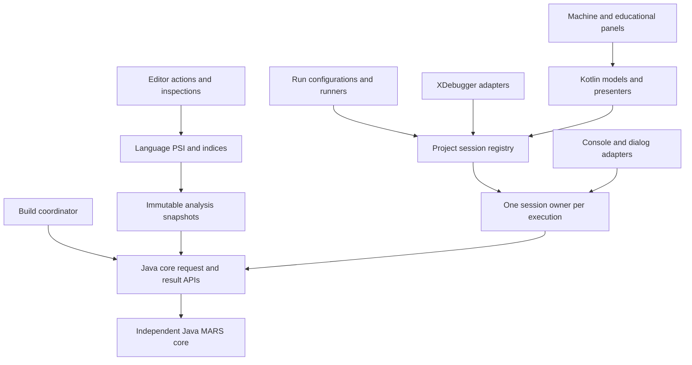

# MARS 5: IntelliJ component mapping and implementation plan

**Date:** 2026-11-08. **Status:** complete planning baseline; proposed components are not implemented unless stated otherwise.

**Product target:** MARS feature parity within the recorded scope in IntelliJ IDEA 2026.3, plus native language and debugger capabilities.
The independent engine stays Java. All new plugin production and test code is Kotlin.
A Java plugin exception requires evidence that Kotlin cannot implement the required integration.
Convenience, examples written in Java, and annotation processing alone do not justify an exception.

Use imports rather than fully qualified class names throughout implementation, tests and Gradle
Kotlin scripts. Use import aliases for name collisions. A qualified name is allowed only where a
framework or API explicitly requires it, such as a Settings page lookup; explain non-obvious cases.

## Contents

1. [Decisions and evidence](#1-decisions-and-evidence)
2. [Ownership and dependency design](#2-ownership-and-dependency-design)
3. [Engine component mapping](#3-engine-component-mapping)
4. [Editing and language services](#4-editing-and-language-services)
5. [Projects, assembly, and build integration](#5-projects-assembly-and-build-integration)
6. [Execution and console adapters](#6-execution-and-console-adapters)
7. [XDebugger integration](#7-xdebugger-integration)
8. [Panels, settings, and desktop actions](#8-panels-settings-and-desktop-actions)
9. [All educational tools](#9-all-educational-tools)
10. [Tests and coverage requirements](#10-tests-and-coverage-requirements)
11. [Delivery sequence and release gates](#11-delivery-sequence-and-release-gates)
12. [Risks, decisions, and parity acceptance](#12-risks-decisions-and-parity-acceptance)
13. [IntelliJ source evidence](#13-intellij-source-evidence)
14. [Exhaustive MARS source inventory](#14-exhaustive-mars-source-inventory)
15. [Resource inventory](#15-resource-inventory)

## 1. Decisions and evidence

### 1.1 Scope and disposition rules

The plugin must preserve every existing user capability in scope. A later delivery step does not constitute feature deferral.
This plan assigns every production source file and packaged resource to a component below.
A component may have several source files. Conversely, a source file may serve several features.
The primary mapping in the appendix identifies its owner; the feature tables describe the shared responsibilities.

| Disposition | Meaning in this plan |
| --- | --- |
| Retain | Keep the existing Java engine behavior and independent implementation. Add explicit APIs where the plugin needs them. |
| Direct reimplementation | Implement equivalent behavior in Kotlin against native IntelliJ APIs. Preserve data and semantic contracts. |
| Redesign | Preserve the capability while replacing the interaction, ownership, or implementation structure. |
| Retire implementation | Remove an obsolete implementation from the plugin design because IntelliJ supplies its capability. The capability remains. |
| Exclude from plugin | An explicit scope decision recorded in the component inventory. |
| Deferral | Use only if unresolved future details prevent a responsible disposition decision. This inventory has **no deferred features**. |

Screen Magnifier (T14) is the one explicit feature exclusion. Other retirements are implementation mechanisms such as
the jEdit widget, standalone window shell, or desktop service loader. The separate desktop application remains available during implementation.
It is not a plugin runtime dependency. This plan does not authorize deleting desktop sources as a shortcut to parity.

The baseline is Java/Kotlin-level integration for **MIPS development**. It does not mean implementing JVM debugging,
Java's type system, or Kotlin's compiler in a MIPS plugin. Navigation, rename, diagnostics, build results, Run/Debug,
watches, source stepping, and state inspection must feel native and work together.

### 1.2 Verified starting state

- MARS source baseline: commit `9ba6efe`, before this planning document.
- Reference checkout: `/Users/nhubbard/IdeaProjects/intellij-community`.
- Verified tag: `idea/2026.3`; commit `c91871ae2864649d952825cff72569e3db0e7ac6`.
- The reference checkout was clean when inspected. It was used read-only. No builds, generated files, or patches were made there.
- Production source inventory: core 295 Java files; CLI 2 Java files; desktop 125 Java files; plugin 1 Kotlin file.
- Packaged resource inventory: core 4 files; desktop 84 files; plugin 1 descriptor.
- Existing test baseline: 1,201 passing tests at the preceding checkpoint. This is a test count, **not measured coverage**.
- Existing plugin: `MarsSessionService`, its lifecycle tests, and a descriptor. No language, run, console, or debugger integration exists yet.
- Build baseline: JDK 25, Gradle 9.9, Kotlin 2.4.21, IntelliJ Platform Gradle Plugin 2.20.0, IDE build line 263.

Older IDE releases are outside the compatibility target. The initial release targets the verified 2026.3 release build.
The current descriptor allows `263.*`; release qualification must test each patch build we claim to support.
A 263 prefix alone does not prove compatibility. Later IDE upgrades require source review, verifier checks, and the full acceptance suite.

### 1.3 Important findings from the reference checkout

1. `XDebuggerManager.newSessionBuilder` is the current session entry point. Several older startup methods are deprecated.
   Override stepping and resume methods that accept `XSuspendContext`; their parameterless predecessors are deprecated. [XDebugProcess], [XDebugSessionBuilder]
2. `ToolWindowFactory.isApplicableAsync` replaces the deprecated synchronous applicability method. Content creation runs on the UI thread. [ToolWindowFactory]
3. Build events have public builders. `MessageEventImpl` is internal and its old convenience constructor is deprecated.
   Use the event interfaces and builders. `BuildProgress` and its convenience factory are experimental in this checkout. [BuildImplTrap], [StartBuildEvent], [FileMessageEvent], [BuildViewManager]
4. Jupiter infrastructure retains `junit5` in its package and artifact names. Its module references JUnit 6 Jupiter and launcher modules.
   The code-insight fixture module still references a JUnit 4 helper dependency. This does not require Vintage test discovery.
   We will not copy historical JUnit 3/4 test inheritance or run Vintage. [TestApplication], [JupiterModule], [JupiterCodeInsightModule]
5. `RunInEdt` is itself deprecated here. Its guidance recommends bounded coroutine tests and short `Dispatchers.UI` sections.
   Do not make the entire test suite run on the EDT. [JupiterUI]
6. Coroutine read actions can restart. Their bodies must be idempotent and must not mutate a simulation or publish build events. [Threading]
7. `com.intellij.diagnostic.rethrowControlFlowException` is the current helper for broad exception boundaries.
   Cancellation and other control-flow exceptions must propagate before logging or conversion into diagnostics. [Cancellation]

Bracketed names identify exact, commit-pinned source links in section 13. Source location alone does not make an API public.
Check annotations and extension contracts before using it. Implementation classes are evidence for behavior, not dependencies to copy.

## 2. Ownership and dependency design

### 2.1 Intended layers

Keep four Gradle modules initially. Put new plugin packages under `edu.missouristate.mars.plugin`.
Use `language`, `analysis`, `project`, `build`, `run`, `debug`, `console`, `machine`, `tools`, `settings`, and `testing` boundaries.
Split Gradle modules only when a real dependency or build-time boundary warrants it.
Do not move IntelliJ classes into Java core to avoid an adapter.

| Owner | Owned state and responsibility | Lifetime and disposal |
| --- | --- | --- |
| Application | Immutable instruction/directive metadata, icons, localized messages, presentation defaults | No mutable machine, file descriptor, RNG, breakpoint, or selected-project state |
| Project services | Source dependency model, build cache, persistent project defaults, execution registry, selected session ID | Project service scope; cancellation on close; explicit listener disposal |
| Analysis request | Committed text snapshots, include graph, diagnostics, source stamps | Isolated request; no access to a live execution session |
| Execution owner | Core graph, machine, program image, undo, console input, file handles, RNG, debugger controller, device models | One per Run/Debug invocation, including simultaneous invocations in one project |
| Debug suspension | Immutable machine view, frame identity, source map revision, stop reason, stop generation | Invalid after resume, mutation, reverse step, reset, or disposal |
| Tool window content | Presenters, Swing components, subscriptions to a selected session | Child disposable of content; switching sessions detaches old subscriptions |
| Document | PSI, ranges, editor highlights, modification stamps | IDE owns documents; no retained PSI element across invalid read scopes |

**Required starter redesign:** `MarsSessionService` currently holds one lazy core context for the entire project.
Replace that assumption with a project registry and a `MarsExecutionSession` factory.
An analysis request or second run must never reuse the first run's machine.
Retain the existing project service lifecycle tests and extend them to simultaneous runs and project closure.
A session selector must appear in machine/tool panels. It must never infer ownership from the active editor or thread name.

### 2.2 Proposed Kotlin packages and platform registrations

The following names are implementation intentions, not existing classes. Register the corresponding extension contracts from the pinned SDK.
Keep user-visible text in a resource bundle. Extension constructors must not open a machine or start background work.
Use Kotlin classes for platform-owned extensions; do not substitute global Kotlin objects for lifecycle-managed services.

| Package and proposed components | Registration or platform connection | Lifetime/test focus |
| --- | --- | --- |
| `language.MipsLanguage`, `MipsFileType`, lexer/parser/PSI and highlighter | File type, `lang.parserDefinition`, `lang.syntaxHighlighterFactory` | Descriptor loading, file association, tolerant parser and lexical restart |
| `language.resolve`, completion, annotators, refs and indices | `completion.contributor`, `annotator`/`externalAnnotator`, PSI reference/index extensions | Real fixture completion/resolve, stale diagnostics, dumb mode and index rebuild |
| `language.documentation.MipsDocumentationTargetProvider` | `platform.backend.documentation.psiTargetProvider` | Valid pointers across read scopes and disposed PSI |
| `project.MarsProjectSettings`, `MarsSessionRegistry` | Project light services; settings configurable and persistent-state contract | Lazy construction, schema migration, explicit project/run ownership |
| `build.MarsBuildCoordinator`, `MarsProjectTaskRunner`, before-run provider | Project service, `projectTaskRunner`, `stepsBeforeRunProvider`; optional `compiler.task` adapter | One coordinator, cancellation, build deduplication and native failure propagation |
| `run.MarsConfigurationType`, factory, configuration, context producer and gutter contributor | `configurationType`, `runConfigurationProducer`, Run line marker extension | Serialization, producer matching, entry point detection and action context |
| `run.MarsRunRunner`, `debug.MarsDebugRunner` | `programRunner`, Run/Debug executor IDs | No runner collision, result/content ownership and restart |
| `debug.MarsDebugProcess`, starter, suspend context, stack and values | `XDebugProcessStarter` and current session builder; constructed per invocation | Same execution owner as handler/console; suspension generation and stop handshake |
| `debug.MarsLineBreakpointType`, address/data/exception breakpoint types | `xdebugger.breakpointType`; line points use `XLineBreakpointType`, non-line points use `XBreakpointType` | Verified/unverified states, serialized properties, conditions, stop/resume and live changes |
| `console.IdeSyscallEnvironment`, process handler and ports | Constructed per execution; native `ConsoleView` attachment | No global streams, deterministic input/EOF and asynchronous termination |
| `machine.MarsMachineToolWindowFactory`, `tools.MarsToolsToolWindowFactory` | `toolWindow`, `ContentFactory`, content disposables | Lazy availability, session selection and subscription disposal |
| `tools.MarsToolProvider` and 14 providers | A plugin-owned dynamic extension point and provider metadata | Stable IDs, third-party extension example, lazy loading and removal |
| `settings` color/style/settings components and help actions | Configurable, color settings page and native actions | Theme/schema tests, localization and no desktop UI dependency |

The plugin-owned tool extension point is a new typed contract. Do not retain the desktop loader's API as a compatibility facade.
Dagger-generated Java stays in the existing Java core module. Calling it from Kotlin does not require Java plugin sources or a plugin-wide KAPT layer.

### 2.3 Core boundary extensions, implemented in Java

These are required work items, not APIs that exist today.
The first integration step must add and test them before UI adapters rely on private internals.

| Gap observed in current code | Intended contract | Required acceptance |
| --- | --- | --- |
| `MarsAssembler` accepts disk paths only | `SourceSnapshot`/source-provider request with stable logical URI, text, encoding, stamp, and include resolution | Unsaved root and included documents assemble exactly as captured; no temporary path appears in user diagnostics |
| `Program` exposes only instruction count | Immutable program metadata: instructions, address/source mapping, macro/include expansion chain, symbols, segment ranges, entry point, build identity | One source statement may map to several instructions; several sources may contribute one program |
| Session assembly changes live machine state | Detached analysis/build context and a validated executable image or installation request | Background analysis cannot reset the running program; failed installation leaves no half-installed state |
| Individual register/memory reads lack an atomic machine view | Worker-owned snapshot request for integer/CP0/CP1 state, memory pages, PC, delay state, and generation | A UI snapshot cannot mix values from different instructions; reading it does not produce simulated accesses |
| UI edits can bypass history and serialization | Serialized paused-state commands with edit origin and an explicit undo policy | Register/memory/PC edits are atomic, validated, reversible where supported, and rejected while running |
| `runAsync` clones breakpoint addresses and checks them after an instruction | Instruction-boundary control hook and replaceable breakpoint predicates | Entry-point breakpoints stop before execution; resume bypasses the same stop once; live changes take effect deterministically |
| `StepEvent.pc` means the instruction just executed | Explicit executed PC, next PC, source location, instruction event order, and stop snapshot | Execution highlight uses the next instruction; statistics count the completed instruction exactly once |
| Pause/stop operate at instruction boundaries | Interruptible external waits with stop/close wakeup and completion signal | Stop while waiting for console input, a dialog, sleep, or synchronous MIDI cannot strand a worker |
| No debugger call-stack contract | Instruction trace with call/return evidence, delay-slot handling, and conservative frame reconstruction | Step-over/out and reverse execution remain correct for supported calls; arbitrary assembly does not produce invented frames |
| Default `CoreModule` loads shared Java Preferences | Explicit session options factory without persistent side effects | IDE projects and run overrides cannot modify desktop preferences or leak settings between runs |

Use the existing execution lease and single worker as the serialization foundation.
A lock on one register is not a substitute for a coherent snapshot.
Publish core events without holding locks while invoking IntelliJ UI services.
Do not catch IntelliJ cancellation inside core; core remains independent and uses explicit cancellation/control contracts.

### 2.4 Threading and event rules

Capture PSI and document data in a short read action. Release the read lock before parsing, assembly, simulation, or file I/O.
Use request generations to reject stale diagnostics. A restarted read action must not enqueue the same build twice.
Run simulation commands on the session worker. Keep one state writer per session.
Use the injected service coroutine scope for coordination; never use `GlobalScope` or an unmanaged executor in a panel.

Dispatch Swing presentation changes through `Dispatchers.UI`. Request model/read/write access explicitly when required.
Do not assume a UI dispatcher grants PSI access. Use write commands for document edits and IntelliJ undo integration.
Never block the UI thread on `Future.get`, simulator completion, file reads, audio completion, or console input.

Separate two event streams. Device models and statistics receive the complete ordered execution stream.
Renderers receive bounded, coalesced presentation updates. Dropping repaint frames is permitted; dropping MMIO writes,
cache accesses, branch outcomes, or instruction counts is not. Backpressure must remain bounded and stop-aware.
Each subscription has an owner, unsubscribe path, and close-race test.

### 2.5 Unified analysis core: independent facts and query-time joins

Use the sentinel-and-join approach from the user's existing plugin. Each independent index emits
facts it can determine from its own file. A reference retains a symbolic sentinel key for a target
provided by another index. Neither producer queries the other index, resolves a target, or starts
assembly while indexing. The unified query layer reads both sides and joins matching keys later.

A sentinel is a typed unresolved link, not a magic string, null address, cached PSI element, or
promise that an asynchronous task will eventually mutate. Its key identifies the symbol name and
kind. Its occurrence identifies the source and local identity. Future include/path links add their
own typed target keys; macro arity and visibility remain explicit semantic facts.

| Data/operation | Owner and constraint |
| --- | --- |
| Declaration facts | The declaration producer emits local names, kinds, occurrence IDs and source revision. |
| Reference sentinels | The reference producer emits the target key and occurrence; it does not need the declaration producer to finish. |
| Bidirectional lookup | The unified core queries declaration and reference tables by the same key. It returns candidate declarations and incoming references. |
| Missing partition | Report incomplete data explicitly. A missing partition is different from a known-empty contribution or a missing symbol. |
| Revision mismatch | Use facts from the newest captured revision of a source. Older partitions cannot complete that source's newer revision. |
| Scope | Every query has an explicit source/build scope. Matching names across projects, unrelated build units or symbol kinds must not merge. |
| Semantic resolution | A unique indexed candidate is not proof of correct MIPS resolution. Include order, exports, macro scope, `.eqv` expansion and options remain the semantic resolver's responsibility. |
| Publication | Build a detached immutable snapshot, then publish it atomically only if its request is still current. Old readers keep a coherent prior snapshot. |
| Cancellation | Superseded background requests cancel cooperatively; a generation/identity guard also rejects stale results. Project disposal cancels work and releases stored facts. |

The same key supports lookup from either side. A reference asks for candidate declarations; a
declaration asks for incoming reference candidates. Do not write resolved results back into a
persistent file index. That would create a dependency on another file and revive invalidation problems.
Do not recursively query another index from an indexer's `map`, stub serializer or indexing callback.

Separate acquisition from joining. IntelliJ index adapters capture file-local contributions under
the proper read/index-access context. The background worker receives immutable values and holds no
PSI, VFS or read lock while joining them. During dumb mode, publish/query explicit availability
instead of recursively forcing smart mode from indexing. Cancellation must not become a false
"no matching symbol" result.

For production performance, query native index keys directly and reuse immutable file partitions.
Do not rescan every file for completion or rebuild every partition after one edit. Track reverse
include/build dependencies and invalidate affected semantic snapshots. Keep bounded caches keyed
by source revisions, scope, options and catalog version. Bulk snapshot construction is useful for
initial ingestion and tests; it is not a license to copy the entire project on every keystroke.
The user's sub-five-second result motivates measurement. It is not a measured MARS performance claim.

#### First implemented slice

The `plugin.analysis` package now contains typed declaration/reference facts, query-time joins,
explicit pending partitions, source revision selection, immutable scoped snapshots, an atomic
publication owner, a cancellable background coordinator and a project light service.
The coordinator uses the platform-supplied service coroutine scope. Its builder performs no
IntelliJ index or PSI access. Failed builds preserve the last publication; disposal rejects late work.

This first slice established the query/publication foundation. The native producers described below
extend it. Semantic resolution, editor subscriptions and executable/source-map analysis remain
committed implementation scope.
The existing Java simulator and the execution-session starter are unchanged by this analysis slice.

Jupiter tests cover producer order independence, both lookup directions, known-empty versus pending,
revision skew, ambiguous candidates, symbol kind and source scope, immutable inputs/results,
replacement/removal, malformed producer facts, cancellation inside large contributions, superseded
requests, failed computation, project isolation, disposal and preservation of old snapshots.
Measure the new package with JaCoCo and gate its reachable line/branch coverage. Real IntelliJ
fixture/index tests remain necessary before claiming that persistence and platform indexing work.

The first-slice acceptance run passes 21 plugin Jupiter tests and the complete module build/plugin
package. JaCoCo reports 139/139 lines and 58/58 branches in `plugin.analysis`; the current plugin
as a whole reports 163/163 lines and 68/68 branches. No coverage exclusions were added.
Gradle `check` now enforces 100% line/branch coverage per current plugin package, with Jupiter-only
engine selection. The IDE test classloader needs no-source-location instrumentation, restricted
to plugin classes; otherwise a successful test run can misleadingly report no project coverage.
The scaled correctness case builds facts for 2,000 sources and checks keyed lookups. It is not an
end-to-end IDE indexing benchmark or evidence of a sub-five-second project indexing time.

Implementation entry points:

- [IndexFacts.kt](/Users/nhubbard/IdeaProjects/mars-original/mars5/plugin/src/main/kotlin/edu/missouristate/mars/plugin/analysis/IndexFacts.kt): independent facts and typed sentinels.
- [IndexSnapshot.kt](/Users/nhubbard/IdeaProjects/mars-original/mars5/plugin/src/main/kotlin/edu/missouristate/mars/plugin/analysis/IndexSnapshot.kt): immutable keyed joins, explicit scope and readiness.
- [UnifiedAnalysisCore.kt](/Users/nhubbard/IdeaProjects/mars-original/mars5/plugin/src/main/kotlin/edu/missouristate/mars/plugin/analysis/UnifiedAnalysisCore.kt): atomic publication and stale-request protection.
- [AnalysisCoordinator.kt](/Users/nhubbard/IdeaProjects/mars-original/mars5/plugin/src/main/kotlin/edu/missouristate/mars/plugin/analysis/AnalysisCoordinator.kt): cancellable background computation.
- [MarsAnalysisService.kt](/Users/nhubbard/IdeaProjects/mars-original/mars5/plugin/src/main/kotlin/edu/missouristate/mars/plugin/analysis/MarsAnalysisService.kt): project service lifecycle.

Reproduce with `./gradlew :plugin:test :plugin:jacocoTestReport :plugin:jacocoTestCoverageVerification`
from `mars5`. HTML and XML coverage appear under `plugin/build/reports/jacoco/test`.

#### Native index producers and include resolution

Use IntelliJ's mechanisms for each data type. `MipsDeclarationIndex` is a native
`FileBasedIndexExtension`, following the reference checkout's `EditorConfigIdentifierIndex`.
It collects syntactic label, macro and constant candidates from the indexed file's PSI. Its values
retain offsets, duplicates and enclosing macro offsets. It does not resolve visibility or read
another file. Native query scopes, document overlays and index invalidation own those operations.

`MipsIncludeProvider` supplies unresolved `FileIncludeInfo` values to the platform's shared
`fileIncludes` index. Do not add a parallel persistent MARS include index. Override the current
`acceptFile(IndexedFile)` API, not the deprecated overloads used by some older platform examples.
Keep path extraction a pure function of the provided content.

The producer follows the assembler's include prepass. It accepts the first matching include on
each line, including inside macro bodies and replacement text. It accepts case variations and
comma separators. It strips the enclosing quotes without decoding string escapes. Comments,
quoted directive text, missing arguments and unfinished strings do not create include links.
Relative paths remain unresolved until query time.

Use `FileIncludeManager` for native reverse lookups. The provider's resolution hook uses the same
`FileReferenceSet` as the editor's include string PSI. Native file references supply navigation,
filename completion, usage search, rename and move handling. Override path ranges, decoding and
contexts for MARS's raw filenames. The generic platform behavior trims spaces, treats `?` as URL
syntax and uses project roots for absolute paths. MARS uses literal filenames, the including file's
directory for relative paths, and a filesystem root for absolute paths. Keep text changes in the
registered element manipulator so quotes and unrelated strings are preserved.

Use fresh literal references for forward resolution. The platform's cached forward graph can keep
an empty result after a missing target appears. `IncludedFilesProvider` tracks the source document
and existing targets, but does not track VFS structure changes. Its generic resolver fallback also
applies the default path rules when a provider returns no target. A cached graph or fallback result
does not establish MARS build dependencies. Retain the unresolved path sentinel and resolve it again
when needed. Any MARS semantic cache for forward dependencies must use the platform's cache facilities
and include `VirtualFileManager.VFS_STRUCTURE_MODIFICATIONS`, source revisions and build options as
dependencies. The editor caches only a file's path texts by PSI offset and lets native references
resolve the targets. This requires no second include store.

Real Jupiter fixture tests exercise persistent declaration queries, native scope filtering, unsaved
edits, deletion, relative and absolute includes, reverse lookups, cycle-safe graph traversal, newly
created targets, native completion, file/directory rename, and file moves. See
[PLUGIN_IMPLEMENTATION.md](/Users/nhubbard/IdeaProjects/mars-original/PLUGIN_IMPLEMENTATION.md)
for current acceptance results and the separate visual startup check.

## 3. Engine component mapping

The dispositions below preserve the Java engine. Kotlin adapters consume explicit contracts.
`C` identifiers also classify the exhaustive source appendix.

| ID | Existing components | Disposition and IntelliJ connection | Test obligation |
| --- | --- | --- | --- |
| C01 | `MarsContext`, Dagger component/module, API interfaces, application metadata | Retain composition in core; Kotlin execution factory owns each graph. Keep logging/UI routing explicit. | Two projects and multiple runs isolate hardware, RNG, descriptors, settings, undo, and events; close is idempotent. |
| C02 | `Assembler`, tokenizer/parser, first/second passes, operands, data types, translations, session assembler | Retain execution semantics; adapt snapshots and rich diagnostics. PSI uses a tolerant parser, not a mutable live assembler session. | Differential valid/invalid corpus; local/global symbols; forward references; include cycles; diagnostic positions. |
| C03 | `MIPSprogram`, `ProgramStatement`, `Program`, `SourceLine`, symbols, macros, expansion | Retain machine image semantics; expose immutable source/expansion metadata for navigation and debugging. | Nested macro/include maps; pseudo expansions; repeated assembly; source revision identity. |
| C04 | Instruction definitions, loading, encoding/decoding, pseudo-op catalog, syscall registry | Retain canonical metadata; share immutable descriptions with completion, docs, operand hints, disassembly, and tool models. | Catalog completeness; overloads; no duplicate mnemonic tables; binary encodings match the engine. |
| C05 | All 155 `Instr*` implementations plus `InstrHelpers` | Retain Java execution. Do not reimplement arithmetic or FPU semantics in the plugin. | Existing semantic/encoding tests remain gates; debugger views reflect signed/unsigned and raw values accurately. |
| C06 | Integer registers, PC, HI/LO, `Register` | Retain state; present through V01 and XValues. Writes use a session command. | `$zero`; aliases; PC alignment/range; wraparound; undo; mutation during running rejected. |
| C07 | CP0, exceptions, external interrupts | Retain state; expose status/cause/EPC/bad address, bit decoding, exception navigation, and interrupt tools. | Trap/handler paths; nested/delayed branch cases; masks; device interrupts; EPC precision. |
| C08 | CP1 registers, paired double values, condition flags | Retain state; show raw hex, float, double pairs, and all flags. | NaN payloads, infinities, signed zero, odd pair validation, rounding and reversible edits. |
| C09 | `MemoryState`, segments, memory layouts, memory adapter and errors | Retain storage; add side-effect-free snapshots, pages, editable views, dump and watch APIs. | Unsigned addresses, alignment, sparse pages, bounds, endianness, code/data writes, MMIO observation. |
| C10 | Typed access notices, scoped access origin, event emitter/listeners | Retain events; distinguish execution, inspection, user edits, and device events explicitly as needed. | UI reads do not count as instructions/cache hits; subscription disposal; exact order and no event loss. |
| C11 | Delayed branches, program arguments, execution errors and stop state | Retain semantics; include state in reset, snapshots, stepping, and source mapping. | Taken/not-taken and delay-slot behavior; argv stack; exceptions; all stop reasons. |
| C12 | `BackStepper` and instruction mutation history | Retain reverse machine semantics; integrate D08. Define debugger-edit and device-history policies. | Multi-write instructions; CP0/CP1; stores; branching; history capacity; external side-effect boundaries. |
| C13 | Binary conversions, number bases, properties, filename discovery, memory-dump utilities | Retain pure engine utilities. Replace filesystem discovery at the IDE boundary with project/VFS-aware inputs. | Bit-exact conversions; ASCII rendering; locale independence; deterministic source ordering. |

The core's disk assembly and public mutable fields are not sufficient debugger interfaces by themselves.
Promote necessary behavior through supported Java APIs. Do not make Kotlin adapters reflect into private fields.
Retain all core instruction, directive, macro, syscall, and memory-layout behavior, including deliberately ignored `.set` handling.

## 4. Editing and language services

Native editor integration replaces `MARSTextEditingArea`, both editor implementations, and the custom syntax document.
Do not embed the old editor in a tool window. Use IntelliJ documents, PSI, editors, inspections, commands, and indices.
The lexer/parser implementation must be Kotlin. Grammar generation that emits Java is not the default path.
The implemented path uses Grammar-Kit Kotlin generation for the native `syntax-api`, Kotlin PSI adapters,
and the platform lexer bridge. The hand-written parser prototype was discarded. The lexer remains
a lossless Kotlin implementation of MARS token rules. See [implementation progress](PLUGIN_IMPLEMENTATION.md).

| ID | User capability and current source | Intended Kotlin component and platform API | Acceptance and branch cases |
| --- | --- | --- | --- |
| E01 | Tabs, open/save, syntax editor, caret, selection, undo/redo | `MipsLanguage`, `MipsFileType`, normal IDE file editor; retire jEdit/generic widgets and `SyntaxDocument` from plugin | `.asm` and `.s` association is user-overridable; existing assembly plugins trigger an association choice; edits and undo use native documents. |
| E02 | `MIPSTokenMarker`, `TokenTypes`, quoted strings, comments, numeric operands | Incremental `MipsLexer`, tolerant `MipsParser`, PSI via `ParserDefinition`, syntax highlighter | Incomplete lines, invalid escapes, register aliases, CRLF, Unicode comments, negative/hex/binary values, lexical restart at arbitrary offsets. |
| E03 | Labels, `.globl`, `.extern`, `.eqv`, includes, macros and parameters | Named PSI, references, symbol stubs and indices; resolve within the selected build unit/include graph | Local/global precedence, duplicate definitions, ambiguity, exported symbols, macro arity, hygienic labels, cycles, scoped substitutions. |
| E04 | Popup instruction guidance and token completion | `CompletionContributor`, lookup elements, operand-aware completion, `ParameterInfoHandler` | Mnemonics/overloads, directives, GPR/FPR/CP0 operands, labels, macros, include paths; no expensive full assembly for every keystroke. |
| E05 | Assembly messages and instruction guidance | Cheap `Annotator`/local inspections; cancellable detached semantic analysis; diagnostic publisher or `ExternalAnnotator` | Illegal operand/register, unknown symbol/directive, duplicate label, malformed macro, pseudo disabled, warnings-as-errors; stale results discarded. |
| E06 | Help for instructions/directives/syscalls/macros | `PsiDocumentationTargetProvider` and `DocumentationTarget`, with valid pointers and cached immutable metadata | Quick documentation, hover, completion docs, operand examples, syscall register contracts; sanitized HTML and no external dependency for core docs. |
| E07 | Labels window navigation and new IDE navigation | Structure view, Go to Declaration/Symbol, Find Usages, include navigation, breadcrumbs | Multi-file and macro references; malformed PSI; dumb mode; deleted/renamed files; navigation from diagnostics and machine addresses. |
| E08 | New safe refactoring | Named PSI `setName`, references and rename support; safe label/macro/parameter/constant rename; move/include-path update support | Scope conflicts, unrelated identical text, comments/strings unchanged unless requested, undo/redo, multi-file updates and macro expansions. |
| E09 | Auto-indent, tabs, comments, editor settings | `FormattingModelBuilder`, code-style settings, commenter, brace/quote handlers, smart enter, folding, live templates | Preserve literals and macro bodies; idempotent formatting; incomplete syntax; `.editorconfig`; tabs/spaces and directive indentation. |
| E10 | New code insight beyond the old editor | Register-use highlighting, semantic colors, branch/call gutter navigation, inlays for addresses/pseudo expansion, intentions and quick fixes | Inlays distinguish stale addresses; fixes use write commands; hints do not assemble on EDT; accessibility and disabling hints work. |
| E11 | Find/replace, cut/copy/paste, select all, printing, line numbers | Delegate to native IDE actions and editor settings | Standard keymaps, selections, clipboard, read-only files and print preview work; no duplicate global key bindings. |

References: [ParserDefinition], [ParserExample], [SyntaxHighlighterFactory], [CompletionContributor], [Annotator],
[ExternalAnnotator], [PsiReferenceContributor], [StubIndexExtension], [FileBasedIndexExtension], [PsiNamedElement],
[FindUsagesProvider], [RenamePsiElementProcessor], [DocumentationTarget], [PsiDocumentationTargetProvider],
[FoldingBuilderEx], [FormattingModelBuilder], [Commenter], [PairedBraceMatcher], [ParameterInfoHandler].

### 4.1 PSI and assembler agreement

PSI tolerates incomplete text; the assembler decides executable semantics. Both use the same instruction/directive catalog.
Do not put absolute assembled addresses in a file-only index. Addresses depend on build-unit order, options, includes, and layouts.
Store syntactic declarations in stubs. Resolve build-dependent symbols against a versioned analysis snapshot.
Cross-file indices must depend only on the indexed file's content; model include dependencies outside those indices.
Avoid duplicating the full assembler in inspections. Add pure core analysis operations where necessary.

Extend native inspections and formatting to signed literals, macro declarations and calls, formal parameters,
offset-and-base operands, label declarations and references, and `.eqv` definitions and substitutions.
Inspect undefined or duplicate macro parameters, bad macro arity, invalid register and offset combinations,
and cyclic equivalences using the same source-order and expansion rules as assembly. Use IntelliJ's
`FormattingModelBuilder` and code-style settings to handle sign adjacency, operand parentheses, label colons,
and macro indentation. For `.eqv` replacements and incomplete statements, retain any spacing or punctuation
that can change the expanded token sequence. Test formatting for idempotence and equivalent assembler output,
including when replacements introduce an instruction, address, label separator, or macro boundary.

Use the expanded role of label and directive aliases to place their statements at the margin.
Indent macro bodies using the include-ordered scope, including boundaries supplied by aliases.
Reparse operand fragments completed by alias expansion and complete parenthesized operands that use
aliases. Project offset-and-base and grouped-operand spacing onto the written parentheses.
Apply spacing or indentation only at physical boundaries that preserve the assembler's token sequence
and the stored replacement text. An alias spanning several roles should retain its own editor color.

Diagnostic mapping must distinguish line/column conventions, UTF-16 editor offsets, byte encodings, tabs, and macro-origin chains.
Do not assume assembler columns already equal IntelliJ offsets. Test non-ASCII text before the reported column.
Every diagnostic carries the source identity and stamp used to compute it. Never apply ranges to a newer document blindly.

### 4.2 Language parity corpus

Generate catalog tests from the instruction list and pseudo-op resource, not a hand-maintained subset.
Cover every directive: `.data`, `.text`, `.word`, `.ascii`, `.asciiz`, `.byte`, `.align`, `.half`, `.space`,
`.double`, `.float`, `.extern`, `.kdata`, `.ktext`, `.globl`, `.set`, `.eqv`, `.macro`, `.end_macro`, and `.include`.
Include all accepted operand formats and overloads. Assert PSI recovery and editor responsiveness for each malformed form.
The editor's **Show Generated MIPS Instructions** action assembles captured documents in a detached
session. It lists each instruction emitted from the caret line with its address and encoding, and
opens a navigable source and caller chain for nested macro expansions.

## 5. Projects, assembly, and build integration

MARS is an assembler, not a Java compiler task. Native build integration must not require a JDK in a student's MIPS project.
The plugin runtime uses the IDE's JDK. A user does not need Gradle, Maven, or a JVM module to assemble a file.

| ID | Existing responsibility | Intended integration | Acceptance |
| --- | --- | --- | --- |
| B01 | Assemble active file or all files in its directory; exception-handler source | `MarsBuildCoordinator` consumes immutable build requests; project settings select entry and ordered sources | Active-file, explicit multi-file, and directory-project modes; deterministic order; include/handler dependencies; cancellation and concurrent requests. |
| B02 | `ErrorList`, `ErrorMessage`, warnings and clickable assembly messages | Native Build tool window events with source navigation and final success/failure/cancel result | One start/finish pair per build; file positions; warning count; warnings-as-errors; no stale result published after cancellation. |
| B03 | Assemble on open and before execution | Debounced project option; explicit Assemble/Rebuild actions; `BeforeRunTaskProvider` for shared build step | Opening files does not mutate live runs; failed/cancelled assembly prevents Run/Debug; one build result is reused without duplicate assembly. |
| B04 | Reassembly and reset state | Content/options hash, dependency graph and versioned executable image; install into a fresh or stopped execution session | `.include`, handler, settings, file moves, external changes and unsaved text invalidate exactly the dependent builds. |
| B05 | Memory dump menu and six dump formats | Export action/dialog and optional after-run dump requests; reuse core format implementations | ASCII text, raw binary, binary text, hex text, Intel HEX and segment-window output; segment/range, alignment, empty ranges, I/O errors and exact bytes. |
| B06 | Command-line project support and automated builds | Keep existing CLI; map desktop launcher's full option set into parity CLI/request options; reusable assembly task contract | Both launchers match program output, diagnostics, exit codes, register/memory reports, dumps and instruction counts. |
| B08 | Native project build tasks and mixed-language compilation | Kotlin `MarsProjectTaskRunner` plus optional Java-compiler `CompileTask` adapter, both delegating to the coordinator | Own MIPS task types only; Build/Rebuild integration, cancellation/error propagation, mixed Java/Kotlin/MIPS scope and no duplicate assembly. |
| B07 | New project creation and shared configuration | Lightweight MIPS project generator/templates; existing-directory open; project defaults and shareable Run configurations | No mandatory custom module type; mixed Java/Kotlin/MIPS projects work; path macros, relative paths and source roots round-trip. |

### 5.1 Build path and API choice

Create a build ID and `DefaultBuildDescriptor`. Use `BuildViewManager.createBuildProgress` for the
start, success, failure, and cancellation lifecycle. Its public experimental API in 263 supplies
the terminal results, whose concrete classes are in `events.impl`. Use public event builders for
source messages that need both a file position and a range-tracking navigator.
[BuildViewManager], [AbstractViewManager], [StartBuildEvent], [FinishBuildEvent], [FileMessageEvent]

The build coordinator serves the toolbar action, before-run task, directory builds, and automated task entry points.
No runner should call a separate private assembler path. Diagnostics and images must come from the same source snapshot.
A run request consumes exactly one image revision. Editing files during execution marks that revision stale but does not rewrite its source map.
Provide navigation to the captured source when current files differ. Offer rebuild/restart instead of silently executing changed text.

Use project/VFS listeners to invalidate models, but never perform assembly inside a VFS write callback.
Saving all project documents is not required for editor analysis. For Run/Debug, capture the selected source documents explicitly;
use the snapshot API to preserve includes and paths without dirty-file surprises. A disk-only fallback is not the final design.

### 5.2 Build systems and external automation

Provide native Assemble, Rebuild and before-run assembly first. They constitute a real build integration without inventing an external build system.
For mixed projects, users may order MARS assembly alongside existing Gradle/Maven tasks through native before-run tasks.
Define a headless assembly request and result schema that can back an explicit Gradle task or command invocation.
The implementation plan includes a documented Gradle `JavaExec`/CLI task example with declared inputs/outputs and reproducible options.
Implement a `MarsBuildTask` and `MarsProjectTaskRunner` for `ProjectTaskManager` integration.
Override the current `canRun(Project, ProjectTask, ProjectTaskContext)` signature; older overloads are deprecated. [ProjectTaskRunner]
In mixed projects, provide an optional Java-compiler integration descriptor with a Kotlin `CompileTask` registered before compilation.
It assembles selected MIPS units and reports failures through the compile context. It must honor compile scope, cancellation and build generations.
This optional dependency must not make Java support mandatory for the base MIPS plugin. [CompileTask]
Do not intercept unrelated Java/Kotlin tasks or claim a custom task automatically participates in every Build Project invocation.
The mixed-project adapter and native MIPS build actions provide the explicit connection. Test both entry paths and deduplication.

A JPS `ModuleLevelBuilder` is specifically an extension of Java module compilation in an external build process.
That is not the base architecture for plain MIPS projects. We select an IDE task/compiler adapter plus the standalone CLI,
rather than a second JPS engine packaging path. The existing CLI remains available to external build systems. [ModuleLevelBuilder]
Do not register a fake IntelliJ External System manager when there is no external project model to import.
Do not depend on internal Java compiler implementations or require `com.intellij.java` for the base assembly path. [BeforeRunTaskProvider], [RunProfileState]

### 5.3 Existing launcher parity that must not disappear

The smaller `MarsCli` does not currently expose everything in desktop `MarsLaunch`.
Preserve the latter's `a`, `ae<n>`, `ascii`, `b`, `d`, `db`, `dec`, `dump`, `h`, `hex`, `ic`, `mc`, `me`, `nc`,
`np`, `p`, `se<n>`, `sm`, `smc`, numeric step limit, register selections, memory ranges, `pa`, and warnings-as-errors behavior.
Map them to typed requests and documented CLI equivalents. Retiring the desktop launcher requires differential tests for this complete set.
Program exit status is distinct from assembly failure, simulator error, cancellation, and a step-limit stop.
Do not change a simulated exit value simply because the IDE process remains alive.

## 6. Execution and console adapters

### 6.1 Run pipeline

Implement a MIPS `ConfigurationType` and factory, `RunConfigurationBase`, Kotlin settings editor, context producer, and gutter contributor.
The configuration records the entry/source set, handler, working directory, program arguments, layout, assembler flags,
delay slots, self-modifying code, start-at-main, step limit, run speed, input mode and optional dumps/reports.
Resolve path macros before validation. Do not execute or assemble while validating UI fields.

`MarsRunRunner` accepts the Run executor and our configuration only. `MarsDebugRunner` accepts Debug and the same configuration.
Use `ExecutionManager.startRunProfile` and return the proper run content descriptor/result.
The current shell runner is workflow evidence, not a reason to copy its internal filesystem calls. [ConfigurationType],
[RunConfigurationBase], [RunConfigurationProducer], [RunLineMarkerContributor], [ProgramRunner], [ExecutionManager], [RunnerExample]

| ID | Existing execution component | Intended component | Required behavior and tests |
| --- | --- | --- | --- |
| R01 | `SimulatorEngine`, desktop simulation wrapper, Go/Pause/Stop/Step | Kotlin `MarsExecutionController` wraps one Java engine; explicit state machine | Created → assembling → ready → running ↔ paused/waiting-input → terminating → terminated; failures and cancel at every boundary; no double starts. |
| R02 | CLI/desktop launch lifecycle and exit status | `MarsProcessHandler` bridges in-process execution to native Run/Debug | Exactly one start/termination event; asynchronous destroy; close input on stop; no fake OS PID; no `System.exit`. |
| R03 | Program arguments and project/run options | Immutable `MarsRunOptions`; execution-specific core construction | Concurrent configurations cannot leak flags or argv; new run and restart own fresh resources. |
| R04 | Speed slider and step limits | Toolbar control plus run setting; worker reads updated throttle | Unlimited and finite rates; no UI sleeps; changes while running; cancellation during delay; bounded test clock. |
| R05 | Reset and reassemble | Restart/reset command installs the captured image and options; explicit rebuild variant | GPR/FPR/CP0, memory/heap, symbols, delay state, RNG policy, descriptors, undo and tools reset coherently. |
| R06 | Source edits while running, stopped program, exceptions | Generation-aware run model, captured-source navigation and notifications | Terminal failures show reason/source once; resume never uses an old suspension; edits do not corrupt running images. |

In-process execution is the selected architecture. XDebugger supports custom languages without JDWP.
A separate worker process is not required for feature parity. Do not add a transport protocol or attach claim without a concrete need.
Expose the controller behind a Kotlin interface so tests can schedule events and exercise close races without loading the IDE.

### 6.2 Process and console contract

Implement `ProcessHandler` directly for the simulated process. Its destroy/detach callbacks may run on EDT and must return promptly.
Do not use `OSProcessHandler` without an OS process. For in-process execution, detach means terminate the owned session cleanly;
it must not leave an invisible simulator running after the tab closes. Do not advertise detach as the default.
Call termination only after the worker and owned resources finish. Preserve failure/exit distinctions in the run result. [ProcessHandler], [DefaultExecutionResult]

Create a `ConsoleView` through `TextConsoleBuilderFactory`, attach it to the handler, and expose its standard actions.
Program output goes through `notifyTextAvailable` with stdout/stderr/system output types; avoid printing the same output twice through two adapters.
Keep assembly diagnostics in Build and program output in Run/Debug. Console diagnostic filters create navigable file links.
The console implementation is reference material for input buffering and process attachment; do not subclass `ConsoleViewImpl`. [ConsoleView], [TextConsoleBuilderFactory], [ConsoleViewContentType], [ConsoleImplementation]

| ID | Existing syscall/I/O family | Kotlin adapter or retained engine behavior | Acceptance |
| --- | --- | --- | --- |
| I01 | Print int/unsigned/hex/binary, float/double, char/string; `MarsGuiProxy` messages | `IdeSyscallEnvironment` and console output port; core retains numeric formatting semantics | Exact text, ordering and stream routing; Unicode/byte conversion policy; partial writes; output burst/backpressure; no cross-run output. |
| I02 | Read int/float/double/char/string, descriptors 0/1/2 | Cancellable session input queue; `getProcessInput()` accepts console bytes; typed core reads consume protocol | Split UTF-8 sequences, newline/CRLF, char vs line behavior, maximum length, EOF, malformed numeric input, queued input, stop/project close while blocked. |
| I03 | File open/read/write/close | Session file service delegates to independent core I/O with run working directory | Flags 0/1/9; relative paths; descriptor isolation; descriptor 0/1/2 routing; missing files; partial reads; errors; close on termination. |
| I04 | Sbrk/heap and process exit/exit2 | Retain core semantics; bridge stop/exit completion into process model | Alignment, allocation bounds, exit value, normal/cliff termination, runtime exception and step-limit distinction. |
| I05 | Input/confirm/message dialogs and formatted message variants | IDE dialog port with run/project parent; suspend worker request until UI result | Correct cancellation/status registers, parse failures, modal ownership, stop while open, project close, one completion per request. |
| I06 | MIDI asynchronous/synchronous output | Session audio port and Java core tone service; scheduler and synthesizer hidden behind test ports | Pitch/duration/instrument/volume normalization; async returns immediately; sync waits; unavailable device feedback; cancellation and deterministic fake audio. |
| I07 | Time, sleep, seeded random streams | Retain core behavior; inject clock/scheduler/RNG seams where required | Millisecond split, sleep interruption, reproducible seeds per stream/session, range errors; no shared RNG in tool models. |
| I08 | Clear-screen syscall and console controls | Adapter clears the correct run console on UI dispatcher; native scroll/pause/history actions | Pending output ordering, input preservation policy, disposed console, multiple runs, clear during active output. |

`SyscallEnvironment` already abstracts console, file, heap, dialogs, clear, and tones.
Install the custom environment on each assembled program through the supported `MIPSprogram.setSyscallEnvironment` boundary before execution.
The program environment is caller-owned; the execution owner must close its ports and delegate resources on termination.
Do not leave the default `System.in`/`System.out` environment active in an IDE run or accidentally create a second descriptor table.
Time and sleep currently call host APIs directly; add Java clock/sleep ports for deterministic tests and interruptible waiting.
Use the existing I/O contract instead of reviving `SystemIO` or implementing syscalls in the plugin.
The present project starter routes output to logging and rejects input; it must be replaced before claiming runnable parity.

A console read may block the simulator worker, but never the UI thread. Prefer a stop-aware blocking queue at the synchronous Java boundary.
Closing the input port must wake blocked readers. Coroutine cancellation alone does not interrupt an unrelated Java queue automatically.
Track a waiting-input presentation state without misreporting the engine as paused at a completed instruction.

The user explicitly invokes MIPS file I/O and dialog syscalls. Honor IntelliJ project trust before starting side-effectful execution.
Do not impose arbitrary new file restrictions that break existing programs. Make the working directory and host-file access clear in configuration.
Use trusted-project APIs through a narrow platform port; test denial without starting a machine.

### 6.3 Complete syscall service map

These are the 40 implemented service classes and their current default numbers. The per-session registry remains the authority.
Tests enumerate the registry, so a future service cannot be added without an adapter disposition and behavioral coverage.

| Service family | Default service numbers and operations | Mapping |
| --- | --- | --- |
| Output | 1 integer; 2 float; 3 double; 4 string; 11 character; 34 hex; 35 binary; 36 unsigned integer | I01 |
| Input | 5 integer; 6 float; 7 double; 8 string; 12 character | I02 |
| Files | 13 open; 14 read; 15 write; 16 close | I03 |
| Heap/process | 9 sbrk; 10 exit; 17 exit2 | I04 |
| Dialogs | 50 confirm; 51 int input; 52 float input; 53 double input; 54 string input; 55 message; 56 int message; 57 float message; 58 double message; 59 string message | I05 |
| Audio | 31 MIDI out; 33 synchronous MIDI out | I06 |
| Time/random | 30 time; 32 sleep; 40 seed; 41 random int; 42 bounded random int; 43 random float; 44 random double | I07 |
| Console control | 60 clear screen | I08 |

## 7. XDebugger integration

### 7.1 Session connection

`MarsDebugRunner` creates a fresh execution owner and calls `XDebuggerManager.newSessionBuilder(MarsDebugProcessStarter)`.
Set the execution environment, start the session, and return the resulting run content descriptor through the execution workflow.
Do not also show a second tab manually. `showTab(true)` is for standalone debugger startup, not the normal runner path. [XDebugSessionBuilder]

`MarsDebugProcess` supplies the same process handler and console as that execution owner.
It implements the context-taking stepping/resume methods, pause, stop, run-to-position, breakpoint handlers, and editor provider.
All commands pass through `MarsDebugController`. The XDebugger object does not mutate registers directly. [XDebugProcess]

| ID | Debug capability | Intended platform bridge and core requirement | Tests and semantics |
| --- | --- | --- | --- |
| D01 | Source suspension and execution position | `MarsSuspendContext`, one simulated CPU `XExecutionStack`, `MarsStackFrame`, `XSourcePosition` | Zero-based source lines; missing sources; expansion origin; PC after execution vs executed PC; snapshot invalidation. |
| D02 | Line/address breakpoints, enable/disable, clear/mute | `XLineBreakpointType`, properties, `XBreakpointHandler`; worker-owned breakpoint table | First instruction; pseudo expansion; multiple addresses; moved lines; no-code lines; dynamic add/remove; mute; restart; hit without executing instruction. |
| D03 | Conditions, hit counts, logpoints and dependent breakpoints | Pure evaluator plus breakpoint policy; integrate `XDebugSession.breakpointReached` result | Evaluate condition first; honor returned suspend decision; false/log-only points resume; temporary/dependent behavior tested against real platform. |
| D04 | Instruction and source step into | Engine one-instruction command plus source-group stepping; context-taking `startStepInto` | Pseudo/macro expansion, repeated source lines, includes, delay slots, exceptions and interrupts; explicit instruction/source mode. |
| D05 | Step over, step out, run to cursor | Call-aware controller and temporary predicates; `startStepOver`, `startStepOut`, `runToPosition` | `jal`, linking branches, `jalr`, recursion, tail jumps, changed `$ra`, delay slots, breakpoint interruption; no loop that blocks EDT. |
| D06 | Variables/registers/memory, Evaluate, Watches, Quick Evaluate | `XValue` groups and `XDebuggerEvaluator`; dedicated expression PSI/editor provider | Numeric/register/symbol/address expressions, dereference widths, arithmetic and bit operators, formatting, invalid input, stale snapshots and no inspection side effects. |
| D07 | Set Value and machine edits | `XValueModifier`, paused-state commands; same validation as machine tables | Read-only `$zero`; invalid register pair; aligned writes; edits after resume rejected; fresh snapshot, history and device policy. |
| D08 | Backstep and reverse source step | Native debugger toolbar actions calling core undo; publish a new suspension | Multi-instruction source grouping, empty/expired history, branch delay/CP0/FPU restore, consistent views; no false promise of undoing host output/files. |
| D09 | Stack presentation | Conservative call trace with return-address evidence, current CPU frame always available | Unconventional stack conventions marked unknown; no fabricated Java-style locals; interrupted/recursive calls and reverse trace tested. |
| D10 | Runtime exceptions and CP0 interrupts | Map `ErrorEvent`, stop snapshot and handler transitions to debugger events, diagnostics and CP0 panel | Handled MIPS trap continues through handler; unhandled error terminates once; optional exception breakpoint does not alter normal semantics. |
| D11 | Disassembly and self-modifying code | V04 instruction view, address breakpoints, invalidated decoding/source correspondence | Patched instruction shown from current memory; data execution and unmapped PC; source identity never guessed from stale bytes. |
| D12 | Memory read/write and instruction watchpoints | Public breakpoint type/properties plus worker access predicates and origin filtering | Read/write/execute distinctions, range overlap, access width, unsigned ranges, ignore inspection/device updates as configured. |

References: [XSuspendContext], [XExecutionStack], [XStackFrame], [XValue], [XValueModifier], [XDebuggerEvaluator],
[XDebuggerEditorsProvider], [XLineBreakpointType], [XBreakpointHandler], [XDebugSession].

### 7.2 Stepping and address mapping decisions

A source breakpoint resolves to executable addresses in the current image. Default to the first instruction of each logical source statement.
Allow instruction-specific breakpoints in disassembly. Mark unresolved or non-executable lines unverified with an explanation.
Re-resolve at each assembly revision. A macro-definition breakpoint can have several expansion locations; show these explicitly.
Run-to-cursor uses a temporary breakpoint without deleting permanent breakpoints.

Source step advances until the logical source location changes; instruction step always executes one basic instruction.
Call-aware step-over/out uses dynamic call evidence and a return predicate, not a fixed `$ra` value captured without context.
An arbitrary MIPS program may not obey a calling convention. In that case expose instruction stepping and explain why a call frame is unknown.
This is a correctness condition, not a deferral of stepping support. Keep the user's ability to run to a chosen address/source location.
A step operation must remain cancellable and respect explicit breakpoints, exceptions, and a safety step budget.

The core's existing breakpoint array is insufficient for conditional/live breakpoints and entry-point stops.
Add a core boundary hook before relying on debugger callbacks. Do not emulate this with a UI loop that repeatedly calls `step()`.
At a breakpoint, the controller evaluates side-effect-free conditions and logging expressions against a coherent snapshot.
Ask the platform whether to suspend and honor that result; avoid two independent implementations of platform hit-count/dependency semantics.
Prove the handshake in a real Jupiter platform test before exposing advanced breakpoint controls.

### 7.3 Evaluation, history, and external effects

Use a small, documented MIPS expression grammar: register aliases, symbols, integer/float literals, parentheses,
arithmetic/bitwise/comparison operators and explicit memory reads. Watches and conditions are read-only.
Disable code-fragment evaluation unless a safe command language is implemented. Never compile arbitrary host Kotlin/Java for watches.
Set Value is a separate explicit mutation command. Expressions cannot trigger syscalls or MMIO side effects.

The core records machine changes, not a reversible host filesystem. Backstep must preserve the old machine-state capability.
Display non-reversible output, host-file, clock, random, and audio boundaries honestly. Do not replay host side effects during reverse navigation.
For device models and call traces, attach reversible deltas or restore checkpoints keyed to instruction history.
If a model cannot reconstruct a historical value, label it unavailable at that history point rather than displaying a false value.
Define debugger-edit undo as a separate history item or a documented history reset; never silently splice it into instruction history.

Instruction disassembly is a first-class panel. `XAlternativeSourceHandler` is experimental in this checkout;
using it is not necessary to deliver disassembly or navigation. Keep normal navigation public-API-based.
Any later experimental integration needs a focused adapter, source evidence, verifier allowance, and a contract test.

## 8. Panels, settings, and desktop actions

### 8.1 Tool window layout

Provide a **MARS Machine** tool window with Registers, CP0, CP1, Memory, Instructions and Symbols contents.
Provide a **MARS Tools** tool window with lazy contents for the educational tools.
Keep build diagnostics in Build, execution output in Run/Debug, and Watches/Frames in Debug.
Use native docking, splitting and detached tool-window capabilities instead of custom top-level windows.
Persist selected content and display preferences. Selection always includes an explicit execution ID.

Each `ToolWindowFactory` is cheap to construct and uses `isApplicableAsync` where applicability needs work.
Use `ContentFactory`, content disposal, localized titles, scalable icons and native toolbar actions.
Pure models compute rows and drawing primitives. UI code only renders and dispatches commands. [ToolWindowFactory], [ContentFactory], [AnAction], [ActionUpdateThread]

| ID | Current panels/components | Disposition and intended presentation | Acceptance |
| --- | --- | --- | --- |
| V01 | `RegistersWindow`, register panes/renderers | Direct reimplementation as `JBTable`/native value models; integer/PC/HI/LO, names, bases and change highlighting | Exact values, signed/unsigned modes, editable paused state, aliases, row copy, keyboard access, stopped snapshot consistency. |
| V02 | `Coprocessor0Window` | Direct reimplementation with bit-field details and exception navigation | All supported registers; cause/status flags; pending interrupts; invalid writes and EPC changes. |
| V03 | `Coprocessor1Window` | Direct reimplementation with raw/float/double views and condition flags | Pair grouping, bit-preserving edits, flags, NaNs and display-base changes. |
| V04 | `TextSegmentWindow` | Redesign as instruction/disassembly listing with address, bytes, basic instruction, original source and breakpoint markers | Sort/column persistence, macro expansion, current/previous PC, source navigation and patched code. |
| V05 | `DataSegmentWindow`, number-base chooser and repeat buttons | Redesign as virtualized memory pages, regions, address/symbol navigation, hex/decimal/ASCII and edits | All layouts/segments including stack, kernel and MMIO; endian grouping, sparse memory, unsigned addresses, bounded reads and export. |
| V06 | `LabelsWindow`, label sort setting | Redesign as symbols view plus native navigation/structure | Local/global labels, values/addresses, sorting/filtering, source unit identity and stale-image indicator. |
| V07 | `MessagesPane` | Retire custom tabs; use native Build and Run/Debug consoles with I01–I08 adapters | Diagnostics never mix with program stdin; links, clear, output limits, scroll lock, copy/save, accessibility. |
| V08 | Main pane/window shell, highlighting controls, font dialogs and generic renderers | Retire standalone shell from plugin; native tool content and IDE theme/font settings | Light/dark/high-contrast themes, scaling, focus, keyboard traversal, no global frame or session singleton. |

Memory view reads must not acknowledge MMIO devices or count as cache accesses.
Large memory exports use a consistent paused snapshot or a worker-owned streaming read, not a long UI-thread scan.
If the program runs, display the last coherent snapshot and its generation. Do not advertise a live atomic view assembled from unrelated reads.

### 8.2 Settings mapping

Use project persistent state for reproducible assembly defaults, run configuration state for execution overrides,
and application state for presentation preferences. Prefer `SerializablePersistentStateComponent` with immutable state and atomic updates.
Use Kotlin UI DSL in a `Configurable`. Core receives explicit nonpersistent settings; it never queries IDE services. [SerializablePersistentStateComponent], [Configurable]

| ID | Existing setting family | Intended owner and mapping | Test obligation |
| --- | --- | --- | --- |
| S01 | Extended assembler, bare machine, delayed branching, self-modifying code, warnings-as-errors, start-at-main | Project defaults plus run overrides; immutable execution options | Every existing key/default round-trips; precedence is run override → project default → engine default; no Java Preferences leakage. |
| S02 | Assemble on open, assemble all, exception handler and memory configuration | Project build settings with validated paths and invalidation | Default/CompactDataAtZero/CompactTextAtZero; handler enabled/disabled/missing; directory/source-set scope. |
| S03 | Address/value base, label visibility/sort, text-column order, register/data highlights | Presentation state for Machine/Debug contents | Settings apply to selected content without altering machine values; persisted columns and sort are schema-versioned. |
| S04 | Program arguments, popup syscall input | Run configuration and explicit console input mode | argv tokenization; line vs dialog input; session-local changes; no global input prompt switch. |
| S05 | Editor font/styles, line numbers, caret blink, tab size, auto-indent, generic editor selection, popup prefix length | Native editor/color scheme/code style/completion settings; retire duplicate editor selector | Existing capabilities map to native preferences; migration imports only supported values and never overwrites global IDE settings silently. |
| S06 | Row/highlight fonts/colors, syntax token styles, delay-slot highlight | Theme-aware text attributes and MARS color settings page | High contrast, color blindness, scaling; distinct execution/delay/change attributes; reset-to-default behavior. |
| S07 | Config resource limits, error count, undo capacity, extensions, ASCII table/nonprint placeholder | Typed configuration schema with bounded limits; engine defaults retained | Positive capacities; output/trace bounds; default parity; invalid stored state fallback; no unbounded memory from a run. |

Preference migration is explicit and one-time. Offer an import of MARS preferences and a preview of mapped values.
Do not reintroduce deprecated per-setting wrappers. Do not serialize transient machine state, listeners, core graphs, or open descriptors.
New settings state needs schema migration tests and compatibility with a clean project and missing optional fields.

### 8.3 Actions and help

| ID | Existing actions/components | Intended destination | Acceptance |
| --- | --- | --- | --- |
| W01 | File New/Open/Close/Close All/Save/Save As/Save All/Print/Exit; chooser filters and hardcopy writer | Native IDE actions plus MIPS file template; retire duplicate window/file lifecycle | New/open templates, `.s`/`.asm`, read-only buffers, save conflicts, print and project close retain equivalent capability. |
| W02 | Edit Undo/Redo/Cut/Copy/Paste/Find/Replace/Select All | Native editor actions; retire desktop input handlers and command history | Normal keymaps, write-command undo, multicaret and project search work without plugin-specific forks. |
| W03 | Assemble/Go/Step/Backstep/Pause/Stop/Reset, breakpoint clear/mute, run-speed controls | Native action system in Run/Debug and MARS toolbars, backed by the same controller | Action enablement for every state; BGT-safe updates; shortcuts scoped to context; no hidden second execution path. |
| H01 | Help, About, syscall/instruction/directive/macro/exception/debugging/CLI/tool documentation; PDF; acknowledgements/license/history | Bundled documentation catalog, Quick Documentation, Help actions, searchable reference content, retained attribution and PDF access | Offline core help; valid internal links; safe rendering; docs agree with catalog and options; no dead desktop instructions presented as plugin behavior. |

The splash screen and custom About frame are implementation retirements. Keep version, license, authorship and acknowledgements available.
Existing educational images and diagrams remain available when they convey information. Old toolbar bitmap assets can be replaced with
native/scalable icons while preserving the actions. Never bundle the desktop jar to obtain one image or help file.

## 9. All educational tools

The loader registers **14 tools**. The additional tool source files are support classes, not five extra products.
Thirteen tools are in scope for IntelliJ. Port their behavior and data formats to Kotlin models and rebuild their UI as native content.
Tool models receive a session/device port explicitly. They must not receive `VenusUI`, `DesktopSession`, or a process-wide machine.

All connected tools retain connect/disconnect, reset, configuration and help capability where present.
A disconnected tool stops observing and affecting the machine. Closing a view removes its subscriptions unless a run configuration
explicitly owns a headless device. Headless device state and visible renderer lifetimes are separate.

| ID | Existing tool and support files | Disposition and destination | Required tests and parity details |
| --- | --- | --- | --- |
| T01 | `BHTSimulator`, `BHTEntry`, `BHTableModel`, `BHTSimGUI` | Redesign as pure branch-prediction model and BHT content | Configurable table/history/initial prediction; one/two-bit state transitions; aliasing/indexing; predictions, outcomes and rates; branch delay slots; reset/reconfiguration. |
| T02 | `BitmapDisplay` | Redesign as pixel-buffer model with a theme-neutral image renderer | Base address, display/unit sizes, color word mapping, writes and redraw; reconnect; partial updates; viewport scaling; no lost writes when repaints coalesce. |
| T03 | `CacheSimulator` | Redesign as deterministic cache model and statistics/log panel | Direct, fully associative and N-way mapping; block/set sizes; LRU/random replacement; seeded RNG; hit/miss/count/rate/log parity; inspection excluded. |
| T04 | `DigitalLabSim` | Redesign as MMIO device model and digital-lab panel | Seven-segment output, keypad input and instruction-driven counter interrupts; MMIO addresses/byte widths; deterministic instruction/event traces and session isolation. |
| T05 | `FloatRepresentation` | Direct reimplementation of the teaching behavior, with pure IEEE-754 conversion model | 32-bit sign/exponent/fraction, decimal/hex/binary edits, normalized/subnormal/zero/infinity/NaN cases; selected FPR synchronization and invalid text. |
| T06 | `InstructionCounter` | Direct reimplementation as instruction-event counter content | Total/basic format counts and percentages, reset/connect/disconnect, zero denominator, exactly-once instruction accounting and reverse-history policy. |
| T07 | `InstructionStatistics` | Direct reimplementation as classification model and charts/tables | Existing categories and totals, unknown instructions, delays/branches, reset; do not infer execution from editor memory reads. |
| T08 | `IntroToTools` | Redesign as in-IDE tool-development help and working Kotlin provider example | Example explicitly owns a session subscription; no global lookup, reflection scan, obsolete standalone window instruction or hidden service locator. |
| T09 | `KeyboardAndDisplaySimulator` | Redesign as receiver/transmitter MMIO model and keyboard/display console content | Ready/data/control registers, input delivery, display clearing/wrapping and configured delays/interrupts; event order; input focus; no feedback loop from UI inspection. |
| T10 | `MarsBot` | Redesign as robot/world model with deterministic simulation ticks and renderer | Heading, movement, position, pen/tracks, board bounds, MMIO protocol and reset; fake clock; no renderer-owned infinite thread. |
| T11 | `MemoryReferenceVisualization` | Redesign as access-density model and grid renderer | Base/range, words per cell, unit/display sizes, access colors/counts, reset and configuration changes; complete events independent of render rate. |
| T12 | `MipsXray`, `FunctionUnitVisualization`, `UnitAnimation`, datapath XML/images | Redesign as instruction/datapath model, timeline and animation content | Opcode/function selection, register/ALU/control paths, XML parsing and diagrams, pause/rate/reset; deterministic animation clock and accessible textual equivalent. |
| T13 | `ScavengerHunt` | Redesign as game/world model and MMIO panel, retaining the existing administration/player protocol | Authentication/player ID, initialization, turns, energy, locations/tasks, movement/ready handshakes, per-player address regions, bounded world updates and reset. |
| T14 | `ScreenMagnifier` and its package-private capture/settings/scribbler classes | Exclude from plugin by user decision | Record the exclusion in the release ledger. |
| T15 | `MarsTool`, `MarsToolProvider`, `AbstractMarsToolAndApplication`, `ToolLoader`, `ToolAction` | Retire desktop loading/window framework in plugin; implement Kotlin `MarsToolProvider` extension point and lazy content registry | Unique provider IDs, ordering, error reporting, lazy creation, session binding, unload/disposal, registration test and third-party example. |

Source behavior needs characterization before it becomes a parity oracle.
For example, `DigitalLabSim.addAsObserver()` currently registers the first display address and the text range,
while its handler contains cases for additional MMIO registers. Its counter also advances in that access callback.
Add a protocol trace that covers every documented register and interrupt, then distinguish intentional behavior from registration/counting defects.
Preserve the documented device capability; do not reproduce a confirmed defect merely to match the old callback structure.

Source behavior needs characterization before it becomes a parity oracle.
For example, `DigitalLabSim.addAsObserver()` currently registers the first display address and the text range,
while its handler contains cases for additional MMIO registers. Its counter also advances in that access callback.
Add a protocol trace that covers every documented register and interrupt, then distinguish intentional behavior from registration/counting defects.
Preserve the documented device capability; do not reproduce a confirmed defect merely to match the old callback structure.

The game and robot retain their MMIO contracts. UI controls must dispatch device input through the session worker.
MarsBot's default ports overlap the first Scavenger Hunt player region. When both tools are available,
reject simultaneous attachment to those addresses in one execution.
Do not mutate core memory from a Swing timer. Devices must run without their panel visible when explicitly attached to a run.
Store tool configuration per project/run as appropriate; never share one cache/BHT/robot model across concurrent sessions.

For tools that historically accumulate observations, define whether backstep rewinds statistics or retains cumulative observations.
Preserve the original default where verified; offer a clearly named history-following mode as an enhancement.
Record the selected policy in tests. Device state that affects future execution must be restored or explicitly invalidate reverse-history continuation.

## 10. Tests and coverage requirements

### 10.1 Jupiter-only test architecture

All new plugin tests use Kotlin and Jupiter annotations/extensions. Use the JUnit 6 release compatible with the pinned IDE/test artifacts.
Keep engine tests on their existing Jupiter path. Ban `junit.framework.TestCase`, JUnit 4 test annotations, rules/runners,
and `junit-vintage-engine` from our test execution. Verify the discovered engine IDs and expected test counts in CI.
A green build with zero discovered platform tests is a failure.

Use the published `TestFrameworkType.JUnit5` and `JUnit5CodeInsight` artifacts for the pinned IDE version.
Their names do not force a JUnit 5 engine. Use `@TestApplication`, project/module/temp-path/disposable fixtures,
and `codeInsightFixture` from the checked-out Jupiter framework. [TestApplication], [JupiterFixtures], [JupiterCodeInsight]
The SDK lists these published variants explicitly. [SDK test framework types](https://plugins.jetbrains.com/docs/intellij/tools-intellij-platform-gradle-plugin-types.html)

Do not subclass `LightPlatformCodeInsightFixtureTestCase` or a historical debugger test case just because an example does.
If a fixture helper requires a JUnit 4 compatibility library as a transitive implementation detail, isolate and document that dependency.
It must not introduce authored Vintage tests, a Vintage engine, or an inherited JUnit 3/4 lifecycle.
Do not remove a required helper jar blindly and call resulting linkage failures a reason to abandon Jupiter.

Use one aligned Jupiter API/engine/platform launcher set per test process.
The current plugin BOM is 6.0.0; update it to the version required by the resolved 263 test framework before adopting those fixtures.
Lock the resolved versions and inspect conflicts. Do not assume the current two ordinary unit tests prove platform fixture compatibility.
The initial test-foundation milestone must run a real project service and a real code-insight operation in a Jupiter IDE sandbox.

### 10.2 Coverage policy

The goal is stable functionality with nearly complete branch coverage, not an inflated percentage.
The following are proposed enforceable release gates, with stricter behavior obligations than the aggregate number alone:

| Scope | Proposed gate | Additional requirement |
| --- | --- | --- |
| Pure plugin models, parsers, resolution rules, expression evaluator, state machines and adapters with ports | 100% reachable business branches and executable lines | Every documented normal/error behavior has an assertion; no assertion-free coverage tests. |
| Plugin platform adapters and UI presenters | At least 99% lines and 99% branches per functional package after reviewed exceptions | Every meaningful decision, cancellation/close race and user-visible failure path has behavioral coverage. |
| Entire plugin | At least 99% lines and 99% branches; no large package may hide a low-coverage small package | New/changed behavior must be fully covered. Publish package and changed-code reports. |
| Existing Java core | Preserve all tests; measure and publish the baseline, then close uncovered behavior exposed by integration | Do not claim the current test count establishes near-total coverage. New core API behavior requires full branch tests. |
| Rendering and host integrations | Model/presenter branches meet the same gate; actual platform/OS smoke tests cover connection | Record residual visual/hardware gaps precisely; no blanket UI/audio package exclusion. |

Allowed exceptions are narrow, justified and reviewed: mechanical propagation of a platform control-flow exception,
compiler-generated Kotlin plumbing that the coverage tool correctly filters, or an unreachable invariant with evidence.
Input validation, device failures, I/O errors, malformed source, cancellation cleanup and close races are **not** blanket defensive exclusions.
A rethrow-only catch branch may be exempt; the surrounding cancellation behavior still needs a lifecycle test.

Every exception records the file/branch, reason, evidence, owner and review condition.
Do not mark an entire class as generated or suppress coverage for a whole adapter to exempt one catch branch.
Keep raw reports available alongside any reviewed-exception accounting.
JaCoCo does not offer a general source-branch exclusion annotation; do not claim it can subtract arbitrary catch branches automatically.
Set raw gates where possible and use an explicit reviewed exception report when required.

Use JaCoCo with verified Java 25/Kotlin bytecode support, pinned in the build.
Collect execution data from ordinary unit, platform and integration test JVMs and merge only matching class revisions.
The IDE/starter process needs its own instrumentation configuration; runner JVM coverage alone does not cover plugin execution in the IDE.
Filter generated code using tool-supported filters, not broad package patterns.
Use targeted mutation testing or equivalent negative-control tests for the evaluator, breakpoint logic and state machines.
Killing meaningful mutations is evidence that tests assert behavior; it does not replace integration tests.

### 10.3 Test layers and concrete fixtures

| Layer | Environment | Required corpus and examples |
| --- | --- | --- |
| L1: Pure Kotlin/Java contracts | Ordinary Jupiter, no IDE startup | Lexer restart, recovery parser, expression grammar, symbol scope, settings precedence, tool models, image/source-map transforms, controller transitions and exception paths. |
| L2: Java engine integration | Fresh core graph and fake I/O/clock/audio | All core API additions; snapshot consistency, stop while blocked, first-PC breakpoints, delay-slot stepping, reverse edits, MMIO and syscall fidelity. |
| L3: IntelliJ model tests | Jupiter `@TestApplication`, real project/module/code-insight fixtures | File type/PSI registration, completion, inspection ranges, resolve, rename/undo, format, stubs/index invalidation, docs pointers, dumb mode, project service lifecycle. |
| L4: Run/Debug/Build platform tests | Jupiter fixture project and installed plugin descriptor | Before-run build, Run and Debug executors, Build event sequence, console input/output, handler lifecycle, real breakpoint verification/logpoint behavior, XValues and session stop/close. |
| L5: IDE UI integration | Pinned 263 sandbox, Jupiter Starter/Driver | Create/open project, type source, navigate/rename, build errors, run/input, breakpoint/step/watch/edit/backstep, tool selection/configuration, theme/scale, restart and project close. |
| L6: Release and host checks | Packaged plugin, supported OS matrix | Fresh install, two projects/two runs, unload/reload, leak checks, capture/audio availability, no desktop classes, no duplicate Kotlin runtime, CLI parity and Plugin Verifier. |

Prefer real IntelliJ components in L3/L4. Fake only the owned boundaries such as clock, audio, input, file service, snapshot provider,
and capture backend. Do not build a mock implementation of PSI, project disposal or the breakpoint manager.
This follows the platform's model-level testing approach. [SDK testing overview](https://plugins.jetbrains.com/docs/intellij/testing-plugins.html)

### 10.4 Deterministic concurrency and cancellation

Use bounded coroutine tests with test dispatchers for pure controllers and explicit barriers/latches for Java worker integration.
Use virtual clocks for speed, sleep, animation and robot motion. Drive the digital-lab counter from instruction/access traces, preserving its actual counter semantics. Never make correctness depend on a random sleep.
Keep only Swing operations in short UI dispatcher sections. Use explicit read/write actions for model access.
Run platform tests with appropriate project isolation and no unsafe parallel access to the shared application.
Pure tests may run in parallel when their fixtures own all state.

Required race cases include cancellation before request capture, during analysis, while awaiting input/dialog/audio,
between build completion and launch, during breakpoint installation, after snapshot publication, and during content/project disposal.
Assert resource closure and event count, not just the exception class.
Test stale callbacks arriving after resume/reset/close and reject them using execution and suspension generations.
No completion may publish to a disposed UI or terminate the next run's handler.

### 10.5 Mandatory per-feature test ledger

For each mapping ID, record: implementation package, behavior cases, Jupiter test classes, fixture layer,
raw line/branch report, approved exception list, platform APIs, and manual/host evidence where necessary.
The feature cannot be marked complete with a numeric percentage alone.
Store source fixtures and expected outputs in version control. Golden data includes machine encodings, memory dump bytes,
macro source maps, CP0/CP1 state, console transcripts, tool traces and visual primitives.

### 10.6 CI and upgrade checks

The intended CI pipeline runs fast pure/engine tests, model tests, Run/Debug integration, coverage merge/gates,
plugin packaging, descriptor validation and Plugin Verifier against the supported 263 build.
Run packaged UI/host tests on supported platforms before release; preserve logs, screenshots and failing project fixtures.
Use a separate upgrade job for future IntelliJ releases. That job informs migration and does not widen the declared compatibility range.

Reject new project uses of deprecated/removal APIs, internal APIs, obsolete test frameworks and desktop dependencies.
Use Plugin Verifier/API inspections in addition to Kotlin compiler warnings; Kotlin warnings alone do not enforce every API-status annotation.
Public experimental APIs are acceptable on the pinned IDE target. Record their purpose and contract tests
when reviewing the verifier report. Internal API usage blocks a JetBrains Marketplace release.
Tests must not require the local IntelliJ source checkout or absolute paths from this author's machine.

## 11. Delivery sequence and release gates

These are implementation dependencies for the features in scope.
No item below is deferred merely because it appears late in the sequence.

| Milestone | Work and dependency | Exit evidence |
| --- | --- | --- |
| M0: Test and API foundation | Jupiter IDE/code-insight fixtures, coverage reporting, API-status checks; registry and explicit execution ownership; Java source/snapshot/control contracts | Real Jupiter project/PSI test; two simultaneous executions; no Vintage discovery; baseline coverage report and exception ledger. |
| M1: Native language model | E01–E03, catalog integration, E09 fundamentals; typed project/source graph | All directive/instruction lexical corpus; incomplete-source recovery; symbol/include/macro resolution and index invalidation. |
| M2: Build and diagnostics | B01–B04/B07–B08, E05, immutable images and source maps; project settings | Unsaved include builds, clickable diagnostics, cancellation/stale-result tests, deterministic rebuild, no mutation of live runs. |
| M3: Run and complete I/O | R01–R06, I01–I08, run configurations and process/console adapters | Every syscall family, waiting-input stop, restart and project closure; concurrent run transcripts; native Run action. |
| M4: Debug and machine views | D01–D12, V01–V07, B05 export; breakpoint boundary and history APIs | Source/instruction stepping, delay slots, conditions/logpoints, watches/set value, reverse, exceptions, disassembly and memory watchpoints through real XDebugger. |
| M5: Complete language experience | E04, E06–E10, remaining E09 behavior, docs/settings/actions | Completion/docs/rename/navigation/format/intention/inlay tests; native keymaps; source-map navigation across macros. |
| M6: Educational tools | T01–T13, T15 and device/history integration, V08 and settings details | All 13 in-scope tools ported, with deterministic model tests, session isolation, configuration, disposal and platform presentation coverage as applicable. |
| M7: Parity and release qualification | B06 launcher parity, all settings/help/resources, native action equivalence, host matrix and package checks | Every mapping ID accepted; near-full coverage gates; no unexplained exclusion, deferral or retirement; fresh install/upgrade evidence. |

M4 depends on the richer source map and worker commands from M0/M2. Tools depend on complete typed event/device contracts,
not on a UI being finished first. Work within a milestone can proceed independently only where ownership is already explicit.
Do not declare a partial milestone the final MARS 5 release. The separate desktop application remains the reference frontend until M7.

For each implementation change: add/extend behavioral tests, implement one coherent slice, run relevant Jupiter/engine checks,
then run the required integration/coverage checks before marking that slice complete.
Do not introduce a placeholder UI that silently omits a mapped option. Disabled capabilities need an accurate explanation during development.
Keep commits reviewable by component, including necessary IDE project metadata when the build layout changes.

## 12. Risks, decisions, and parity acceptance

### 12.1 Risk treatment

| Risk | Selected treatment; no feature deferral |
| --- | --- |
| IDE APIs change quickly | Pin source/build; prefer public nondeprecated APIs; small adapters; branch-complete contract tests; verifier plus upgrade job. |
| Shared project service corrupts concurrent sessions | Registry owns execution IDs; isolated graphs; explicit selected session in all views. |
| Live diagnostics reset the machine | Detached source snapshots and analysis context; never assemble into an execution context. |
| Macro/pseudo source positions do not match PC | Versioned many-to-many source map with expansion chain and captured-source navigation. |
| Assembly does not follow a call convention | Conservative dynamic trace; explicit unknown frames; correct instruction stepping and run-to-address remain available. |
| Stop cannot wake input or MIDI | Close-aware I/O port and worker completion contract; cancellation tests before UI delivery. |
| Tool renderer loses machine events | Complete model stream; only repaint state is coalesced; bounded backpressure and deterministic traces. |
| Backstep cannot undo external effects | Preserve machine undo; show irreversible boundaries; reversible device deltas/checkpoints; never replay host side effects. |
| Near-total coverage becomes busywork | Reachable business branches and assertions first; mutation/negative-control checks; narrow documented mechanical exceptions. |
| Published fixtures include old helpers | Jupiter-only authored tests and engine discovery; document helper dependencies; no inherited Vintage lifecycle. |
| Source example uses internal/deprecated API | Read declaration/annotation; use public builder or current overload; record exceptions if no equivalent exists. |
| Tool requires actual host capture/audio | Injectable ports plus OS smoke tests; retain capability and actionable failure state. |

### 12.2 Decisions that are already made

No feature is currently blocked on a future product decision. Implementation will confirm API signatures and fixture artifact resolution.
That work does not warrant marking features deferred. If investigation reveals a genuine incompatibility, record the exact capability,
conflicting requirements, source evidence, alternatives and decision owner. Ask for a decision only after that evidence exists.

Initial decisions: native Kotlin PSI integration; Java engine retained; in-process execution; one machine per invocation;
public Build event builders; native Run/Debug consoles; custom XDebugger process; native machine/tool contents;
13 educational tools in scope, with Screen Magnifier excluded by user decision. Use Jupiter-only tests and target IntelliJ 2026.3.

### 12.3 Final parity checklist

- Every source/resource row in sections 14–15 has a valid mapping ID and an accepted implementation/test ledger entry.
- Every desktop menu action and setting has a native counterpart or an explicitly documented native delegation.
- All instruction/directive/macro/syscall/layout semantics match the engine reference corpus.
- Assembly-only, active-file, directory and explicit multi-source modes work with unsaved text and includes.
- Console/file/dialog/audio/time/random behavior, exit statuses and all six dump formats remain available.
- Editing reaches native resolve, navigation, rename, completion, diagnostics, docs, formatting and search functionality.
- Run/Debug support breakpoints, pause/stop/reset, source/instruction steps, watches/edits, reverse, memory and coprocessor views.
- Every in-scope educational tool works in multiple sessions without a desktop dependency.
- Coverage, lifecycle, cancellation, performance, accessibility, package and supported-OS checks pass.

Performance acceptance uses repeatable source and event corpora. Record baseline completion/analysis latency, build time,
stepping latency, sustained output throughput and tool-event throughput on named hardware.
Set budgets from those measurements in M0–M2; do not invent a universal millisecond target without a baseline.
Regardless of hardware, no EDT assembly/file/audio work, unbounded queue, leaked worker or per-keystroke full-project assembly is acceptable.
Accessibility checks include keyboard-only control, screen-reader labels, focus order, scalable text, contrast and non-color change indicators.

## 13. IntelliJ source evidence

All source links below pin commit `c91871ae2864649d952825cff72569e3db0e7ac6`.
The same files are available under the read-only checkout root stated in section 1.
Only declaration/contract findings are claimed. No IntelliJ build or test run was performed during this documentation task.
The document audit verified 423 unique source entries, 89 unique resources, 92 mapping IDs, 79 source references,
all 40 syscall entries and all 14 registered tools. Local file links, reference targets, table columns and contents anchors were checked.

| Reference | Source path | Application in this plan |
| --- | --- | --- |
| [ParserDefinition] | `platform/core-api/src/com/intellij/lang/ParserDefinition.java` | E02: tolerant parser, PSI construction and token contracts. |
| [SyntaxHighlighterFactory] | `platform/editor-ui-api/src/com/intellij/openapi/fileTypes/SyntaxHighlighterFactory.java` | E02: native editor highlighting factory. |
| [CompletionContributor] | `platform/analysis-api/src/com/intellij/codeInsight/completion/CompletionContributor.java` | E04: completion extension and dumb-mode contract. |
| [Annotator] | `platform/analysis-api/src/com/intellij/lang/annotation/Annotator.java` | E05: cheap local annotations. |
| [ExternalAnnotator] | `platform/analysis-api/src/com/intellij/lang/annotation/ExternalAnnotator.java` | E05: detached background analysis lifecycle. |
| [PsiReferenceContributor] | `platform/core-api/src/com/intellij/psi/PsiReferenceContributor.java` | E03/E07: reference registration and navigation. |
| [StubIndexExtension] | `platform/indexing-api/src/com/intellij/psi/stubs/StubIndexExtension.java` | E03: declaration lookup independent of live machine addresses. |
| [FileBasedIndexExtension] | `platform/indexing-api/src/com/intellij/util/indexing/FileBasedIndexExtension.java` | E03: content-only indexing constraints. |
| [PsiNamedElement] | `platform/core-api/src/com/intellij/psi/PsiNamedElement.java` | E03/E08: named declarations and rename. |
| [RenamePsiElementProcessor] | `platform/lang-impl/src/com/intellij/refactoring/rename/RenamePsiElementProcessor.java` | E08: rename processing and conflict checks. |
| [FindUsagesProvider] | `platform/indexing-api/src/com/intellij/lang/findUsages/FindUsagesProvider.java` | E07: native usage search. |
| [StructureViewFactory] | `platform/editor-ui-api/src/com/intellij/ide/structureView/StructureViewFactory.java` | E07: native file structure integration. |
| [FoldingBuilderEx] | `platform/core-api/src/com/intellij/lang/folding/FoldingBuilderEx.java` | E09: fold ranges in PSI. |
| [FormattingModelBuilder] | `platform/code-style-api/src/com/intellij/formatting/FormattingModelBuilder.java` | E09: native formatting model. |
| [PairedBraceMatcher] | `platform/analysis-api/src/com/intellij/lang/PairedBraceMatcher.java` | E09: editor delimiter matching. |
| [Commenter] | `platform/core-api/src/com/intellij/lang/Commenter.java` | E09/E11: native comment actions. |
| [ParameterInfoHandler] | `platform/lang-api/src/com/intellij/lang/parameterInfo/ParameterInfoHandler.java` | E04: operand signature help. |
| [LineMarkerProvider] | `platform/lang-api/src/com/intellij/codeInsight/daemon/LineMarkerProvider.java` | E10: source gutter navigation. |
| [RunLineMarkerContributor] | `platform/execution-impl/src/com/intellij/execution/lineMarker/RunLineMarkerContributor.java` | B07/R03: contextual Run/Debug entry actions. |
| [ConfigurationType] | `platform/execution/src/com/intellij/execution/configurations/ConfigurationType.java` | R03: run configuration registration. |
| [RunConfigurationBase] | `platform/execution/src/com/intellij/execution/configurations/RunConfigurationBase.java` | R03: configuration state and validation. |
| [RunConfigurationProducer] | `platform/execution/src/com/intellij/execution/actions/RunConfigurationProducer.java` | R03: contextual configuration creation/matching. |
| [ProgramRunner] | `platform/execution/src/com/intellij/execution/runners/ProgramRunner.java` | R01/D01: runner selection and execution workflow. |
| [RunProfileState] | `platform/execution/src/com/intellij/execution/configurations/RunProfileState.java` | R01: execution-state contract. |
| [ExecutionManager] | `platform/execution/src/com/intellij/execution/ExecutionManager.kt` | R01: native run-profile launch lifecycle. |
| [DefaultExecutionResult] | `platform/execution/src/com/intellij/execution/DefaultExecutionResult.java` | R02/I01: shared handler and execution console result. |
| [BeforeRunTaskProvider] | `platform/execution/src/com/intellij/execution/BeforeRunTaskProvider.java` | B03: assembly before Run/Debug. |
| [ProcessHandler] | `platform/util/src/com/intellij/execution/process/ProcessHandler.java` | R02/I02: asynchronous process and input lifecycle. |
| [ConsoleView] | `platform/consoleView/src/com/intellij/execution/ui/ConsoleView.java` | I01/I08: console output, attachment and standard actions. |
| [TextConsoleBuilderFactory] | `platform/consoleView/src/com/intellij/execution/filters/TextConsoleBuilderFactory.java` | I01: public console construction. |
| [ConsoleViewContentType] | `platform/ide-core/src/com/intellij/execution/ui/ConsoleViewContentType.java` | I01: native stream presentation. |
| [BuildViewManager] | `platform/buildView/src/com/intellij/build/BuildViewManager.java` | B02: Build view integration; convenience progress factory is experimental. |
| [AbstractViewManager] | `platform/buildView/src/com/intellij/build/AbstractViewManager.java` | B02: build-event listener contract. |
| [StartBuildEvent] | `platform/buildView/src/com/intellij/build/events/StartBuildEvent.java` | B02: public start-event builder. |
| [FinishBuildEvent] | `platform/buildView/src/com/intellij/build/events/FinishBuildEvent.java` | B02: public finish-event builder. |
| [FileMessageEvent] | `platform/buildView/src/com/intellij/build/events/FileMessageEvent.java` | B02: public file-diagnostic builder. |
| [XDebugProcess] | `platform/xdebugger-api/src/com/intellij/xdebugger/XDebugProcess.java` | D01–D12: custom debug process and current command overloads. |
| [XDebugSessionBuilder] | `platform/xdebugger-api/src/com/intellij/xdebugger/XDebugSessionBuilder.kt` | D01: current session startup and content ownership. |
| [XDebugSession] | `platform/xdebugger-api/src/com/intellij/xdebugger/XDebugSession.java` | D01/D03: position and breakpoint suspend handshake. |
| [XLineBreakpointType] | `platform/xdebugger-api/src/com/intellij/xdebugger/breakpoints/XLineBreakpointType.java` | D02: source-line breakpoint registration/variants. |
| [XBreakpointHandler] | `platform/xdebugger-api/src/com/intellij/xdebugger/breakpoints/XBreakpointHandler.java` | D02: breakpoint registration/removal lifecycle. |
| [XSuspendContext] | `platform/xdebugger-api/src/com/intellij/xdebugger/frame/XSuspendContext.java` | D01: suspension and active execution stack. |
| [XExecutionStack] | `platform/xdebugger-api/src/com/intellij/xdebugger/frame/XExecutionStack.java` | D01/D09: CPU stack and frame enumeration. |
| [XStackFrame] | `platform/xdebugger-api/src/com/intellij/xdebugger/frame/XStackFrame.java` | D01/D06: source frame, values and evaluator. |
| [XValue] | `platform/xdebugger-api/src/com/intellij/xdebugger/frame/XValue.java` | D06: debugger value presentation and children. |
| [XValueModifier] | `platform/xdebugger-api/src/com/intellij/xdebugger/frame/XValueModifier.java` | D07: asynchronous paused-state value edits. |
| [XDebuggerEvaluator] | `platform/xdebugger-api/src/com/intellij/xdebugger/evaluation/XDebuggerEvaluator.java` | D03/D06: watch/condition evaluation; disable unsupported fragments. |
| [XDebuggerEditorsProvider] | `platform/xdebugger-api/src/com/intellij/xdebugger/evaluation/XDebuggerEditorsProvider.java` | D06: expression editor and MIPS file type. |
| [ToolWindowFactory] | `platform/platform-api/src/com/intellij/openapi/wm/ToolWindowFactory.kt` | V01–V08/T01–T15: lazy native contents and async applicability. |
| [ContentFactory] | `platform/ide-core/src/com/intellij/ui/content/ContentFactory.java` | V01–V08: native content ownership. |
| [AnAction] | `platform/editor-ui-api/src/com/intellij/openapi/actionSystem/AnAction.java` | W01–W03: actions and context-sensitive enablement. |
| [ActionUpdateThread] | `platform/editor-ui-api/src/com/intellij/openapi/actionSystem/ActionUpdateThread.java` | W03: BGT update policy; UI hierarchy restrictions. |
| [Service] | `platform/core-api/src/com/intellij/openapi/components/Service.java` | C01: final project service lifetime. |
| [SerializablePersistentStateComponent] | `platform/projectModel-api/src/com/intellij/openapi/components/SerializablePersistentStateComponent.kt` | S01–S07: immutable persistent state and atomic updates. |
| [Configurable] | `platform/ide-core/src/com/intellij/openapi/options/Configurable.java` | S01–S07: native settings pages. |
| [EditorNotificationProvider] | `platform/platform-api/src/com/intellij/ui/EditorNotificationProvider.java` | R06: stale executable/source notification. |
| [Disposable] | `platform/util/src/com/intellij/openapi/Disposable.java` | C01: resource ownership contract. |
| [Disposer] | `platform/util/src/com/intellij/openapi/util/Disposer.java` | C01/V08: child listener/content disposal. |
| [AsyncFileListener] | `platform/core-api/src/com/intellij/openapi/vfs/AsyncFileListener.java` | B04: invalidate source graph without assembly in VFS callbacks. |
| [FileDocumentManager] | `platform/core-api/src/com/intellij/openapi/fileEditor/FileDocumentManager.java` | B01/E01: source documents and save/capture boundaries. |
| [CodeInsightTestFixture] | `platform/testFramework/src/com/intellij/testFramework/fixtures/CodeInsightTestFixture.java` | L3: real completion/resolve/rename/highlighting operations. |
| [DocumentationTarget] | `platform/lang-impl/src/com/intellij/platform/backend/documentation/DocumentationTarget.kt` | E06: read-scoped documentation and pointers. |
| [PsiDocumentationTargetProvider] | `platform/lang-impl/src/com/intellij/platform/backend/documentation/PsiDocumentationTargetProvider.java` | E06: public documentation target extension. |
| [Threading] | `platform/core-api/src/com/intellij/openapi/application/coroutines.kt` | C01/E05: restartable read actions and explicit model access. |
| [Cancellation] | `platform/util/base/src/com/intellij/diagnostic/controlFlowExceptions.kt` | R01/L4: propagate platform control flow before error conversion. |
| [TestApplication] | `platform/testFramework/junit5/src/TestApplication.kt` | L3/L4: Jupiter application and leak-check extensions. |
| [JupiterFixtures] | `platform/testFramework/junit5/src/fixture/fixtures.kt` | L3/L4: project, module, paths and disposable fixtures. |
| [JupiterCodeInsight] | `platform/testFramework/junit5/codeInsight/src/fixture/codeInsightFixture.kt` | L3: Jupiter code-insight fixture wrapper. |
| [JupiterModule] | `platform/testFramework/junit5/intellij.platform.testFramework.junit5.iml` | L3: verified JUnit 6 API/launcher dependencies. |
| [JupiterCodeInsightModule] | `platform/testFramework/junit5/codeInsight/intellij.platform.testFramework.junit5.codeInsight.iml` | L3: verified provided JUnit 4 helper reference, without Vintage requirement. |
| [JupiterUI] | `platform/testFramework/junit5/src/RunInEdt.kt` | L3–L5: deprecated whole-EDT testing pattern and current coroutine guidance. |
| [ParserExample] | `plugins/properties/properties-common/src/com/intellij/lang/properties/parsing/PropertiesParserDefinition.java` | E02: small language parser/PSI example; translate intent to Kotlin. |
| [RunnerExample] | `plugins/sh/backend/src/com/intellij/sh/backend/run/ShRunProgramRunner.java` | R01: native runner workflow example; do not copy internal calls. |
| [BuildImplTrap] | `platform/buildView/src/com/intellij/build/events/impl/MessageEventImpl.java` | B02: internal class/deprecated constructor to avoid. |
| [ConsoleImplementation] | `platform/consoleView/impl/src/com/intellij/execution/impl/ConsoleViewImpl.kt` | I02: input attachment behavior research; do not subclass. |
| [ProjectTaskRunner] | `platform/execution/src/com/intellij/task/ProjectTaskRunner.java` | B08: current context-aware task selection overload. |
| [CompileTask] | `java/compiler/openapi/src/com/intellij/openapi/compiler/CompileTask.java` | B08: optional mixed-project compiler task extension. |
| [ModuleLevelBuilder] | `jps/jps-builders/src/org/jetbrains/jps/incremental/ModuleLevelBuilder.java` | B08: Java module/JPS semantics; not selected for plain MIPS builds. |
| [XBreakpointType] | `platform/xdebugger-api/src/com/intellij/xdebugger/breakpoints/XBreakpointType.java` | D10/D12: non-line address, data and exception breakpoints. |

The references intentionally include implementation files only for behavior research and API traps.
`BuildImplTrap` and `ConsoleImplementation` are not proposed plugin dependencies.
The platform Jupiter module files document the actual test dependency structure at this release.

Additional build/test documentation:

- [Published test framework variants](https://plugins.jetbrains.com/docs/intellij/tools-intellij-platform-gradle-plugin-types.html).
- [IDE test task and sandbox configuration](https://plugins.jetbrains.com/docs/intellij/tools-intellij-platform-gradle-plugin-testing-extension.html).
- [Model-level functional testing](https://plugins.jetbrains.com/docs/intellij/testing-plugins.html).

## 14. Exhaustive MARS source inventory

This appendix lists all 423 production Java/Kotlin source files at the stated MARS baseline.
The preceding tables define the disposition, target and test obligations for each ID.
Helpers share their parent's mapping. Retaining a Java core helper does not authorize new Java plugin code.
Test sources and generated build output are excluded from this production inventory.

### core: 295 source files

| Source | Mapping ID |
| --- | --- |
| [java/edu/missouristate/mars/ApplicationInfo.java](/Users/nhubbard/IdeaProjects/mars-original/mars5/core/src/main/java/edu/missouristate/mars/ApplicationInfo.java) | C01 |
| [java/edu/missouristate/mars/ErrorList.java](/Users/nhubbard/IdeaProjects/mars-original/mars5/core/src/main/java/edu/missouristate/mars/ErrorList.java) | B02 |
| [java/edu/missouristate/mars/ErrorMessage.java](/Users/nhubbard/IdeaProjects/mars-original/mars5/core/src/main/java/edu/missouristate/mars/ErrorMessage.java) | B02 |
| [java/edu/missouristate/mars/MIPSprogram.java](/Users/nhubbard/IdeaProjects/mars-original/mars5/core/src/main/java/edu/missouristate/mars/MIPSprogram.java) | C03 |
| [java/edu/missouristate/mars/ProcessingException.java](/Users/nhubbard/IdeaProjects/mars-original/mars5/core/src/main/java/edu/missouristate/mars/ProcessingException.java) | B02 |
| [java/edu/missouristate/mars/ProgramStatement.java](/Users/nhubbard/IdeaProjects/mars-original/mars5/core/src/main/java/edu/missouristate/mars/ProgramStatement.java) | C03 |
| [java/edu/missouristate/mars/Settings.java](/Users/nhubbard/IdeaProjects/mars-original/mars5/core/src/main/java/edu/missouristate/mars/Settings.java) | S01 |
| [java/edu/missouristate/mars/api/AssemblyError.java](/Users/nhubbard/IdeaProjects/mars-original/mars5/core/src/main/java/edu/missouristate/mars/api/AssemblyError.java) | B02 |
| [java/edu/missouristate/mars/api/AssemblyResult.java](/Users/nhubbard/IdeaProjects/mars-original/mars5/core/src/main/java/edu/missouristate/mars/api/AssemblyResult.java) | C02 |
| [java/edu/missouristate/mars/api/ErrorEvent.java](/Users/nhubbard/IdeaProjects/mars-original/mars5/core/src/main/java/edu/missouristate/mars/api/ErrorEvent.java) | R01 |
| [java/edu/missouristate/mars/api/EventEmitter.java](/Users/nhubbard/IdeaProjects/mars-original/mars5/core/src/main/java/edu/missouristate/mars/api/EventEmitter.java) | C10 |
| [java/edu/missouristate/mars/api/MarsAssembler.java](/Users/nhubbard/IdeaProjects/mars-original/mars5/core/src/main/java/edu/missouristate/mars/api/MarsAssembler.java) | C02 |
| [java/edu/missouristate/mars/api/MarsGuiProxy.java](/Users/nhubbard/IdeaProjects/mars-original/mars5/core/src/main/java/edu/missouristate/mars/api/MarsGuiProxy.java) | I01 |
| [java/edu/missouristate/mars/api/MarsMemory.java](/Users/nhubbard/IdeaProjects/mars-original/mars5/core/src/main/java/edu/missouristate/mars/api/MarsMemory.java) | C09 |
| [java/edu/missouristate/mars/api/MarsRegisterFile.java](/Users/nhubbard/IdeaProjects/mars-original/mars5/core/src/main/java/edu/missouristate/mars/api/MarsRegisterFile.java) | C06 |
| [java/edu/missouristate/mars/api/MarsSettings.java](/Users/nhubbard/IdeaProjects/mars-original/mars5/core/src/main/java/edu/missouristate/mars/api/MarsSettings.java) | S01 |
| [java/edu/missouristate/mars/api/MarsSimulator.java](/Users/nhubbard/IdeaProjects/mars-original/mars5/core/src/main/java/edu/missouristate/mars/api/MarsSimulator.java) | R01 |
| [java/edu/missouristate/mars/api/MemoryAccessException.java](/Users/nhubbard/IdeaProjects/mars-original/mars5/core/src/main/java/edu/missouristate/mars/api/MemoryAccessException.java) | C09 |
| [java/edu/missouristate/mars/api/Program.java](/Users/nhubbard/IdeaProjects/mars-original/mars5/core/src/main/java/edu/missouristate/mars/api/Program.java) | C03 |
| [java/edu/missouristate/mars/api/SessionSyscallEnvironment.java](/Users/nhubbard/IdeaProjects/mars-original/mars5/core/src/main/java/edu/missouristate/mars/api/SessionSyscallEnvironment.java) | I01 |
| [java/edu/missouristate/mars/api/SimulatorListener.java](/Users/nhubbard/IdeaProjects/mars-original/mars5/core/src/main/java/edu/missouristate/mars/api/SimulatorListener.java) | R01 |
| [java/edu/missouristate/mars/api/SimulatorState.java](/Users/nhubbard/IdeaProjects/mars-original/mars5/core/src/main/java/edu/missouristate/mars/api/SimulatorState.java) | R01 |
| [java/edu/missouristate/mars/api/StepEvent.java](/Users/nhubbard/IdeaProjects/mars-original/mars5/core/src/main/java/edu/missouristate/mars/api/StepEvent.java) | R01 |
| [java/edu/missouristate/mars/api/StopEvent.java](/Users/nhubbard/IdeaProjects/mars-original/mars5/core/src/main/java/edu/missouristate/mars/api/StopEvent.java) | R01 |
| [java/edu/missouristate/mars/api/SyscallEnvironment.java](/Users/nhubbard/IdeaProjects/mars-original/mars5/core/src/main/java/edu/missouristate/mars/api/SyscallEnvironment.java) | I01 |
| [java/edu/missouristate/mars/assembler/Assembler.java](/Users/nhubbard/IdeaProjects/mars-original/mars5/core/src/main/java/edu/missouristate/mars/assembler/Assembler.java) | C02 |
| [java/edu/missouristate/mars/assembler/DataTypes.java](/Users/nhubbard/IdeaProjects/mars-original/mars5/core/src/main/java/edu/missouristate/mars/assembler/DataTypes.java) | C02 |
| [java/edu/missouristate/mars/assembler/Directives.java](/Users/nhubbard/IdeaProjects/mars-original/mars5/core/src/main/java/edu/missouristate/mars/assembler/Directives.java) | C02 |
| [java/edu/missouristate/mars/assembler/FirstPassProcessor.java](/Users/nhubbard/IdeaProjects/mars-original/mars5/core/src/main/java/edu/missouristate/mars/assembler/FirstPassProcessor.java) | C02 |
| [java/edu/missouristate/mars/assembler/Macro.java](/Users/nhubbard/IdeaProjects/mars-original/mars5/core/src/main/java/edu/missouristate/mars/assembler/Macro.java) | C03 |
| [java/edu/missouristate/mars/assembler/MacroPool.java](/Users/nhubbard/IdeaProjects/mars-original/mars5/core/src/main/java/edu/missouristate/mars/assembler/MacroPool.java) | C03 |
| [java/edu/missouristate/mars/assembler/OperandFormat.java](/Users/nhubbard/IdeaProjects/mars-original/mars5/core/src/main/java/edu/missouristate/mars/assembler/OperandFormat.java) | C02 |
| [java/edu/missouristate/mars/assembler/Parser.java](/Users/nhubbard/IdeaProjects/mars-original/mars5/core/src/main/java/edu/missouristate/mars/assembler/Parser.java) | C02 |
| [java/edu/missouristate/mars/assembler/PseudoInstructionExpander.java](/Users/nhubbard/IdeaProjects/mars-original/mars5/core/src/main/java/edu/missouristate/mars/assembler/PseudoInstructionExpander.java) | C03 |
| [java/edu/missouristate/mars/assembler/RegisterNames.java](/Users/nhubbard/IdeaProjects/mars-original/mars5/core/src/main/java/edu/missouristate/mars/assembler/RegisterNames.java) | C02 |
| [java/edu/missouristate/mars/assembler/SecondPassProcessor.java](/Users/nhubbard/IdeaProjects/mars-original/mars5/core/src/main/java/edu/missouristate/mars/assembler/SecondPassProcessor.java) | C02 |
| [java/edu/missouristate/mars/assembler/SourceLine.java](/Users/nhubbard/IdeaProjects/mars-original/mars5/core/src/main/java/edu/missouristate/mars/assembler/SourceLine.java) | C03 |
| [java/edu/missouristate/mars/assembler/Symbol.java](/Users/nhubbard/IdeaProjects/mars-original/mars5/core/src/main/java/edu/missouristate/mars/assembler/Symbol.java) | C03 |
| [java/edu/missouristate/mars/assembler/SymbolTable.java](/Users/nhubbard/IdeaProjects/mars-original/mars5/core/src/main/java/edu/missouristate/mars/assembler/SymbolTable.java) | C03 |
| [java/edu/missouristate/mars/assembler/Token.java](/Users/nhubbard/IdeaProjects/mars-original/mars5/core/src/main/java/edu/missouristate/mars/assembler/Token.java) | C02 |
| [java/edu/missouristate/mars/assembler/TokenList.java](/Users/nhubbard/IdeaProjects/mars-original/mars5/core/src/main/java/edu/missouristate/mars/assembler/TokenList.java) | C02 |
| [java/edu/missouristate/mars/assembler/TokenTypes.java](/Users/nhubbard/IdeaProjects/mars-original/mars5/core/src/main/java/edu/missouristate/mars/assembler/TokenTypes.java) | C02 |
| [java/edu/missouristate/mars/assembler/Tokenizer.java](/Users/nhubbard/IdeaProjects/mars-original/mars5/core/src/main/java/edu/missouristate/mars/assembler/Tokenizer.java) | C02 |
| [java/edu/missouristate/mars/assembler/TranslationCode.java](/Users/nhubbard/IdeaProjects/mars-original/mars5/core/src/main/java/edu/missouristate/mars/assembler/TranslationCode.java) | C02 |
| [java/edu/missouristate/mars/core/AssemblyContext.java](/Users/nhubbard/IdeaProjects/mars-original/mars5/core/src/main/java/edu/missouristate/mars/core/AssemblyContext.java) | C02 |
| [java/edu/missouristate/mars/core/InstructionContext.java](/Users/nhubbard/IdeaProjects/mars-original/mars5/core/src/main/java/edu/missouristate/mars/core/InstructionContext.java) | C01 |
| [java/edu/missouristate/mars/core/MarsContext.java](/Users/nhubbard/IdeaProjects/mars-original/mars5/core/src/main/java/edu/missouristate/mars/core/MarsContext.java) | C01 |
| [java/edu/missouristate/mars/core/MarsMemoryAdapter.java](/Users/nhubbard/IdeaProjects/mars-original/mars5/core/src/main/java/edu/missouristate/mars/core/MarsMemoryAdapter.java) | C09 |
| [java/edu/missouristate/mars/core/SessionAssembler.java](/Users/nhubbard/IdeaProjects/mars-original/mars5/core/src/main/java/edu/missouristate/mars/core/SessionAssembler.java) | C02 |
| [java/edu/missouristate/mars/core/SimulationSettings.java](/Users/nhubbard/IdeaProjects/mars-original/mars5/core/src/main/java/edu/missouristate/mars/core/SimulationSettings.java) | S01 |
| [java/edu/missouristate/mars/di/CoreModule.java](/Users/nhubbard/IdeaProjects/mars-original/mars5/core/src/main/java/edu/missouristate/mars/di/CoreModule.java) | C01 |
| [java/edu/missouristate/mars/di/MarsComponent.java](/Users/nhubbard/IdeaProjects/mars-original/mars5/core/src/main/java/edu/missouristate/mars/di/MarsComponent.java) | C01 |
| [java/edu/missouristate/mars/mips/dump/AbstractDumpFormat.java](/Users/nhubbard/IdeaProjects/mars-original/mars5/core/src/main/java/edu/missouristate/mars/mips/dump/AbstractDumpFormat.java) | B05 |
| [java/edu/missouristate/mars/mips/dump/AsciiTextDumpFormat.java](/Users/nhubbard/IdeaProjects/mars-original/mars5/core/src/main/java/edu/missouristate/mars/mips/dump/AsciiTextDumpFormat.java) | B05 |
| [java/edu/missouristate/mars/mips/dump/BinaryDumpFormat.java](/Users/nhubbard/IdeaProjects/mars-original/mars5/core/src/main/java/edu/missouristate/mars/mips/dump/BinaryDumpFormat.java) | B05 |
| [java/edu/missouristate/mars/mips/dump/BinaryTextDumpFormat.java](/Users/nhubbard/IdeaProjects/mars-original/mars5/core/src/main/java/edu/missouristate/mars/mips/dump/BinaryTextDumpFormat.java) | B05 |
| [java/edu/missouristate/mars/mips/dump/DumpFormat.java](/Users/nhubbard/IdeaProjects/mars-original/mars5/core/src/main/java/edu/missouristate/mars/mips/dump/DumpFormat.java) | B05 |
| [java/edu/missouristate/mars/mips/dump/DumpFormatLoader.java](/Users/nhubbard/IdeaProjects/mars-original/mars5/core/src/main/java/edu/missouristate/mars/mips/dump/DumpFormatLoader.java) | B05 |
| [java/edu/missouristate/mars/mips/dump/HexTextDumpFormat.java](/Users/nhubbard/IdeaProjects/mars-original/mars5/core/src/main/java/edu/missouristate/mars/mips/dump/HexTextDumpFormat.java) | B05 |
| [java/edu/missouristate/mars/mips/dump/IntelHexDumpFormat.java](/Users/nhubbard/IdeaProjects/mars-original/mars5/core/src/main/java/edu/missouristate/mars/mips/dump/IntelHexDumpFormat.java) | B05 |
| [java/edu/missouristate/mars/mips/dump/SegmentWindowDumpFormat.java](/Users/nhubbard/IdeaProjects/mars-original/mars5/core/src/main/java/edu/missouristate/mars/mips/dump/SegmentWindowDumpFormat.java) | B05 |
| [java/edu/missouristate/mars/mips/hardware/AccessNotice.java](/Users/nhubbard/IdeaProjects/mars-original/mars5/core/src/main/java/edu/missouristate/mars/mips/hardware/AccessNotice.java) | C10 |
| [java/edu/missouristate/mars/mips/hardware/AccessOrigin.java](/Users/nhubbard/IdeaProjects/mars-original/mars5/core/src/main/java/edu/missouristate/mars/mips/hardware/AccessOrigin.java) | C10 |
| [java/edu/missouristate/mars/mips/hardware/AddressErrorException.java](/Users/nhubbard/IdeaProjects/mars-original/mars5/core/src/main/java/edu/missouristate/mars/mips/hardware/AddressErrorException.java) | C09 |
| [java/edu/missouristate/mars/mips/hardware/Coprocessor0State.java](/Users/nhubbard/IdeaProjects/mars-original/mars5/core/src/main/java/edu/missouristate/mars/mips/hardware/Coprocessor0State.java) | C07 |
| [java/edu/missouristate/mars/mips/hardware/Coprocessor1State.java](/Users/nhubbard/IdeaProjects/mars-original/mars5/core/src/main/java/edu/missouristate/mars/mips/hardware/Coprocessor1State.java) | C08 |
| [java/edu/missouristate/mars/mips/hardware/IntegerRegisterFile.java](/Users/nhubbard/IdeaProjects/mars-original/mars5/core/src/main/java/edu/missouristate/mars/mips/hardware/IntegerRegisterFile.java) | C06 |
| [java/edu/missouristate/mars/mips/hardware/InvalidRegisterAccessException.java](/Users/nhubbard/IdeaProjects/mars-original/mars5/core/src/main/java/edu/missouristate/mars/mips/hardware/InvalidRegisterAccessException.java) | C06 |
| [java/edu/missouristate/mars/mips/hardware/MemoryAccessNotice.java](/Users/nhubbard/IdeaProjects/mars-original/mars5/core/src/main/java/edu/missouristate/mars/mips/hardware/MemoryAccessNotice.java) | C10 |
| [java/edu/missouristate/mars/mips/hardware/MemoryConfiguration.java](/Users/nhubbard/IdeaProjects/mars-original/mars5/core/src/main/java/edu/missouristate/mars/mips/hardware/MemoryConfiguration.java) | C09 |
| [java/edu/missouristate/mars/mips/hardware/MemoryConfigurations.java](/Users/nhubbard/IdeaProjects/mars-original/mars5/core/src/main/java/edu/missouristate/mars/mips/hardware/MemoryConfigurations.java) | C09 |
| [java/edu/missouristate/mars/mips/hardware/MemoryState.java](/Users/nhubbard/IdeaProjects/mars-original/mars5/core/src/main/java/edu/missouristate/mars/mips/hardware/MemoryState.java) | C09 |
| [java/edu/missouristate/mars/mips/hardware/Register.java](/Users/nhubbard/IdeaProjects/mars-original/mars5/core/src/main/java/edu/missouristate/mars/mips/hardware/Register.java) | C06 |
| [java/edu/missouristate/mars/mips/hardware/RegisterAccessNotice.java](/Users/nhubbard/IdeaProjects/mars-original/mars5/core/src/main/java/edu/missouristate/mars/mips/hardware/RegisterAccessNotice.java) | C10 |
| [java/edu/missouristate/mars/mips/hardware/memory/TextMemorySegment.java](/Users/nhubbard/IdeaProjects/mars-original/mars5/core/src/main/java/edu/missouristate/mars/mips/hardware/memory/TextMemorySegment.java) | C09 |
| [java/edu/missouristate/mars/mips/hardware/memory/WordMemorySegment.java](/Users/nhubbard/IdeaProjects/mars-original/mars5/core/src/main/java/edu/missouristate/mars/mips/hardware/memory/WordMemorySegment.java) | C09 |
| [java/edu/missouristate/mars/mips/instructions/BasicInstruction.java](/Users/nhubbard/IdeaProjects/mars-original/mars5/core/src/main/java/edu/missouristate/mars/mips/instructions/BasicInstruction.java) | C04 |
| [java/edu/missouristate/mars/mips/instructions/BasicInstructionFormat.java](/Users/nhubbard/IdeaProjects/mars-original/mars5/core/src/main/java/edu/missouristate/mars/mips/instructions/BasicInstructionFormat.java) | C04 |
| [java/edu/missouristate/mars/mips/instructions/ExtendedInstruction.java](/Users/nhubbard/IdeaProjects/mars-original/mars5/core/src/main/java/edu/missouristate/mars/mips/instructions/ExtendedInstruction.java) | C04 |
| [java/edu/missouristate/mars/mips/instructions/Instruction.java](/Users/nhubbard/IdeaProjects/mars-original/mars5/core/src/main/java/edu/missouristate/mars/mips/instructions/Instruction.java) | C04 |
| [java/edu/missouristate/mars/mips/instructions/InstructionDefaults.java](/Users/nhubbard/IdeaProjects/mars-original/mars5/core/src/main/java/edu/missouristate/mars/mips/instructions/InstructionDefaults.java) | C04 |
| [java/edu/missouristate/mars/mips/instructions/InstructionLoader.java](/Users/nhubbard/IdeaProjects/mars-original/mars5/core/src/main/java/edu/missouristate/mars/mips/instructions/InstructionLoader.java) | C04 |
| [java/edu/missouristate/mars/mips/instructions/InstructionSet.java](/Users/nhubbard/IdeaProjects/mars-original/mars5/core/src/main/java/edu/missouristate/mars/mips/instructions/InstructionSet.java) | C04 |
| [java/edu/missouristate/mars/mips/instructions/SimulationCode.java](/Users/nhubbard/IdeaProjects/mars-original/mars5/core/src/main/java/edu/missouristate/mars/mips/instructions/SimulationCode.java) | C04 |
| [java/edu/missouristate/mars/mips/instructions/SyscallRegistry.java](/Users/nhubbard/IdeaProjects/mars-original/mars5/core/src/main/java/edu/missouristate/mars/mips/instructions/SyscallRegistry.java) | C04 |
| [java/edu/missouristate/mars/mips/instructions/basic/InstrAbsD.java](/Users/nhubbard/IdeaProjects/mars-original/mars5/core/src/main/java/edu/missouristate/mars/mips/instructions/basic/InstrAbsD.java) | C05 |
| [java/edu/missouristate/mars/mips/instructions/basic/InstrAbsS.java](/Users/nhubbard/IdeaProjects/mars-original/mars5/core/src/main/java/edu/missouristate/mars/mips/instructions/basic/InstrAbsS.java) | C05 |
| [java/edu/missouristate/mars/mips/instructions/basic/InstrAdd.java](/Users/nhubbard/IdeaProjects/mars-original/mars5/core/src/main/java/edu/missouristate/mars/mips/instructions/basic/InstrAdd.java) | C05 |
| [java/edu/missouristate/mars/mips/instructions/basic/InstrAddD.java](/Users/nhubbard/IdeaProjects/mars-original/mars5/core/src/main/java/edu/missouristate/mars/mips/instructions/basic/InstrAddD.java) | C05 |
| [java/edu/missouristate/mars/mips/instructions/basic/InstrAddS.java](/Users/nhubbard/IdeaProjects/mars-original/mars5/core/src/main/java/edu/missouristate/mars/mips/instructions/basic/InstrAddS.java) | C05 |
| [java/edu/missouristate/mars/mips/instructions/basic/InstrAddi.java](/Users/nhubbard/IdeaProjects/mars-original/mars5/core/src/main/java/edu/missouristate/mars/mips/instructions/basic/InstrAddi.java) | C05 |
| [java/edu/missouristate/mars/mips/instructions/basic/InstrAddiu.java](/Users/nhubbard/IdeaProjects/mars-original/mars5/core/src/main/java/edu/missouristate/mars/mips/instructions/basic/InstrAddiu.java) | C05 |
| [java/edu/missouristate/mars/mips/instructions/basic/InstrAddu.java](/Users/nhubbard/IdeaProjects/mars-original/mars5/core/src/main/java/edu/missouristate/mars/mips/instructions/basic/InstrAddu.java) | C05 |
| [java/edu/missouristate/mars/mips/instructions/basic/InstrAnd.java](/Users/nhubbard/IdeaProjects/mars-original/mars5/core/src/main/java/edu/missouristate/mars/mips/instructions/basic/InstrAnd.java) | C05 |
| [java/edu/missouristate/mars/mips/instructions/basic/InstrAndi.java](/Users/nhubbard/IdeaProjects/mars-original/mars5/core/src/main/java/edu/missouristate/mars/mips/instructions/basic/InstrAndi.java) | C05 |
| [java/edu/missouristate/mars/mips/instructions/basic/InstrBc1f1.java](/Users/nhubbard/IdeaProjects/mars-original/mars5/core/src/main/java/edu/missouristate/mars/mips/instructions/basic/InstrBc1f1.java) | C05 |
| [java/edu/missouristate/mars/mips/instructions/basic/InstrBc1f2.java](/Users/nhubbard/IdeaProjects/mars-original/mars5/core/src/main/java/edu/missouristate/mars/mips/instructions/basic/InstrBc1f2.java) | C05 |
| [java/edu/missouristate/mars/mips/instructions/basic/InstrBc1t1.java](/Users/nhubbard/IdeaProjects/mars-original/mars5/core/src/main/java/edu/missouristate/mars/mips/instructions/basic/InstrBc1t1.java) | C05 |
| [java/edu/missouristate/mars/mips/instructions/basic/InstrBc1t2.java](/Users/nhubbard/IdeaProjects/mars-original/mars5/core/src/main/java/edu/missouristate/mars/mips/instructions/basic/InstrBc1t2.java) | C05 |
| [java/edu/missouristate/mars/mips/instructions/basic/InstrBeq.java](/Users/nhubbard/IdeaProjects/mars-original/mars5/core/src/main/java/edu/missouristate/mars/mips/instructions/basic/InstrBeq.java) | C05 |
| [java/edu/missouristate/mars/mips/instructions/basic/InstrBgez.java](/Users/nhubbard/IdeaProjects/mars-original/mars5/core/src/main/java/edu/missouristate/mars/mips/instructions/basic/InstrBgez.java) | C05 |
| [java/edu/missouristate/mars/mips/instructions/basic/InstrBgezal.java](/Users/nhubbard/IdeaProjects/mars-original/mars5/core/src/main/java/edu/missouristate/mars/mips/instructions/basic/InstrBgezal.java) | C05 |
| [java/edu/missouristate/mars/mips/instructions/basic/InstrBgtz.java](/Users/nhubbard/IdeaProjects/mars-original/mars5/core/src/main/java/edu/missouristate/mars/mips/instructions/basic/InstrBgtz.java) | C05 |
| [java/edu/missouristate/mars/mips/instructions/basic/InstrBlez.java](/Users/nhubbard/IdeaProjects/mars-original/mars5/core/src/main/java/edu/missouristate/mars/mips/instructions/basic/InstrBlez.java) | C05 |
| [java/edu/missouristate/mars/mips/instructions/basic/InstrBltz.java](/Users/nhubbard/IdeaProjects/mars-original/mars5/core/src/main/java/edu/missouristate/mars/mips/instructions/basic/InstrBltz.java) | C05 |
| [java/edu/missouristate/mars/mips/instructions/basic/InstrBltzal.java](/Users/nhubbard/IdeaProjects/mars-original/mars5/core/src/main/java/edu/missouristate/mars/mips/instructions/basic/InstrBltzal.java) | C05 |
| [java/edu/missouristate/mars/mips/instructions/basic/InstrBne.java](/Users/nhubbard/IdeaProjects/mars-original/mars5/core/src/main/java/edu/missouristate/mars/mips/instructions/basic/InstrBne.java) | C05 |
| [java/edu/missouristate/mars/mips/instructions/basic/InstrBreak1.java](/Users/nhubbard/IdeaProjects/mars-original/mars5/core/src/main/java/edu/missouristate/mars/mips/instructions/basic/InstrBreak1.java) | C05 |
| [java/edu/missouristate/mars/mips/instructions/basic/InstrBreak2.java](/Users/nhubbard/IdeaProjects/mars-original/mars5/core/src/main/java/edu/missouristate/mars/mips/instructions/basic/InstrBreak2.java) | C05 |
| [java/edu/missouristate/mars/mips/instructions/basic/InstrCEqD1.java](/Users/nhubbard/IdeaProjects/mars-original/mars5/core/src/main/java/edu/missouristate/mars/mips/instructions/basic/InstrCEqD1.java) | C05 |
| [java/edu/missouristate/mars/mips/instructions/basic/InstrCEqD2.java](/Users/nhubbard/IdeaProjects/mars-original/mars5/core/src/main/java/edu/missouristate/mars/mips/instructions/basic/InstrCEqD2.java) | C05 |
| [java/edu/missouristate/mars/mips/instructions/basic/InstrCEqS1.java](/Users/nhubbard/IdeaProjects/mars-original/mars5/core/src/main/java/edu/missouristate/mars/mips/instructions/basic/InstrCEqS1.java) | C05 |
| [java/edu/missouristate/mars/mips/instructions/basic/InstrCEqS2.java](/Users/nhubbard/IdeaProjects/mars-original/mars5/core/src/main/java/edu/missouristate/mars/mips/instructions/basic/InstrCEqS2.java) | C05 |
| [java/edu/missouristate/mars/mips/instructions/basic/InstrCLeD1.java](/Users/nhubbard/IdeaProjects/mars-original/mars5/core/src/main/java/edu/missouristate/mars/mips/instructions/basic/InstrCLeD1.java) | C05 |
| [java/edu/missouristate/mars/mips/instructions/basic/InstrCLeD2.java](/Users/nhubbard/IdeaProjects/mars-original/mars5/core/src/main/java/edu/missouristate/mars/mips/instructions/basic/InstrCLeD2.java) | C05 |
| [java/edu/missouristate/mars/mips/instructions/basic/InstrCLeS1.java](/Users/nhubbard/IdeaProjects/mars-original/mars5/core/src/main/java/edu/missouristate/mars/mips/instructions/basic/InstrCLeS1.java) | C05 |
| [java/edu/missouristate/mars/mips/instructions/basic/InstrCLeS2.java](/Users/nhubbard/IdeaProjects/mars-original/mars5/core/src/main/java/edu/missouristate/mars/mips/instructions/basic/InstrCLeS2.java) | C05 |
| [java/edu/missouristate/mars/mips/instructions/basic/InstrCLtD1.java](/Users/nhubbard/IdeaProjects/mars-original/mars5/core/src/main/java/edu/missouristate/mars/mips/instructions/basic/InstrCLtD1.java) | C05 |
| [java/edu/missouristate/mars/mips/instructions/basic/InstrCLtD2.java](/Users/nhubbard/IdeaProjects/mars-original/mars5/core/src/main/java/edu/missouristate/mars/mips/instructions/basic/InstrCLtD2.java) | C05 |
| [java/edu/missouristate/mars/mips/instructions/basic/InstrCLtS1.java](/Users/nhubbard/IdeaProjects/mars-original/mars5/core/src/main/java/edu/missouristate/mars/mips/instructions/basic/InstrCLtS1.java) | C05 |
| [java/edu/missouristate/mars/mips/instructions/basic/InstrCLtS2.java](/Users/nhubbard/IdeaProjects/mars-original/mars5/core/src/main/java/edu/missouristate/mars/mips/instructions/basic/InstrCLtS2.java) | C05 |
| [java/edu/missouristate/mars/mips/instructions/basic/InstrCeilWD.java](/Users/nhubbard/IdeaProjects/mars-original/mars5/core/src/main/java/edu/missouristate/mars/mips/instructions/basic/InstrCeilWD.java) | C05 |
| [java/edu/missouristate/mars/mips/instructions/basic/InstrCeilWS.java](/Users/nhubbard/IdeaProjects/mars-original/mars5/core/src/main/java/edu/missouristate/mars/mips/instructions/basic/InstrCeilWS.java) | C05 |
| [java/edu/missouristate/mars/mips/instructions/basic/InstrClo.java](/Users/nhubbard/IdeaProjects/mars-original/mars5/core/src/main/java/edu/missouristate/mars/mips/instructions/basic/InstrClo.java) | C05 |
| [java/edu/missouristate/mars/mips/instructions/basic/InstrClz.java](/Users/nhubbard/IdeaProjects/mars-original/mars5/core/src/main/java/edu/missouristate/mars/mips/instructions/basic/InstrClz.java) | C05 |
| [java/edu/missouristate/mars/mips/instructions/basic/InstrCvtDS.java](/Users/nhubbard/IdeaProjects/mars-original/mars5/core/src/main/java/edu/missouristate/mars/mips/instructions/basic/InstrCvtDS.java) | C05 |
| [java/edu/missouristate/mars/mips/instructions/basic/InstrCvtDW.java](/Users/nhubbard/IdeaProjects/mars-original/mars5/core/src/main/java/edu/missouristate/mars/mips/instructions/basic/InstrCvtDW.java) | C05 |
| [java/edu/missouristate/mars/mips/instructions/basic/InstrCvtSD.java](/Users/nhubbard/IdeaProjects/mars-original/mars5/core/src/main/java/edu/missouristate/mars/mips/instructions/basic/InstrCvtSD.java) | C05 |
| [java/edu/missouristate/mars/mips/instructions/basic/InstrCvtSW.java](/Users/nhubbard/IdeaProjects/mars-original/mars5/core/src/main/java/edu/missouristate/mars/mips/instructions/basic/InstrCvtSW.java) | C05 |
| [java/edu/missouristate/mars/mips/instructions/basic/InstrCvtWD.java](/Users/nhubbard/IdeaProjects/mars-original/mars5/core/src/main/java/edu/missouristate/mars/mips/instructions/basic/InstrCvtWD.java) | C05 |
| [java/edu/missouristate/mars/mips/instructions/basic/InstrCvtWS.java](/Users/nhubbard/IdeaProjects/mars-original/mars5/core/src/main/java/edu/missouristate/mars/mips/instructions/basic/InstrCvtWS.java) | C05 |
| [java/edu/missouristate/mars/mips/instructions/basic/InstrDiv.java](/Users/nhubbard/IdeaProjects/mars-original/mars5/core/src/main/java/edu/missouristate/mars/mips/instructions/basic/InstrDiv.java) | C05 |
| [java/edu/missouristate/mars/mips/instructions/basic/InstrDivD.java](/Users/nhubbard/IdeaProjects/mars-original/mars5/core/src/main/java/edu/missouristate/mars/mips/instructions/basic/InstrDivD.java) | C05 |
| [java/edu/missouristate/mars/mips/instructions/basic/InstrDivS.java](/Users/nhubbard/IdeaProjects/mars-original/mars5/core/src/main/java/edu/missouristate/mars/mips/instructions/basic/InstrDivS.java) | C05 |
| [java/edu/missouristate/mars/mips/instructions/basic/InstrDivu.java](/Users/nhubbard/IdeaProjects/mars-original/mars5/core/src/main/java/edu/missouristate/mars/mips/instructions/basic/InstrDivu.java) | C05 |
| [java/edu/missouristate/mars/mips/instructions/basic/InstrEret.java](/Users/nhubbard/IdeaProjects/mars-original/mars5/core/src/main/java/edu/missouristate/mars/mips/instructions/basic/InstrEret.java) | C05 |
| [java/edu/missouristate/mars/mips/instructions/basic/InstrFloorWD.java](/Users/nhubbard/IdeaProjects/mars-original/mars5/core/src/main/java/edu/missouristate/mars/mips/instructions/basic/InstrFloorWD.java) | C05 |
| [java/edu/missouristate/mars/mips/instructions/basic/InstrFloorWS.java](/Users/nhubbard/IdeaProjects/mars-original/mars5/core/src/main/java/edu/missouristate/mars/mips/instructions/basic/InstrFloorWS.java) | C05 |
| [java/edu/missouristate/mars/mips/instructions/basic/InstrHelpers.java](/Users/nhubbard/IdeaProjects/mars-original/mars5/core/src/main/java/edu/missouristate/mars/mips/instructions/basic/InstrHelpers.java) | C05 |
| [java/edu/missouristate/mars/mips/instructions/basic/InstrJ.java](/Users/nhubbard/IdeaProjects/mars-original/mars5/core/src/main/java/edu/missouristate/mars/mips/instructions/basic/InstrJ.java) | C05 |
| [java/edu/missouristate/mars/mips/instructions/basic/InstrJal.java](/Users/nhubbard/IdeaProjects/mars-original/mars5/core/src/main/java/edu/missouristate/mars/mips/instructions/basic/InstrJal.java) | C05 |
| [java/edu/missouristate/mars/mips/instructions/basic/InstrJalr1.java](/Users/nhubbard/IdeaProjects/mars-original/mars5/core/src/main/java/edu/missouristate/mars/mips/instructions/basic/InstrJalr1.java) | C05 |
| [java/edu/missouristate/mars/mips/instructions/basic/InstrJalr2.java](/Users/nhubbard/IdeaProjects/mars-original/mars5/core/src/main/java/edu/missouristate/mars/mips/instructions/basic/InstrJalr2.java) | C05 |
| [java/edu/missouristate/mars/mips/instructions/basic/InstrJr.java](/Users/nhubbard/IdeaProjects/mars-original/mars5/core/src/main/java/edu/missouristate/mars/mips/instructions/basic/InstrJr.java) | C05 |
| [java/edu/missouristate/mars/mips/instructions/basic/InstrLb.java](/Users/nhubbard/IdeaProjects/mars-original/mars5/core/src/main/java/edu/missouristate/mars/mips/instructions/basic/InstrLb.java) | C05 |
| [java/edu/missouristate/mars/mips/instructions/basic/InstrLbu.java](/Users/nhubbard/IdeaProjects/mars-original/mars5/core/src/main/java/edu/missouristate/mars/mips/instructions/basic/InstrLbu.java) | C05 |
| [java/edu/missouristate/mars/mips/instructions/basic/InstrLdc1.java](/Users/nhubbard/IdeaProjects/mars-original/mars5/core/src/main/java/edu/missouristate/mars/mips/instructions/basic/InstrLdc1.java) | C05 |
| [java/edu/missouristate/mars/mips/instructions/basic/InstrLh.java](/Users/nhubbard/IdeaProjects/mars-original/mars5/core/src/main/java/edu/missouristate/mars/mips/instructions/basic/InstrLh.java) | C05 |
| [java/edu/missouristate/mars/mips/instructions/basic/InstrLhu.java](/Users/nhubbard/IdeaProjects/mars-original/mars5/core/src/main/java/edu/missouristate/mars/mips/instructions/basic/InstrLhu.java) | C05 |
| [java/edu/missouristate/mars/mips/instructions/basic/InstrLl.java](/Users/nhubbard/IdeaProjects/mars-original/mars5/core/src/main/java/edu/missouristate/mars/mips/instructions/basic/InstrLl.java) | C05 |
| [java/edu/missouristate/mars/mips/instructions/basic/InstrLui.java](/Users/nhubbard/IdeaProjects/mars-original/mars5/core/src/main/java/edu/missouristate/mars/mips/instructions/basic/InstrLui.java) | C05 |
| [java/edu/missouristate/mars/mips/instructions/basic/InstrLw.java](/Users/nhubbard/IdeaProjects/mars-original/mars5/core/src/main/java/edu/missouristate/mars/mips/instructions/basic/InstrLw.java) | C05 |
| [java/edu/missouristate/mars/mips/instructions/basic/InstrLwc1.java](/Users/nhubbard/IdeaProjects/mars-original/mars5/core/src/main/java/edu/missouristate/mars/mips/instructions/basic/InstrLwc1.java) | C05 |
| [java/edu/missouristate/mars/mips/instructions/basic/InstrLwl.java](/Users/nhubbard/IdeaProjects/mars-original/mars5/core/src/main/java/edu/missouristate/mars/mips/instructions/basic/InstrLwl.java) | C05 |
| [java/edu/missouristate/mars/mips/instructions/basic/InstrLwr.java](/Users/nhubbard/IdeaProjects/mars-original/mars5/core/src/main/java/edu/missouristate/mars/mips/instructions/basic/InstrLwr.java) | C05 |
| [java/edu/missouristate/mars/mips/instructions/basic/InstrMadd.java](/Users/nhubbard/IdeaProjects/mars-original/mars5/core/src/main/java/edu/missouristate/mars/mips/instructions/basic/InstrMadd.java) | C05 |
| [java/edu/missouristate/mars/mips/instructions/basic/InstrMaddu.java](/Users/nhubbard/IdeaProjects/mars-original/mars5/core/src/main/java/edu/missouristate/mars/mips/instructions/basic/InstrMaddu.java) | C05 |
| [java/edu/missouristate/mars/mips/instructions/basic/InstrMfc0.java](/Users/nhubbard/IdeaProjects/mars-original/mars5/core/src/main/java/edu/missouristate/mars/mips/instructions/basic/InstrMfc0.java) | C05 |
| [java/edu/missouristate/mars/mips/instructions/basic/InstrMfc1.java](/Users/nhubbard/IdeaProjects/mars-original/mars5/core/src/main/java/edu/missouristate/mars/mips/instructions/basic/InstrMfc1.java) | C05 |
| [java/edu/missouristate/mars/mips/instructions/basic/InstrMfhi.java](/Users/nhubbard/IdeaProjects/mars-original/mars5/core/src/main/java/edu/missouristate/mars/mips/instructions/basic/InstrMfhi.java) | C05 |
| [java/edu/missouristate/mars/mips/instructions/basic/InstrMflo.java](/Users/nhubbard/IdeaProjects/mars-original/mars5/core/src/main/java/edu/missouristate/mars/mips/instructions/basic/InstrMflo.java) | C05 |
| [java/edu/missouristate/mars/mips/instructions/basic/InstrMovD.java](/Users/nhubbard/IdeaProjects/mars-original/mars5/core/src/main/java/edu/missouristate/mars/mips/instructions/basic/InstrMovD.java) | C05 |
| [java/edu/missouristate/mars/mips/instructions/basic/InstrMovS.java](/Users/nhubbard/IdeaProjects/mars-original/mars5/core/src/main/java/edu/missouristate/mars/mips/instructions/basic/InstrMovS.java) | C05 |
| [java/edu/missouristate/mars/mips/instructions/basic/InstrMovf1.java](/Users/nhubbard/IdeaProjects/mars-original/mars5/core/src/main/java/edu/missouristate/mars/mips/instructions/basic/InstrMovf1.java) | C05 |
| [java/edu/missouristate/mars/mips/instructions/basic/InstrMovf2.java](/Users/nhubbard/IdeaProjects/mars-original/mars5/core/src/main/java/edu/missouristate/mars/mips/instructions/basic/InstrMovf2.java) | C05 |
| [java/edu/missouristate/mars/mips/instructions/basic/InstrMovfD1.java](/Users/nhubbard/IdeaProjects/mars-original/mars5/core/src/main/java/edu/missouristate/mars/mips/instructions/basic/InstrMovfD1.java) | C05 |
| [java/edu/missouristate/mars/mips/instructions/basic/InstrMovfD2.java](/Users/nhubbard/IdeaProjects/mars-original/mars5/core/src/main/java/edu/missouristate/mars/mips/instructions/basic/InstrMovfD2.java) | C05 |
| [java/edu/missouristate/mars/mips/instructions/basic/InstrMovfS1.java](/Users/nhubbard/IdeaProjects/mars-original/mars5/core/src/main/java/edu/missouristate/mars/mips/instructions/basic/InstrMovfS1.java) | C05 |
| [java/edu/missouristate/mars/mips/instructions/basic/InstrMovfS2.java](/Users/nhubbard/IdeaProjects/mars-original/mars5/core/src/main/java/edu/missouristate/mars/mips/instructions/basic/InstrMovfS2.java) | C05 |
| [java/edu/missouristate/mars/mips/instructions/basic/InstrMovn.java](/Users/nhubbard/IdeaProjects/mars-original/mars5/core/src/main/java/edu/missouristate/mars/mips/instructions/basic/InstrMovn.java) | C05 |
| [java/edu/missouristate/mars/mips/instructions/basic/InstrMovnD.java](/Users/nhubbard/IdeaProjects/mars-original/mars5/core/src/main/java/edu/missouristate/mars/mips/instructions/basic/InstrMovnD.java) | C05 |
| [java/edu/missouristate/mars/mips/instructions/basic/InstrMovnS.java](/Users/nhubbard/IdeaProjects/mars-original/mars5/core/src/main/java/edu/missouristate/mars/mips/instructions/basic/InstrMovnS.java) | C05 |
| [java/edu/missouristate/mars/mips/instructions/basic/InstrMovt1.java](/Users/nhubbard/IdeaProjects/mars-original/mars5/core/src/main/java/edu/missouristate/mars/mips/instructions/basic/InstrMovt1.java) | C05 |
| [java/edu/missouristate/mars/mips/instructions/basic/InstrMovt2.java](/Users/nhubbard/IdeaProjects/mars-original/mars5/core/src/main/java/edu/missouristate/mars/mips/instructions/basic/InstrMovt2.java) | C05 |
| [java/edu/missouristate/mars/mips/instructions/basic/InstrMovtD1.java](/Users/nhubbard/IdeaProjects/mars-original/mars5/core/src/main/java/edu/missouristate/mars/mips/instructions/basic/InstrMovtD1.java) | C05 |
| [java/edu/missouristate/mars/mips/instructions/basic/InstrMovtD2.java](/Users/nhubbard/IdeaProjects/mars-original/mars5/core/src/main/java/edu/missouristate/mars/mips/instructions/basic/InstrMovtD2.java) | C05 |
| [java/edu/missouristate/mars/mips/instructions/basic/InstrMovtS1.java](/Users/nhubbard/IdeaProjects/mars-original/mars5/core/src/main/java/edu/missouristate/mars/mips/instructions/basic/InstrMovtS1.java) | C05 |
| [java/edu/missouristate/mars/mips/instructions/basic/InstrMovtS2.java](/Users/nhubbard/IdeaProjects/mars-original/mars5/core/src/main/java/edu/missouristate/mars/mips/instructions/basic/InstrMovtS2.java) | C05 |
| [java/edu/missouristate/mars/mips/instructions/basic/InstrMovz.java](/Users/nhubbard/IdeaProjects/mars-original/mars5/core/src/main/java/edu/missouristate/mars/mips/instructions/basic/InstrMovz.java) | C05 |
| [java/edu/missouristate/mars/mips/instructions/basic/InstrMovzD.java](/Users/nhubbard/IdeaProjects/mars-original/mars5/core/src/main/java/edu/missouristate/mars/mips/instructions/basic/InstrMovzD.java) | C05 |
| [java/edu/missouristate/mars/mips/instructions/basic/InstrMovzS.java](/Users/nhubbard/IdeaProjects/mars-original/mars5/core/src/main/java/edu/missouristate/mars/mips/instructions/basic/InstrMovzS.java) | C05 |
| [java/edu/missouristate/mars/mips/instructions/basic/InstrMsub.java](/Users/nhubbard/IdeaProjects/mars-original/mars5/core/src/main/java/edu/missouristate/mars/mips/instructions/basic/InstrMsub.java) | C05 |
| [java/edu/missouristate/mars/mips/instructions/basic/InstrMsubu.java](/Users/nhubbard/IdeaProjects/mars-original/mars5/core/src/main/java/edu/missouristate/mars/mips/instructions/basic/InstrMsubu.java) | C05 |
| [java/edu/missouristate/mars/mips/instructions/basic/InstrMtc0.java](/Users/nhubbard/IdeaProjects/mars-original/mars5/core/src/main/java/edu/missouristate/mars/mips/instructions/basic/InstrMtc0.java) | C05 |
| [java/edu/missouristate/mars/mips/instructions/basic/InstrMtc1.java](/Users/nhubbard/IdeaProjects/mars-original/mars5/core/src/main/java/edu/missouristate/mars/mips/instructions/basic/InstrMtc1.java) | C05 |
| [java/edu/missouristate/mars/mips/instructions/basic/InstrMthi.java](/Users/nhubbard/IdeaProjects/mars-original/mars5/core/src/main/java/edu/missouristate/mars/mips/instructions/basic/InstrMthi.java) | C05 |
| [java/edu/missouristate/mars/mips/instructions/basic/InstrMtlo.java](/Users/nhubbard/IdeaProjects/mars-original/mars5/core/src/main/java/edu/missouristate/mars/mips/instructions/basic/InstrMtlo.java) | C05 |
| [java/edu/missouristate/mars/mips/instructions/basic/InstrMul.java](/Users/nhubbard/IdeaProjects/mars-original/mars5/core/src/main/java/edu/missouristate/mars/mips/instructions/basic/InstrMul.java) | C05 |
| [java/edu/missouristate/mars/mips/instructions/basic/InstrMulD.java](/Users/nhubbard/IdeaProjects/mars-original/mars5/core/src/main/java/edu/missouristate/mars/mips/instructions/basic/InstrMulD.java) | C05 |
| [java/edu/missouristate/mars/mips/instructions/basic/InstrMulS.java](/Users/nhubbard/IdeaProjects/mars-original/mars5/core/src/main/java/edu/missouristate/mars/mips/instructions/basic/InstrMulS.java) | C05 |
| [java/edu/missouristate/mars/mips/instructions/basic/InstrMult.java](/Users/nhubbard/IdeaProjects/mars-original/mars5/core/src/main/java/edu/missouristate/mars/mips/instructions/basic/InstrMult.java) | C05 |
| [java/edu/missouristate/mars/mips/instructions/basic/InstrMultu.java](/Users/nhubbard/IdeaProjects/mars-original/mars5/core/src/main/java/edu/missouristate/mars/mips/instructions/basic/InstrMultu.java) | C05 |
| [java/edu/missouristate/mars/mips/instructions/basic/InstrNegD.java](/Users/nhubbard/IdeaProjects/mars-original/mars5/core/src/main/java/edu/missouristate/mars/mips/instructions/basic/InstrNegD.java) | C05 |
| [java/edu/missouristate/mars/mips/instructions/basic/InstrNegS.java](/Users/nhubbard/IdeaProjects/mars-original/mars5/core/src/main/java/edu/missouristate/mars/mips/instructions/basic/InstrNegS.java) | C05 |
| [java/edu/missouristate/mars/mips/instructions/basic/InstrNop.java](/Users/nhubbard/IdeaProjects/mars-original/mars5/core/src/main/java/edu/missouristate/mars/mips/instructions/basic/InstrNop.java) | C05 |
| [java/edu/missouristate/mars/mips/instructions/basic/InstrNor.java](/Users/nhubbard/IdeaProjects/mars-original/mars5/core/src/main/java/edu/missouristate/mars/mips/instructions/basic/InstrNor.java) | C05 |
| [java/edu/missouristate/mars/mips/instructions/basic/InstrOr.java](/Users/nhubbard/IdeaProjects/mars-original/mars5/core/src/main/java/edu/missouristate/mars/mips/instructions/basic/InstrOr.java) | C05 |
| [java/edu/missouristate/mars/mips/instructions/basic/InstrOri.java](/Users/nhubbard/IdeaProjects/mars-original/mars5/core/src/main/java/edu/missouristate/mars/mips/instructions/basic/InstrOri.java) | C05 |
| [java/edu/missouristate/mars/mips/instructions/basic/InstrRoundWD.java](/Users/nhubbard/IdeaProjects/mars-original/mars5/core/src/main/java/edu/missouristate/mars/mips/instructions/basic/InstrRoundWD.java) | C05 |
| [java/edu/missouristate/mars/mips/instructions/basic/InstrRoundWS.java](/Users/nhubbard/IdeaProjects/mars-original/mars5/core/src/main/java/edu/missouristate/mars/mips/instructions/basic/InstrRoundWS.java) | C05 |
| [java/edu/missouristate/mars/mips/instructions/basic/InstrSb.java](/Users/nhubbard/IdeaProjects/mars-original/mars5/core/src/main/java/edu/missouristate/mars/mips/instructions/basic/InstrSb.java) | C05 |
| [java/edu/missouristate/mars/mips/instructions/basic/InstrSc.java](/Users/nhubbard/IdeaProjects/mars-original/mars5/core/src/main/java/edu/missouristate/mars/mips/instructions/basic/InstrSc.java) | C05 |
| [java/edu/missouristate/mars/mips/instructions/basic/InstrSdc1.java](/Users/nhubbard/IdeaProjects/mars-original/mars5/core/src/main/java/edu/missouristate/mars/mips/instructions/basic/InstrSdc1.java) | C05 |
| [java/edu/missouristate/mars/mips/instructions/basic/InstrSh.java](/Users/nhubbard/IdeaProjects/mars-original/mars5/core/src/main/java/edu/missouristate/mars/mips/instructions/basic/InstrSh.java) | C05 |
| [java/edu/missouristate/mars/mips/instructions/basic/InstrSll.java](/Users/nhubbard/IdeaProjects/mars-original/mars5/core/src/main/java/edu/missouristate/mars/mips/instructions/basic/InstrSll.java) | C05 |
| [java/edu/missouristate/mars/mips/instructions/basic/InstrSllv.java](/Users/nhubbard/IdeaProjects/mars-original/mars5/core/src/main/java/edu/missouristate/mars/mips/instructions/basic/InstrSllv.java) | C05 |
| [java/edu/missouristate/mars/mips/instructions/basic/InstrSlt.java](/Users/nhubbard/IdeaProjects/mars-original/mars5/core/src/main/java/edu/missouristate/mars/mips/instructions/basic/InstrSlt.java) | C05 |
| [java/edu/missouristate/mars/mips/instructions/basic/InstrSlti.java](/Users/nhubbard/IdeaProjects/mars-original/mars5/core/src/main/java/edu/missouristate/mars/mips/instructions/basic/InstrSlti.java) | C05 |
| [java/edu/missouristate/mars/mips/instructions/basic/InstrSltiu.java](/Users/nhubbard/IdeaProjects/mars-original/mars5/core/src/main/java/edu/missouristate/mars/mips/instructions/basic/InstrSltiu.java) | C05 |
| [java/edu/missouristate/mars/mips/instructions/basic/InstrSltu.java](/Users/nhubbard/IdeaProjects/mars-original/mars5/core/src/main/java/edu/missouristate/mars/mips/instructions/basic/InstrSltu.java) | C05 |
| [java/edu/missouristate/mars/mips/instructions/basic/InstrSqrtD.java](/Users/nhubbard/IdeaProjects/mars-original/mars5/core/src/main/java/edu/missouristate/mars/mips/instructions/basic/InstrSqrtD.java) | C05 |
| [java/edu/missouristate/mars/mips/instructions/basic/InstrSqrtS.java](/Users/nhubbard/IdeaProjects/mars-original/mars5/core/src/main/java/edu/missouristate/mars/mips/instructions/basic/InstrSqrtS.java) | C05 |
| [java/edu/missouristate/mars/mips/instructions/basic/InstrSra.java](/Users/nhubbard/IdeaProjects/mars-original/mars5/core/src/main/java/edu/missouristate/mars/mips/instructions/basic/InstrSra.java) | C05 |
| [java/edu/missouristate/mars/mips/instructions/basic/InstrSrav.java](/Users/nhubbard/IdeaProjects/mars-original/mars5/core/src/main/java/edu/missouristate/mars/mips/instructions/basic/InstrSrav.java) | C05 |
| [java/edu/missouristate/mars/mips/instructions/basic/InstrSrl.java](/Users/nhubbard/IdeaProjects/mars-original/mars5/core/src/main/java/edu/missouristate/mars/mips/instructions/basic/InstrSrl.java) | C05 |
| [java/edu/missouristate/mars/mips/instructions/basic/InstrSrlv.java](/Users/nhubbard/IdeaProjects/mars-original/mars5/core/src/main/java/edu/missouristate/mars/mips/instructions/basic/InstrSrlv.java) | C05 |
| [java/edu/missouristate/mars/mips/instructions/basic/InstrSub.java](/Users/nhubbard/IdeaProjects/mars-original/mars5/core/src/main/java/edu/missouristate/mars/mips/instructions/basic/InstrSub.java) | C05 |
| [java/edu/missouristate/mars/mips/instructions/basic/InstrSubD.java](/Users/nhubbard/IdeaProjects/mars-original/mars5/core/src/main/java/edu/missouristate/mars/mips/instructions/basic/InstrSubD.java) | C05 |
| [java/edu/missouristate/mars/mips/instructions/basic/InstrSubS.java](/Users/nhubbard/IdeaProjects/mars-original/mars5/core/src/main/java/edu/missouristate/mars/mips/instructions/basic/InstrSubS.java) | C05 |
| [java/edu/missouristate/mars/mips/instructions/basic/InstrSubu.java](/Users/nhubbard/IdeaProjects/mars-original/mars5/core/src/main/java/edu/missouristate/mars/mips/instructions/basic/InstrSubu.java) | C05 |
| [java/edu/missouristate/mars/mips/instructions/basic/InstrSw.java](/Users/nhubbard/IdeaProjects/mars-original/mars5/core/src/main/java/edu/missouristate/mars/mips/instructions/basic/InstrSw.java) | C05 |
| [java/edu/missouristate/mars/mips/instructions/basic/InstrSwc1.java](/Users/nhubbard/IdeaProjects/mars-original/mars5/core/src/main/java/edu/missouristate/mars/mips/instructions/basic/InstrSwc1.java) | C05 |
| [java/edu/missouristate/mars/mips/instructions/basic/InstrSwl.java](/Users/nhubbard/IdeaProjects/mars-original/mars5/core/src/main/java/edu/missouristate/mars/mips/instructions/basic/InstrSwl.java) | C05 |
| [java/edu/missouristate/mars/mips/instructions/basic/InstrSwr.java](/Users/nhubbard/IdeaProjects/mars-original/mars5/core/src/main/java/edu/missouristate/mars/mips/instructions/basic/InstrSwr.java) | C05 |
| [java/edu/missouristate/mars/mips/instructions/basic/InstrSyscall.java](/Users/nhubbard/IdeaProjects/mars-original/mars5/core/src/main/java/edu/missouristate/mars/mips/instructions/basic/InstrSyscall.java) | C05 |
| [java/edu/missouristate/mars/mips/instructions/basic/InstrTeq.java](/Users/nhubbard/IdeaProjects/mars-original/mars5/core/src/main/java/edu/missouristate/mars/mips/instructions/basic/InstrTeq.java) | C05 |
| [java/edu/missouristate/mars/mips/instructions/basic/InstrTeqi.java](/Users/nhubbard/IdeaProjects/mars-original/mars5/core/src/main/java/edu/missouristate/mars/mips/instructions/basic/InstrTeqi.java) | C05 |
| [java/edu/missouristate/mars/mips/instructions/basic/InstrTge.java](/Users/nhubbard/IdeaProjects/mars-original/mars5/core/src/main/java/edu/missouristate/mars/mips/instructions/basic/InstrTge.java) | C05 |
| [java/edu/missouristate/mars/mips/instructions/basic/InstrTgei.java](/Users/nhubbard/IdeaProjects/mars-original/mars5/core/src/main/java/edu/missouristate/mars/mips/instructions/basic/InstrTgei.java) | C05 |
| [java/edu/missouristate/mars/mips/instructions/basic/InstrTgeiu.java](/Users/nhubbard/IdeaProjects/mars-original/mars5/core/src/main/java/edu/missouristate/mars/mips/instructions/basic/InstrTgeiu.java) | C05 |
| [java/edu/missouristate/mars/mips/instructions/basic/InstrTgeu.java](/Users/nhubbard/IdeaProjects/mars-original/mars5/core/src/main/java/edu/missouristate/mars/mips/instructions/basic/InstrTgeu.java) | C05 |
| [java/edu/missouristate/mars/mips/instructions/basic/InstrTlt.java](/Users/nhubbard/IdeaProjects/mars-original/mars5/core/src/main/java/edu/missouristate/mars/mips/instructions/basic/InstrTlt.java) | C05 |
| [java/edu/missouristate/mars/mips/instructions/basic/InstrTlti.java](/Users/nhubbard/IdeaProjects/mars-original/mars5/core/src/main/java/edu/missouristate/mars/mips/instructions/basic/InstrTlti.java) | C05 |
| [java/edu/missouristate/mars/mips/instructions/basic/InstrTltiu.java](/Users/nhubbard/IdeaProjects/mars-original/mars5/core/src/main/java/edu/missouristate/mars/mips/instructions/basic/InstrTltiu.java) | C05 |
| [java/edu/missouristate/mars/mips/instructions/basic/InstrTltu.java](/Users/nhubbard/IdeaProjects/mars-original/mars5/core/src/main/java/edu/missouristate/mars/mips/instructions/basic/InstrTltu.java) | C05 |
| [java/edu/missouristate/mars/mips/instructions/basic/InstrTne.java](/Users/nhubbard/IdeaProjects/mars-original/mars5/core/src/main/java/edu/missouristate/mars/mips/instructions/basic/InstrTne.java) | C05 |
| [java/edu/missouristate/mars/mips/instructions/basic/InstrTnei.java](/Users/nhubbard/IdeaProjects/mars-original/mars5/core/src/main/java/edu/missouristate/mars/mips/instructions/basic/InstrTnei.java) | C05 |
| [java/edu/missouristate/mars/mips/instructions/basic/InstrTruncWD.java](/Users/nhubbard/IdeaProjects/mars-original/mars5/core/src/main/java/edu/missouristate/mars/mips/instructions/basic/InstrTruncWD.java) | C05 |
| [java/edu/missouristate/mars/mips/instructions/basic/InstrTruncWS.java](/Users/nhubbard/IdeaProjects/mars-original/mars5/core/src/main/java/edu/missouristate/mars/mips/instructions/basic/InstrTruncWS.java) | C05 |
| [java/edu/missouristate/mars/mips/instructions/basic/InstrXor.java](/Users/nhubbard/IdeaProjects/mars-original/mars5/core/src/main/java/edu/missouristate/mars/mips/instructions/basic/InstrXor.java) | C05 |
| [java/edu/missouristate/mars/mips/instructions/basic/InstrXori.java](/Users/nhubbard/IdeaProjects/mars-original/mars5/core/src/main/java/edu/missouristate/mars/mips/instructions/basic/InstrXori.java) | C05 |
| [java/edu/missouristate/mars/mips/instructions/syscalls/AbstractSyscall.java](/Users/nhubbard/IdeaProjects/mars-original/mars5/core/src/main/java/edu/missouristate/mars/mips/instructions/syscalls/AbstractSyscall.java) | C04 |
| [java/edu/missouristate/mars/mips/instructions/syscalls/RandomStreams.java](/Users/nhubbard/IdeaProjects/mars-original/mars5/core/src/main/java/edu/missouristate/mars/mips/instructions/syscalls/RandomStreams.java) | I07 |
| [java/edu/missouristate/mars/mips/instructions/syscalls/Syscall.java](/Users/nhubbard/IdeaProjects/mars-original/mars5/core/src/main/java/edu/missouristate/mars/mips/instructions/syscalls/Syscall.java) | C04 |
| [java/edu/missouristate/mars/mips/instructions/syscalls/SyscallClearScreen.java](/Users/nhubbard/IdeaProjects/mars-original/mars5/core/src/main/java/edu/missouristate/mars/mips/instructions/syscalls/SyscallClearScreen.java) | I08 |
| [java/edu/missouristate/mars/mips/instructions/syscalls/SyscallClose.java](/Users/nhubbard/IdeaProjects/mars-original/mars5/core/src/main/java/edu/missouristate/mars/mips/instructions/syscalls/SyscallClose.java) | I03 |
| [java/edu/missouristate/mars/mips/instructions/syscalls/SyscallConfirmDialog.java](/Users/nhubbard/IdeaProjects/mars-original/mars5/core/src/main/java/edu/missouristate/mars/mips/instructions/syscalls/SyscallConfirmDialog.java) | I05 |
| [java/edu/missouristate/mars/mips/instructions/syscalls/SyscallExit.java](/Users/nhubbard/IdeaProjects/mars-original/mars5/core/src/main/java/edu/missouristate/mars/mips/instructions/syscalls/SyscallExit.java) | I04 |
| [java/edu/missouristate/mars/mips/instructions/syscalls/SyscallExit2.java](/Users/nhubbard/IdeaProjects/mars-original/mars5/core/src/main/java/edu/missouristate/mars/mips/instructions/syscalls/SyscallExit2.java) | I04 |
| [java/edu/missouristate/mars/mips/instructions/syscalls/SyscallInputDialogDouble.java](/Users/nhubbard/IdeaProjects/mars-original/mars5/core/src/main/java/edu/missouristate/mars/mips/instructions/syscalls/SyscallInputDialogDouble.java) | I05 |
| [java/edu/missouristate/mars/mips/instructions/syscalls/SyscallInputDialogFloat.java](/Users/nhubbard/IdeaProjects/mars-original/mars5/core/src/main/java/edu/missouristate/mars/mips/instructions/syscalls/SyscallInputDialogFloat.java) | I05 |
| [java/edu/missouristate/mars/mips/instructions/syscalls/SyscallInputDialogInt.java](/Users/nhubbard/IdeaProjects/mars-original/mars5/core/src/main/java/edu/missouristate/mars/mips/instructions/syscalls/SyscallInputDialogInt.java) | I05 |
| [java/edu/missouristate/mars/mips/instructions/syscalls/SyscallInputDialogString.java](/Users/nhubbard/IdeaProjects/mars-original/mars5/core/src/main/java/edu/missouristate/mars/mips/instructions/syscalls/SyscallInputDialogString.java) | I05 |
| [java/edu/missouristate/mars/mips/instructions/syscalls/SyscallMessageDialog.java](/Users/nhubbard/IdeaProjects/mars-original/mars5/core/src/main/java/edu/missouristate/mars/mips/instructions/syscalls/SyscallMessageDialog.java) | I05 |
| [java/edu/missouristate/mars/mips/instructions/syscalls/SyscallMessageDialogDouble.java](/Users/nhubbard/IdeaProjects/mars-original/mars5/core/src/main/java/edu/missouristate/mars/mips/instructions/syscalls/SyscallMessageDialogDouble.java) | I05 |
| [java/edu/missouristate/mars/mips/instructions/syscalls/SyscallMessageDialogFloat.java](/Users/nhubbard/IdeaProjects/mars-original/mars5/core/src/main/java/edu/missouristate/mars/mips/instructions/syscalls/SyscallMessageDialogFloat.java) | I05 |
| [java/edu/missouristate/mars/mips/instructions/syscalls/SyscallMessageDialogInt.java](/Users/nhubbard/IdeaProjects/mars-original/mars5/core/src/main/java/edu/missouristate/mars/mips/instructions/syscalls/SyscallMessageDialogInt.java) | I05 |
| [java/edu/missouristate/mars/mips/instructions/syscalls/SyscallMessageDialogString.java](/Users/nhubbard/IdeaProjects/mars-original/mars5/core/src/main/java/edu/missouristate/mars/mips/instructions/syscalls/SyscallMessageDialogString.java) | I05 |
| [java/edu/missouristate/mars/mips/instructions/syscalls/SyscallMidiOut.java](/Users/nhubbard/IdeaProjects/mars-original/mars5/core/src/main/java/edu/missouristate/mars/mips/instructions/syscalls/SyscallMidiOut.java) | I06 |
| [java/edu/missouristate/mars/mips/instructions/syscalls/SyscallMidiOutSync.java](/Users/nhubbard/IdeaProjects/mars-original/mars5/core/src/main/java/edu/missouristate/mars/mips/instructions/syscalls/SyscallMidiOutSync.java) | I06 |
| [java/edu/missouristate/mars/mips/instructions/syscalls/SyscallOpen.java](/Users/nhubbard/IdeaProjects/mars-original/mars5/core/src/main/java/edu/missouristate/mars/mips/instructions/syscalls/SyscallOpen.java) | I03 |
| [java/edu/missouristate/mars/mips/instructions/syscalls/SyscallPrintChar.java](/Users/nhubbard/IdeaProjects/mars-original/mars5/core/src/main/java/edu/missouristate/mars/mips/instructions/syscalls/SyscallPrintChar.java) | I01 |
| [java/edu/missouristate/mars/mips/instructions/syscalls/SyscallPrintDouble.java](/Users/nhubbard/IdeaProjects/mars-original/mars5/core/src/main/java/edu/missouristate/mars/mips/instructions/syscalls/SyscallPrintDouble.java) | I01 |
| [java/edu/missouristate/mars/mips/instructions/syscalls/SyscallPrintFloat.java](/Users/nhubbard/IdeaProjects/mars-original/mars5/core/src/main/java/edu/missouristate/mars/mips/instructions/syscalls/SyscallPrintFloat.java) | I01 |
| [java/edu/missouristate/mars/mips/instructions/syscalls/SyscallPrintInt.java](/Users/nhubbard/IdeaProjects/mars-original/mars5/core/src/main/java/edu/missouristate/mars/mips/instructions/syscalls/SyscallPrintInt.java) | I01 |
| [java/edu/missouristate/mars/mips/instructions/syscalls/SyscallPrintIntBinary.java](/Users/nhubbard/IdeaProjects/mars-original/mars5/core/src/main/java/edu/missouristate/mars/mips/instructions/syscalls/SyscallPrintIntBinary.java) | I01 |
| [java/edu/missouristate/mars/mips/instructions/syscalls/SyscallPrintIntHex.java](/Users/nhubbard/IdeaProjects/mars-original/mars5/core/src/main/java/edu/missouristate/mars/mips/instructions/syscalls/SyscallPrintIntHex.java) | I01 |
| [java/edu/missouristate/mars/mips/instructions/syscalls/SyscallPrintIntUnsigned.java](/Users/nhubbard/IdeaProjects/mars-original/mars5/core/src/main/java/edu/missouristate/mars/mips/instructions/syscalls/SyscallPrintIntUnsigned.java) | I01 |
| [java/edu/missouristate/mars/mips/instructions/syscalls/SyscallPrintString.java](/Users/nhubbard/IdeaProjects/mars-original/mars5/core/src/main/java/edu/missouristate/mars/mips/instructions/syscalls/SyscallPrintString.java) | I01 |
| [java/edu/missouristate/mars/mips/instructions/syscalls/SyscallRandDouble.java](/Users/nhubbard/IdeaProjects/mars-original/mars5/core/src/main/java/edu/missouristate/mars/mips/instructions/syscalls/SyscallRandDouble.java) | I07 |
| [java/edu/missouristate/mars/mips/instructions/syscalls/SyscallRandFloat.java](/Users/nhubbard/IdeaProjects/mars-original/mars5/core/src/main/java/edu/missouristate/mars/mips/instructions/syscalls/SyscallRandFloat.java) | I07 |
| [java/edu/missouristate/mars/mips/instructions/syscalls/SyscallRandInt.java](/Users/nhubbard/IdeaProjects/mars-original/mars5/core/src/main/java/edu/missouristate/mars/mips/instructions/syscalls/SyscallRandInt.java) | I07 |
| [java/edu/missouristate/mars/mips/instructions/syscalls/SyscallRandIntRange.java](/Users/nhubbard/IdeaProjects/mars-original/mars5/core/src/main/java/edu/missouristate/mars/mips/instructions/syscalls/SyscallRandIntRange.java) | I07 |
| [java/edu/missouristate/mars/mips/instructions/syscalls/SyscallRandSeed.java](/Users/nhubbard/IdeaProjects/mars-original/mars5/core/src/main/java/edu/missouristate/mars/mips/instructions/syscalls/SyscallRandSeed.java) | I07 |
| [java/edu/missouristate/mars/mips/instructions/syscalls/SyscallRead.java](/Users/nhubbard/IdeaProjects/mars-original/mars5/core/src/main/java/edu/missouristate/mars/mips/instructions/syscalls/SyscallRead.java) | I03 |
| [java/edu/missouristate/mars/mips/instructions/syscalls/SyscallReadChar.java](/Users/nhubbard/IdeaProjects/mars-original/mars5/core/src/main/java/edu/missouristate/mars/mips/instructions/syscalls/SyscallReadChar.java) | I02 |
| [java/edu/missouristate/mars/mips/instructions/syscalls/SyscallReadDouble.java](/Users/nhubbard/IdeaProjects/mars-original/mars5/core/src/main/java/edu/missouristate/mars/mips/instructions/syscalls/SyscallReadDouble.java) | I02 |
| [java/edu/missouristate/mars/mips/instructions/syscalls/SyscallReadFloat.java](/Users/nhubbard/IdeaProjects/mars-original/mars5/core/src/main/java/edu/missouristate/mars/mips/instructions/syscalls/SyscallReadFloat.java) | I02 |
| [java/edu/missouristate/mars/mips/instructions/syscalls/SyscallReadInt.java](/Users/nhubbard/IdeaProjects/mars-original/mars5/core/src/main/java/edu/missouristate/mars/mips/instructions/syscalls/SyscallReadInt.java) | I02 |
| [java/edu/missouristate/mars/mips/instructions/syscalls/SyscallReadString.java](/Users/nhubbard/IdeaProjects/mars-original/mars5/core/src/main/java/edu/missouristate/mars/mips/instructions/syscalls/SyscallReadString.java) | I02 |
| [java/edu/missouristate/mars/mips/instructions/syscalls/SyscallSbrk.java](/Users/nhubbard/IdeaProjects/mars-original/mars5/core/src/main/java/edu/missouristate/mars/mips/instructions/syscalls/SyscallSbrk.java) | I04 |
| [java/edu/missouristate/mars/mips/instructions/syscalls/SyscallSleep.java](/Users/nhubbard/IdeaProjects/mars-original/mars5/core/src/main/java/edu/missouristate/mars/mips/instructions/syscalls/SyscallSleep.java) | I07 |
| [java/edu/missouristate/mars/mips/instructions/syscalls/SyscallTime.java](/Users/nhubbard/IdeaProjects/mars-original/mars5/core/src/main/java/edu/missouristate/mars/mips/instructions/syscalls/SyscallTime.java) | I07 |
| [java/edu/missouristate/mars/mips/instructions/syscalls/SyscallWrite.java](/Users/nhubbard/IdeaProjects/mars-original/mars5/core/src/main/java/edu/missouristate/mars/mips/instructions/syscalls/SyscallWrite.java) | I03 |
| [java/edu/missouristate/mars/mips/instructions/syscalls/ToneGenerator.java](/Users/nhubbard/IdeaProjects/mars-original/mars5/core/src/main/java/edu/missouristate/mars/mips/instructions/syscalls/ToneGenerator.java) | I06 |
| [java/edu/missouristate/mars/simulator/BackStepper.java](/Users/nhubbard/IdeaProjects/mars-original/mars5/core/src/main/java/edu/missouristate/mars/simulator/BackStepper.java) | C12 |
| [java/edu/missouristate/mars/simulator/DelayedBranchState.java](/Users/nhubbard/IdeaProjects/mars-original/mars5/core/src/main/java/edu/missouristate/mars/simulator/DelayedBranchState.java) | C11 |
| [java/edu/missouristate/mars/simulator/Exceptions.java](/Users/nhubbard/IdeaProjects/mars-original/mars5/core/src/main/java/edu/missouristate/mars/simulator/Exceptions.java) | C11 |
| [java/edu/missouristate/mars/simulator/ProgramArgumentList.java](/Users/nhubbard/IdeaProjects/mars-original/mars5/core/src/main/java/edu/missouristate/mars/simulator/ProgramArgumentList.java) | C11 |
| [java/edu/missouristate/mars/simulator/SimulatorEngine.java](/Users/nhubbard/IdeaProjects/mars-original/mars5/core/src/main/java/edu/missouristate/mars/simulator/SimulatorEngine.java) | R01 |
| [java/edu/missouristate/mars/util/Binary.java](/Users/nhubbard/IdeaProjects/mars-original/mars5/core/src/main/java/edu/missouristate/mars/util/Binary.java) | C13 |
| [java/edu/missouristate/mars/util/FilenameFinder.java](/Users/nhubbard/IdeaProjects/mars-original/mars5/core/src/main/java/edu/missouristate/mars/util/FilenameFinder.java) | C13 |
| [java/edu/missouristate/mars/util/MemoryDump.java](/Users/nhubbard/IdeaProjects/mars-original/mars5/core/src/main/java/edu/missouristate/mars/util/MemoryDump.java) | C13 |
| [java/edu/missouristate/mars/util/NumberDisplayBase.java](/Users/nhubbard/IdeaProjects/mars-original/mars5/core/src/main/java/edu/missouristate/mars/util/NumberDisplayBase.java) | C13 |
| [java/edu/missouristate/mars/util/PropertiesFile.java](/Users/nhubbard/IdeaProjects/mars-original/mars5/core/src/main/java/edu/missouristate/mars/util/PropertiesFile.java) | C13 |

### cli: 2 source files

| Source | Mapping ID |
| --- | --- |
| [java/edu/missouristate/mars/cli/HeadlessGuiProxy.java](/Users/nhubbard/IdeaProjects/mars-original/mars5/cli/src/main/java/edu/missouristate/mars/cli/HeadlessGuiProxy.java) | B06 |
| [java/edu/missouristate/mars/cli/MarsCli.java](/Users/nhubbard/IdeaProjects/mars-original/mars5/cli/src/main/java/edu/missouristate/mars/cli/MarsCli.java) | B06 |

### desktop: 125 source files

| Source | Mapping ID |
| --- | --- |
| [java/edu/missouristate/mars/desktop/Mars.java](/Users/nhubbard/IdeaProjects/mars-original/mars5/desktop/src/main/java/edu/missouristate/mars/desktop/Mars.java) | B06 |
| [java/edu/missouristate/mars/desktop/MarsLaunch.java](/Users/nhubbard/IdeaProjects/mars-original/mars5/desktop/src/main/java/edu/missouristate/mars/desktop/MarsLaunch.java) | B06 |
| [java/edu/missouristate/mars/desktop/MarsSplashScreen.java](/Users/nhubbard/IdeaProjects/mars-original/mars5/desktop/src/main/java/edu/missouristate/mars/desktop/MarsSplashScreen.java) | V08 |
| [java/edu/missouristate/mars/desktop/WindowGuiProxy.java](/Users/nhubbard/IdeaProjects/mars-original/mars5/desktop/src/main/java/edu/missouristate/mars/desktop/WindowGuiProxy.java) | R01 |
| [java/edu/missouristate/mars/desktop/di/DesktopComponent.java](/Users/nhubbard/IdeaProjects/mars-original/mars5/desktop/src/main/java/edu/missouristate/mars/desktop/di/DesktopComponent.java) | R01 |
| [java/edu/missouristate/mars/desktop/di/DesktopModule.java](/Users/nhubbard/IdeaProjects/mars-original/mars5/desktop/src/main/java/edu/missouristate/mars/desktop/di/DesktopModule.java) | R01 |
| [java/edu/missouristate/mars/desktop/runtime/DesktopApplication.java](/Users/nhubbard/IdeaProjects/mars-original/mars5/desktop/src/main/java/edu/missouristate/mars/desktop/runtime/DesktopApplication.java) | R01 |
| [java/edu/missouristate/mars/desktop/runtime/DesktopSession.java](/Users/nhubbard/IdeaProjects/mars-original/mars5/desktop/src/main/java/edu/missouristate/mars/desktop/runtime/DesktopSession.java) | R01 |
| [java/edu/missouristate/mars/desktop/runtime/DesktopSimulation.java](/Users/nhubbard/IdeaProjects/mars-original/mars5/desktop/src/main/java/edu/missouristate/mars/desktop/runtime/DesktopSimulation.java) | R01 |
| [java/edu/missouristate/mars/desktop/runtime/ExecutionNotice.java](/Users/nhubbard/IdeaProjects/mars-original/mars5/desktop/src/main/java/edu/missouristate/mars/desktop/runtime/ExecutionNotice.java) | R01 |
| [java/edu/missouristate/mars/desktop/runtime/SimulatorActionSource.java](/Users/nhubbard/IdeaProjects/mars-original/mars5/desktop/src/main/java/edu/missouristate/mars/desktop/runtime/SimulatorActionSource.java) | R01 |
| [java/edu/missouristate/mars/desktop/runtime/SimulatorObserver.java](/Users/nhubbard/IdeaProjects/mars-original/mars5/desktop/src/main/java/edu/missouristate/mars/desktop/runtime/SimulatorObserver.java) | R01 |
| [java/edu/missouristate/mars/desktop/tools/AbstractMarsToolAndApplication.java](/Users/nhubbard/IdeaProjects/mars-original/mars5/desktop/src/main/java/edu/missouristate/mars/desktop/tools/AbstractMarsToolAndApplication.java) | T15 |
| [java/edu/missouristate/mars/desktop/tools/BHTEntry.java](/Users/nhubbard/IdeaProjects/mars-original/mars5/desktop/src/main/java/edu/missouristate/mars/desktop/tools/BHTEntry.java) | T01 |
| [java/edu/missouristate/mars/desktop/tools/BHTSimGUI.java](/Users/nhubbard/IdeaProjects/mars-original/mars5/desktop/src/main/java/edu/missouristate/mars/desktop/tools/BHTSimGUI.java) | T01 |
| [java/edu/missouristate/mars/desktop/tools/BHTSimulator.java](/Users/nhubbard/IdeaProjects/mars-original/mars5/desktop/src/main/java/edu/missouristate/mars/desktop/tools/BHTSimulator.java) | T01 |
| [java/edu/missouristate/mars/desktop/tools/BHTableModel.java](/Users/nhubbard/IdeaProjects/mars-original/mars5/desktop/src/main/java/edu/missouristate/mars/desktop/tools/BHTableModel.java) | T01 |
| [java/edu/missouristate/mars/desktop/tools/BitmapDisplay.java](/Users/nhubbard/IdeaProjects/mars-original/mars5/desktop/src/main/java/edu/missouristate/mars/desktop/tools/BitmapDisplay.java) | T02 |
| [java/edu/missouristate/mars/desktop/tools/CacheSimulator.java](/Users/nhubbard/IdeaProjects/mars-original/mars5/desktop/src/main/java/edu/missouristate/mars/desktop/tools/CacheSimulator.java) | T03 |
| [java/edu/missouristate/mars/desktop/tools/DigitalLabSim.java](/Users/nhubbard/IdeaProjects/mars-original/mars5/desktop/src/main/java/edu/missouristate/mars/desktop/tools/DigitalLabSim.java) | T04 |
| [java/edu/missouristate/mars/desktop/tools/FloatRepresentation.java](/Users/nhubbard/IdeaProjects/mars-original/mars5/desktop/src/main/java/edu/missouristate/mars/desktop/tools/FloatRepresentation.java) | T05 |
| [java/edu/missouristate/mars/desktop/tools/FunctionUnitVisualization.java](/Users/nhubbard/IdeaProjects/mars-original/mars5/desktop/src/main/java/edu/missouristate/mars/desktop/tools/FunctionUnitVisualization.java) | T12 |
| [java/edu/missouristate/mars/desktop/tools/InstructionCounter.java](/Users/nhubbard/IdeaProjects/mars-original/mars5/desktop/src/main/java/edu/missouristate/mars/desktop/tools/InstructionCounter.java) | T06 |
| [java/edu/missouristate/mars/desktop/tools/InstructionStatistics.java](/Users/nhubbard/IdeaProjects/mars-original/mars5/desktop/src/main/java/edu/missouristate/mars/desktop/tools/InstructionStatistics.java) | T07 |
| [java/edu/missouristate/mars/desktop/tools/IntroToTools.java](/Users/nhubbard/IdeaProjects/mars-original/mars5/desktop/src/main/java/edu/missouristate/mars/desktop/tools/IntroToTools.java) | T08 |
| [java/edu/missouristate/mars/desktop/tools/KeyboardAndDisplaySimulator.java](/Users/nhubbard/IdeaProjects/mars-original/mars5/desktop/src/main/java/edu/missouristate/mars/desktop/tools/KeyboardAndDisplaySimulator.java) | T09 |
| [java/edu/missouristate/mars/desktop/tools/MarsBot.java](/Users/nhubbard/IdeaProjects/mars-original/mars5/desktop/src/main/java/edu/missouristate/mars/desktop/tools/MarsBot.java) | T10 |
| [java/edu/missouristate/mars/desktop/tools/MarsTool.java](/Users/nhubbard/IdeaProjects/mars-original/mars5/desktop/src/main/java/edu/missouristate/mars/desktop/tools/MarsTool.java) | T15 |
| [java/edu/missouristate/mars/desktop/tools/MarsToolProvider.java](/Users/nhubbard/IdeaProjects/mars-original/mars5/desktop/src/main/java/edu/missouristate/mars/desktop/tools/MarsToolProvider.java) | T15 |
| [java/edu/missouristate/mars/desktop/tools/MemoryReferenceVisualization.java](/Users/nhubbard/IdeaProjects/mars-original/mars5/desktop/src/main/java/edu/missouristate/mars/desktop/tools/MemoryReferenceVisualization.java) | T11 |
| [java/edu/missouristate/mars/desktop/tools/MipsXray.java](/Users/nhubbard/IdeaProjects/mars-original/mars5/desktop/src/main/java/edu/missouristate/mars/desktop/tools/MipsXray.java) | T12 |
| [java/edu/missouristate/mars/desktop/tools/ScavengerHunt.java](/Users/nhubbard/IdeaProjects/mars-original/mars5/desktop/src/main/java/edu/missouristate/mars/desktop/tools/ScavengerHunt.java) | T13 |
| [java/edu/missouristate/mars/desktop/tools/ScreenMagnifier.java](/Users/nhubbard/IdeaProjects/mars-original/mars5/desktop/src/main/java/edu/missouristate/mars/desktop/tools/ScreenMagnifier.java) | T14 |
| [java/edu/missouristate/mars/desktop/tools/UnitAnimation.java](/Users/nhubbard/IdeaProjects/mars-original/mars5/desktop/src/main/java/edu/missouristate/mars/desktop/tools/UnitAnimation.java) | T12 |
| [java/edu/missouristate/mars/desktop/venus/AbstractFontSettingDialog.java](/Users/nhubbard/IdeaProjects/mars-original/mars5/desktop/src/main/java/edu/missouristate/mars/desktop/venus/AbstractFontSettingDialog.java) | V08 |
| [java/edu/missouristate/mars/desktop/venus/Coprocessor0Window.java](/Users/nhubbard/IdeaProjects/mars-original/mars5/desktop/src/main/java/edu/missouristate/mars/desktop/venus/Coprocessor0Window.java) | V02 |
| [java/edu/missouristate/mars/desktop/venus/Coprocessor1Window.java](/Users/nhubbard/IdeaProjects/mars-original/mars5/desktop/src/main/java/edu/missouristate/mars/desktop/venus/Coprocessor1Window.java) | V03 |
| [java/edu/missouristate/mars/desktop/venus/DataSegmentWindow.java](/Users/nhubbard/IdeaProjects/mars-original/mars5/desktop/src/main/java/edu/missouristate/mars/desktop/venus/DataSegmentWindow.java) | V05 |
| [java/edu/missouristate/mars/desktop/venus/EditCopyAction.java](/Users/nhubbard/IdeaProjects/mars-original/mars5/desktop/src/main/java/edu/missouristate/mars/desktop/venus/EditCopyAction.java) | W02 |
| [java/edu/missouristate/mars/desktop/venus/EditCutAction.java](/Users/nhubbard/IdeaProjects/mars-original/mars5/desktop/src/main/java/edu/missouristate/mars/desktop/venus/EditCutAction.java) | W02 |
| [java/edu/missouristate/mars/desktop/venus/EditFindReplaceAction.java](/Users/nhubbard/IdeaProjects/mars-original/mars5/desktop/src/main/java/edu/missouristate/mars/desktop/venus/EditFindReplaceAction.java) | W02 |
| [java/edu/missouristate/mars/desktop/venus/EditPane.java](/Users/nhubbard/IdeaProjects/mars-original/mars5/desktop/src/main/java/edu/missouristate/mars/desktop/venus/EditPane.java) | E01 |
| [java/edu/missouristate/mars/desktop/venus/EditPasteAction.java](/Users/nhubbard/IdeaProjects/mars-original/mars5/desktop/src/main/java/edu/missouristate/mars/desktop/venus/EditPasteAction.java) | W02 |
| [java/edu/missouristate/mars/desktop/venus/EditRedoAction.java](/Users/nhubbard/IdeaProjects/mars-original/mars5/desktop/src/main/java/edu/missouristate/mars/desktop/venus/EditRedoAction.java) | W02 |
| [java/edu/missouristate/mars/desktop/venus/EditSelectAllAction.java](/Users/nhubbard/IdeaProjects/mars-original/mars5/desktop/src/main/java/edu/missouristate/mars/desktop/venus/EditSelectAllAction.java) | W02 |
| [java/edu/missouristate/mars/desktop/venus/EditTabbedPane.java](/Users/nhubbard/IdeaProjects/mars-original/mars5/desktop/src/main/java/edu/missouristate/mars/desktop/venus/EditTabbedPane.java) | E01 |
| [java/edu/missouristate/mars/desktop/venus/EditUndoAction.java](/Users/nhubbard/IdeaProjects/mars-original/mars5/desktop/src/main/java/edu/missouristate/mars/desktop/venus/EditUndoAction.java) | W02 |
| [java/edu/missouristate/mars/desktop/venus/Editor.java](/Users/nhubbard/IdeaProjects/mars-original/mars5/desktop/src/main/java/edu/missouristate/mars/desktop/venus/Editor.java) | E01 |
| [java/edu/missouristate/mars/desktop/venus/EditorFont.java](/Users/nhubbard/IdeaProjects/mars-original/mars5/desktop/src/main/java/edu/missouristate/mars/desktop/venus/EditorFont.java) | E01 |
| [java/edu/missouristate/mars/desktop/venus/EditorSettings.java](/Users/nhubbard/IdeaProjects/mars-original/mars5/desktop/src/main/java/edu/missouristate/mars/desktop/venus/EditorSettings.java) | S01 |
| [java/edu/missouristate/mars/desktop/venus/EditorState.java](/Users/nhubbard/IdeaProjects/mars-original/mars5/desktop/src/main/java/edu/missouristate/mars/desktop/venus/EditorState.java) | V08 |
| [java/edu/missouristate/mars/desktop/venus/ExecutePane.java](/Users/nhubbard/IdeaProjects/mars-original/mars5/desktop/src/main/java/edu/missouristate/mars/desktop/venus/ExecutePane.java) | V08 |
| [java/edu/missouristate/mars/desktop/venus/FileChooserFilters.java](/Users/nhubbard/IdeaProjects/mars-original/mars5/desktop/src/main/java/edu/missouristate/mars/desktop/venus/FileChooserFilters.java) | W01 |
| [java/edu/missouristate/mars/desktop/venus/FileCloseAction.java](/Users/nhubbard/IdeaProjects/mars-original/mars5/desktop/src/main/java/edu/missouristate/mars/desktop/venus/FileCloseAction.java) | W01 |
| [java/edu/missouristate/mars/desktop/venus/FileCloseAllAction.java](/Users/nhubbard/IdeaProjects/mars-original/mars5/desktop/src/main/java/edu/missouristate/mars/desktop/venus/FileCloseAllAction.java) | W01 |
| [java/edu/missouristate/mars/desktop/venus/FileDumpMemoryAction.java](/Users/nhubbard/IdeaProjects/mars-original/mars5/desktop/src/main/java/edu/missouristate/mars/desktop/venus/FileDumpMemoryAction.java) | B05 |
| [java/edu/missouristate/mars/desktop/venus/FileExitAction.java](/Users/nhubbard/IdeaProjects/mars-original/mars5/desktop/src/main/java/edu/missouristate/mars/desktop/venus/FileExitAction.java) | W01 |
| [java/edu/missouristate/mars/desktop/venus/FileNewAction.java](/Users/nhubbard/IdeaProjects/mars-original/mars5/desktop/src/main/java/edu/missouristate/mars/desktop/venus/FileNewAction.java) | W01 |
| [java/edu/missouristate/mars/desktop/venus/FileOpenAction.java](/Users/nhubbard/IdeaProjects/mars-original/mars5/desktop/src/main/java/edu/missouristate/mars/desktop/venus/FileOpenAction.java) | W01 |
| [java/edu/missouristate/mars/desktop/venus/FilePrintAction.java](/Users/nhubbard/IdeaProjects/mars-original/mars5/desktop/src/main/java/edu/missouristate/mars/desktop/venus/FilePrintAction.java) | W01 |
| [java/edu/missouristate/mars/desktop/venus/FileSaveAction.java](/Users/nhubbard/IdeaProjects/mars-original/mars5/desktop/src/main/java/edu/missouristate/mars/desktop/venus/FileSaveAction.java) | W01 |
| [java/edu/missouristate/mars/desktop/venus/FileSaveAllAction.java](/Users/nhubbard/IdeaProjects/mars-original/mars5/desktop/src/main/java/edu/missouristate/mars/desktop/venus/FileSaveAllAction.java) | W01 |
| [java/edu/missouristate/mars/desktop/venus/FileSaveAsAction.java](/Users/nhubbard/IdeaProjects/mars-original/mars5/desktop/src/main/java/edu/missouristate/mars/desktop/venus/FileSaveAsAction.java) | W01 |
| [java/edu/missouristate/mars/desktop/venus/FileStatus.java](/Users/nhubbard/IdeaProjects/mars-original/mars5/desktop/src/main/java/edu/missouristate/mars/desktop/venus/FileStatus.java) | W01 |
| [java/edu/missouristate/mars/desktop/venus/GuiAction.java](/Users/nhubbard/IdeaProjects/mars-original/mars5/desktop/src/main/java/edu/missouristate/mars/desktop/venus/GuiAction.java) | V08 |
| [java/edu/missouristate/mars/desktop/venus/HardcopyWriter.java](/Users/nhubbard/IdeaProjects/mars-original/mars5/desktop/src/main/java/edu/missouristate/mars/desktop/venus/HardcopyWriter.java) | W01 |
| [java/edu/missouristate/mars/desktop/venus/HelpAboutAction.java](/Users/nhubbard/IdeaProjects/mars-original/mars5/desktop/src/main/java/edu/missouristate/mars/desktop/venus/HelpAboutAction.java) | H01 |
| [java/edu/missouristate/mars/desktop/venus/HelpHelpAction.java](/Users/nhubbard/IdeaProjects/mars-original/mars5/desktop/src/main/java/edu/missouristate/mars/desktop/venus/HelpHelpAction.java) | H01 |
| [java/edu/missouristate/mars/desktop/venus/LabelsWindow.java](/Users/nhubbard/IdeaProjects/mars-original/mars5/desktop/src/main/java/edu/missouristate/mars/desktop/venus/LabelsWindow.java) | V06 |
| [java/edu/missouristate/mars/desktop/venus/MainPane.java](/Users/nhubbard/IdeaProjects/mars-original/mars5/desktop/src/main/java/edu/missouristate/mars/desktop/venus/MainPane.java) | V08 |
| [java/edu/missouristate/mars/desktop/venus/MessagesPane.java](/Users/nhubbard/IdeaProjects/mars-original/mars5/desktop/src/main/java/edu/missouristate/mars/desktop/venus/MessagesPane.java) | V07 |
| [java/edu/missouristate/mars/desktop/venus/MonoRightCellRenderer.java](/Users/nhubbard/IdeaProjects/mars-original/mars5/desktop/src/main/java/edu/missouristate/mars/desktop/venus/MonoRightCellRenderer.java) | V08 |
| [java/edu/missouristate/mars/desktop/venus/NumberDisplayBaseChooser.java](/Users/nhubbard/IdeaProjects/mars-original/mars5/desktop/src/main/java/edu/missouristate/mars/desktop/venus/NumberDisplayBaseChooser.java) | V05 |
| [java/edu/missouristate/mars/desktop/venus/PopupListener.java](/Users/nhubbard/IdeaProjects/mars-original/mars5/desktop/src/main/java/edu/missouristate/mars/desktop/venus/PopupListener.java) | V08 |
| [java/edu/missouristate/mars/desktop/venus/RegistersPane.java](/Users/nhubbard/IdeaProjects/mars-original/mars5/desktop/src/main/java/edu/missouristate/mars/desktop/venus/RegistersPane.java) | V01 |
| [java/edu/missouristate/mars/desktop/venus/RegistersWindow.java](/Users/nhubbard/IdeaProjects/mars-original/mars5/desktop/src/main/java/edu/missouristate/mars/desktop/venus/RegistersWindow.java) | V01 |
| [java/edu/missouristate/mars/desktop/venus/RepeatButton.java](/Users/nhubbard/IdeaProjects/mars-original/mars5/desktop/src/main/java/edu/missouristate/mars/desktop/venus/RepeatButton.java) | V05 |
| [java/edu/missouristate/mars/desktop/venus/RunAssembleAction.java](/Users/nhubbard/IdeaProjects/mars-original/mars5/desktop/src/main/java/edu/missouristate/mars/desktop/venus/RunAssembleAction.java) | W03 |
| [java/edu/missouristate/mars/desktop/venus/RunBackstepAction.java](/Users/nhubbard/IdeaProjects/mars-original/mars5/desktop/src/main/java/edu/missouristate/mars/desktop/venus/RunBackstepAction.java) | W03 |
| [java/edu/missouristate/mars/desktop/venus/RunClearBreakpointsAction.java](/Users/nhubbard/IdeaProjects/mars-original/mars5/desktop/src/main/java/edu/missouristate/mars/desktop/venus/RunClearBreakpointsAction.java) | W03 |
| [java/edu/missouristate/mars/desktop/venus/RunGoAction.java](/Users/nhubbard/IdeaProjects/mars-original/mars5/desktop/src/main/java/edu/missouristate/mars/desktop/venus/RunGoAction.java) | W03 |
| [java/edu/missouristate/mars/desktop/venus/RunPauseAction.java](/Users/nhubbard/IdeaProjects/mars-original/mars5/desktop/src/main/java/edu/missouristate/mars/desktop/venus/RunPauseAction.java) | W03 |
| [java/edu/missouristate/mars/desktop/venus/RunResetAction.java](/Users/nhubbard/IdeaProjects/mars-original/mars5/desktop/src/main/java/edu/missouristate/mars/desktop/venus/RunResetAction.java) | W03 |
| [java/edu/missouristate/mars/desktop/venus/RunSpeedPanel.java](/Users/nhubbard/IdeaProjects/mars-original/mars5/desktop/src/main/java/edu/missouristate/mars/desktop/venus/RunSpeedPanel.java) | W03 |
| [java/edu/missouristate/mars/desktop/venus/RunStepAction.java](/Users/nhubbard/IdeaProjects/mars-original/mars5/desktop/src/main/java/edu/missouristate/mars/desktop/venus/RunStepAction.java) | W03 |
| [java/edu/missouristate/mars/desktop/venus/RunStopAction.java](/Users/nhubbard/IdeaProjects/mars-original/mars5/desktop/src/main/java/edu/missouristate/mars/desktop/venus/RunStopAction.java) | W03 |
| [java/edu/missouristate/mars/desktop/venus/RunToggleBreakpointsAction.java](/Users/nhubbard/IdeaProjects/mars-original/mars5/desktop/src/main/java/edu/missouristate/mars/desktop/venus/RunToggleBreakpointsAction.java) | W03 |
| [java/edu/missouristate/mars/desktop/venus/SettingsAddressDisplayBaseAction.java](/Users/nhubbard/IdeaProjects/mars-original/mars5/desktop/src/main/java/edu/missouristate/mars/desktop/venus/SettingsAddressDisplayBaseAction.java) | S01 |
| [java/edu/missouristate/mars/desktop/venus/SettingsAssembleAllAction.java](/Users/nhubbard/IdeaProjects/mars-original/mars5/desktop/src/main/java/edu/missouristate/mars/desktop/venus/SettingsAssembleAllAction.java) | S01 |
| [java/edu/missouristate/mars/desktop/venus/SettingsAssembleOnOpenAction.java](/Users/nhubbard/IdeaProjects/mars-original/mars5/desktop/src/main/java/edu/missouristate/mars/desktop/venus/SettingsAssembleOnOpenAction.java) | S01 |
| [java/edu/missouristate/mars/desktop/venus/SettingsDelayedBranchingAction.java](/Users/nhubbard/IdeaProjects/mars-original/mars5/desktop/src/main/java/edu/missouristate/mars/desktop/venus/SettingsDelayedBranchingAction.java) | S01 |
| [java/edu/missouristate/mars/desktop/venus/SettingsEditorAction.java](/Users/nhubbard/IdeaProjects/mars-original/mars5/desktop/src/main/java/edu/missouristate/mars/desktop/venus/SettingsEditorAction.java) | S01 |
| [java/edu/missouristate/mars/desktop/venus/SettingsExceptionHandlerAction.java](/Users/nhubbard/IdeaProjects/mars-original/mars5/desktop/src/main/java/edu/missouristate/mars/desktop/venus/SettingsExceptionHandlerAction.java) | S01 |
| [java/edu/missouristate/mars/desktop/venus/SettingsExtendedAction.java](/Users/nhubbard/IdeaProjects/mars-original/mars5/desktop/src/main/java/edu/missouristate/mars/desktop/venus/SettingsExtendedAction.java) | S01 |
| [java/edu/missouristate/mars/desktop/venus/SettingsHighlightingAction.java](/Users/nhubbard/IdeaProjects/mars-original/mars5/desktop/src/main/java/edu/missouristate/mars/desktop/venus/SettingsHighlightingAction.java) | S01 |
| [java/edu/missouristate/mars/desktop/venus/SettingsLabelAction.java](/Users/nhubbard/IdeaProjects/mars-original/mars5/desktop/src/main/java/edu/missouristate/mars/desktop/venus/SettingsLabelAction.java) | S01 |
| [java/edu/missouristate/mars/desktop/venus/SettingsMemoryConfigurationAction.java](/Users/nhubbard/IdeaProjects/mars-original/mars5/desktop/src/main/java/edu/missouristate/mars/desktop/venus/SettingsMemoryConfigurationAction.java) | S01 |
| [java/edu/missouristate/mars/desktop/venus/SettingsPopupInputAction.java](/Users/nhubbard/IdeaProjects/mars-original/mars5/desktop/src/main/java/edu/missouristate/mars/desktop/venus/SettingsPopupInputAction.java) | S01 |
| [java/edu/missouristate/mars/desktop/venus/SettingsProgramArgumentsAction.java](/Users/nhubbard/IdeaProjects/mars-original/mars5/desktop/src/main/java/edu/missouristate/mars/desktop/venus/SettingsProgramArgumentsAction.java) | S01 |
| [java/edu/missouristate/mars/desktop/venus/SettingsSelfModifyingCodeAction.java](/Users/nhubbard/IdeaProjects/mars-original/mars5/desktop/src/main/java/edu/missouristate/mars/desktop/venus/SettingsSelfModifyingCodeAction.java) | S01 |
| [java/edu/missouristate/mars/desktop/venus/SettingsStartAtMainAction.java](/Users/nhubbard/IdeaProjects/mars-original/mars5/desktop/src/main/java/edu/missouristate/mars/desktop/venus/SettingsStartAtMainAction.java) | S01 |
| [java/edu/missouristate/mars/desktop/venus/SettingsValueDisplayBaseAction.java](/Users/nhubbard/IdeaProjects/mars-original/mars5/desktop/src/main/java/edu/missouristate/mars/desktop/venus/SettingsValueDisplayBaseAction.java) | S01 |
| [java/edu/missouristate/mars/desktop/venus/SettingsWarningsAreErrorsAction.java](/Users/nhubbard/IdeaProjects/mars-original/mars5/desktop/src/main/java/edu/missouristate/mars/desktop/venus/SettingsWarningsAreErrorsAction.java) | S01 |
| [java/edu/missouristate/mars/desktop/venus/TextSegmentWindow.java](/Users/nhubbard/IdeaProjects/mars-original/mars5/desktop/src/main/java/edu/missouristate/mars/desktop/venus/TextSegmentWindow.java) | V04 |
| [java/edu/missouristate/mars/desktop/venus/ToolAction.java](/Users/nhubbard/IdeaProjects/mars-original/mars5/desktop/src/main/java/edu/missouristate/mars/desktop/venus/ToolAction.java) | T15 |
| [java/edu/missouristate/mars/desktop/venus/ToolLoader.java](/Users/nhubbard/IdeaProjects/mars-original/mars5/desktop/src/main/java/edu/missouristate/mars/desktop/venus/ToolLoader.java) | T15 |
| [java/edu/missouristate/mars/desktop/venus/VenusSyscallEnvironment.java](/Users/nhubbard/IdeaProjects/mars-original/mars5/desktop/src/main/java/edu/missouristate/mars/desktop/venus/VenusSyscallEnvironment.java) | I01 |
| [java/edu/missouristate/mars/desktop/venus/VenusUI.java](/Users/nhubbard/IdeaProjects/mars-original/mars5/desktop/src/main/java/edu/missouristate/mars/desktop/venus/VenusUI.java) | V08 |
| [java/edu/missouristate/mars/desktop/venus/editors/MARSTextEditingArea.java](/Users/nhubbard/IdeaProjects/mars-original/mars5/desktop/src/main/java/edu/missouristate/mars/desktop/venus/editors/MARSTextEditingArea.java) | E01 |
| [java/edu/missouristate/mars/desktop/venus/editors/generic/GenericTextArea.java](/Users/nhubbard/IdeaProjects/mars-original/mars5/desktop/src/main/java/edu/missouristate/mars/desktop/venus/editors/generic/GenericTextArea.java) | E01 |
| [java/edu/missouristate/mars/desktop/venus/editors/jeditsyntax/DefaultInputHandler.java](/Users/nhubbard/IdeaProjects/mars-original/mars5/desktop/src/main/java/edu/missouristate/mars/desktop/venus/editors/jeditsyntax/DefaultInputHandler.java) | E01 |
| [java/edu/missouristate/mars/desktop/venus/editors/jeditsyntax/InputHandler.java](/Users/nhubbard/IdeaProjects/mars-original/mars5/desktop/src/main/java/edu/missouristate/mars/desktop/venus/editors/jeditsyntax/InputHandler.java) | E01 |
| [java/edu/missouristate/mars/desktop/venus/editors/jeditsyntax/JEditBasedTextArea.java](/Users/nhubbard/IdeaProjects/mars-original/mars5/desktop/src/main/java/edu/missouristate/mars/desktop/venus/editors/jeditsyntax/JEditBasedTextArea.java) | E01 |
| [java/edu/missouristate/mars/desktop/venus/editors/jeditsyntax/JEditTextArea.java](/Users/nhubbard/IdeaProjects/mars-original/mars5/desktop/src/main/java/edu/missouristate/mars/desktop/venus/editors/jeditsyntax/JEditTextArea.java) | E01 |
| [java/edu/missouristate/mars/desktop/venus/editors/jeditsyntax/KeywordMap.java](/Users/nhubbard/IdeaProjects/mars-original/mars5/desktop/src/main/java/edu/missouristate/mars/desktop/venus/editors/jeditsyntax/KeywordMap.java) | E01 |
| [java/edu/missouristate/mars/desktop/venus/editors/jeditsyntax/PopupHelpItem.java](/Users/nhubbard/IdeaProjects/mars-original/mars5/desktop/src/main/java/edu/missouristate/mars/desktop/venus/editors/jeditsyntax/PopupHelpItem.java) | E01 |
| [java/edu/missouristate/mars/desktop/venus/editors/jeditsyntax/SyntaxDocument.java](/Users/nhubbard/IdeaProjects/mars-original/mars5/desktop/src/main/java/edu/missouristate/mars/desktop/venus/editors/jeditsyntax/SyntaxDocument.java) | E01 |
| [java/edu/missouristate/mars/desktop/venus/editors/jeditsyntax/SyntaxStyle.java](/Users/nhubbard/IdeaProjects/mars-original/mars5/desktop/src/main/java/edu/missouristate/mars/desktop/venus/editors/jeditsyntax/SyntaxStyle.java) | E01 |
| [java/edu/missouristate/mars/desktop/venus/editors/jeditsyntax/SyntaxUtilities.java](/Users/nhubbard/IdeaProjects/mars-original/mars5/desktop/src/main/java/edu/missouristate/mars/desktop/venus/editors/jeditsyntax/SyntaxUtilities.java) | E01 |
| [java/edu/missouristate/mars/desktop/venus/editors/jeditsyntax/TextAreaDefaults.java](/Users/nhubbard/IdeaProjects/mars-original/mars5/desktop/src/main/java/edu/missouristate/mars/desktop/venus/editors/jeditsyntax/TextAreaDefaults.java) | E01 |
| [java/edu/missouristate/mars/desktop/venus/editors/jeditsyntax/TextAreaPainter.java](/Users/nhubbard/IdeaProjects/mars-original/mars5/desktop/src/main/java/edu/missouristate/mars/desktop/venus/editors/jeditsyntax/TextAreaPainter.java) | E01 |
| [java/edu/missouristate/mars/desktop/venus/editors/jeditsyntax/TextUtilities.java](/Users/nhubbard/IdeaProjects/mars-original/mars5/desktop/src/main/java/edu/missouristate/mars/desktop/venus/editors/jeditsyntax/TextUtilities.java) | E01 |
| [java/edu/missouristate/mars/desktop/venus/editors/jeditsyntax/tokenmarker/MIPSTokenMarker.java](/Users/nhubbard/IdeaProjects/mars-original/mars5/desktop/src/main/java/edu/missouristate/mars/desktop/venus/editors/jeditsyntax/tokenmarker/MIPSTokenMarker.java) | E01 |
| [java/edu/missouristate/mars/desktop/venus/editors/jeditsyntax/tokenmarker/Token.java](/Users/nhubbard/IdeaProjects/mars-original/mars5/desktop/src/main/java/edu/missouristate/mars/desktop/venus/editors/jeditsyntax/tokenmarker/Token.java) | E01 |
| [java/edu/missouristate/mars/desktop/venus/editors/jeditsyntax/tokenmarker/TokenMarker.java](/Users/nhubbard/IdeaProjects/mars-original/mars5/desktop/src/main/java/edu/missouristate/mars/desktop/venus/editors/jeditsyntax/tokenmarker/TokenMarker.java) | E01 |

### plugin: 1 source file

| Source | Mapping ID |
| --- | --- |
| [kotlin/edu/missouristate/mars/plugin/MarsSessionService.kt](/Users/nhubbard/IdeaProjects/mars-original/mars5/plugin/src/main/kotlin/edu/missouristate/mars/plugin/MarsSessionService.kt) | C01 |

## 15. Resource inventory

All 89 packaged resources have an owner. Instruction catalogs and defaults remain core inputs.
Help, licenses and diagrams move to explicit plugin resources as needed; no desktop jar dependency is permitted.
Images are implementation assets, not separate parity features. Replacing an icon does not retire its action.
No resource is discarded without checking its consumers and preserving the relevant content or capability.

| Resource | Mapping ID and treatment |
| --- | --- |
| [core/Config.properties](/Users/nhubbard/IdeaProjects/mars-original/mars5/core/src/main/resources/Config.properties) | S07: retain and map typed defaults |
| [core/PseudoOps.txt](/Users/nhubbard/IdeaProjects/mars-original/mars5/core/src/main/resources/PseudoOps.txt) | C04: retain canonical metadata |
| [core/Settings.properties](/Users/nhubbard/IdeaProjects/mars-original/mars5/core/src/main/resources/Settings.properties) | S07: retain and map typed defaults |
| [core/edu/missouristate/mars/instructions/basic-instructions.list](/Users/nhubbard/IdeaProjects/mars-original/mars5/core/src/main/resources/edu/missouristate/mars/instructions/basic-instructions.list) | C04: retain canonical metadata |
| [shared/datapath/ALUcontrolDatapath.xml](/Users/nhubbard/IdeaProjects/mars-original/mars5/shared/datapath/ALUcontrolDatapath.xml) | T12: preserve datapath content in Kotlin tool |
| [desktop/MARSlicense.txt](/Users/nhubbard/IdeaProjects/mars-original/mars5/desktop/src/main/resources/MARSlicense.txt) | H01: preserve/update bundled documentation and attribution |
| [shared/datapath/MipsXRayOpcode.xml](/Users/nhubbard/IdeaProjects/mars-original/mars5/shared/datapath/MipsXRayOpcode.xml) | T12: preserve datapath content in Kotlin tool |
| [shared/datapath/controlDatapath.xml](/Users/nhubbard/IdeaProjects/mars-original/mars5/shared/datapath/controlDatapath.xml) | T12: preserve datapath content in Kotlin tool |
| [desktop/help/Acknowledgements.html](/Users/nhubbard/IdeaProjects/mars-original/mars5/desktop/src/main/resources/help/Acknowledgements.html) | H01: preserve/update bundled documentation and attribution |
| [desktop/help/BugReportingHelp.html](/Users/nhubbard/IdeaProjects/mars-original/mars5/desktop/src/main/resources/help/BugReportingHelp.html) | H01: preserve/update bundled documentation and attribution |
| [desktop/help/ExceptionsHelp.html](/Users/nhubbard/IdeaProjects/mars-original/mars5/desktop/src/main/resources/help/ExceptionsHelp.html) | H01: preserve/update bundled documentation and attribution |
| [desktop/help/HTML_of_links_for_posting_to_MARS_website.html](/Users/nhubbard/IdeaProjects/mars-original/mars5/desktop/src/main/resources/help/HTML_of_links_for_posting_to_MARS_website.html) | H01: preserve/update bundled documentation and attribution |
| [desktop/help/MIPSInstructionSetSong.html](/Users/nhubbard/IdeaProjects/mars-original/mars5/desktop/src/main/resources/help/MIPSInstructionSetSong.html) | H01: preserve/update bundled documentation and attribution |
| [desktop/help/MacrosHelp.html](/Users/nhubbard/IdeaProjects/mars-original/mars5/desktop/src/main/resources/help/MacrosHelp.html) | H01: preserve/update bundled documentation and attribution |
| [desktop/help/MarsHelpCommand.html](/Users/nhubbard/IdeaProjects/mars-original/mars5/desktop/src/main/resources/help/MarsHelpCommand.html) | H01: preserve/update bundled documentation and attribution |
| [desktop/help/MarsHelpDebugging.html](/Users/nhubbard/IdeaProjects/mars-original/mars5/desktop/src/main/resources/help/MarsHelpDebugging.html) | H01: preserve/update bundled documentation and attribution |
| [desktop/help/MarsHelpHistory.html](/Users/nhubbard/IdeaProjects/mars-original/mars5/desktop/src/main/resources/help/MarsHelpHistory.html) | H01: preserve/update bundled documentation and attribution |
| [desktop/help/MarsHelpIDE.html](/Users/nhubbard/IdeaProjects/mars-original/mars5/desktop/src/main/resources/help/MarsHelpIDE.html) | H01: preserve/update bundled documentation and attribution |
| [desktop/help/MarsHelpIntro.html](/Users/nhubbard/IdeaProjects/mars-original/mars5/desktop/src/main/resources/help/MarsHelpIntro.html) | H01: preserve/update bundled documentation and attribution |
| [desktop/help/MarsHelpLimits.html](/Users/nhubbard/IdeaProjects/mars-original/mars5/desktop/src/main/resources/help/MarsHelpLimits.html) | H01: preserve/update bundled documentation and attribution |
| [desktop/help/MarsHelpSettings.html](/Users/nhubbard/IdeaProjects/mars-original/mars5/desktop/src/main/resources/help/MarsHelpSettings.html) | H01: preserve/update bundled documentation and attribution |
| [desktop/help/MarsHelpTools.html](/Users/nhubbard/IdeaProjects/mars-original/mars5/desktop/src/main/resources/help/MarsHelpTools.html) | H01: preserve/update bundled documentation and attribution |
| [desktop/help/SyscallHelp.html](/Users/nhubbard/IdeaProjects/mars-original/mars5/desktop/src/main/resources/help/SyscallHelp.html) | H01: preserve/update bundled documentation and attribution |
| [desktop/help/SyscallMessageDialogError.gif](/Users/nhubbard/IdeaProjects/mars-original/mars5/desktop/src/main/resources/help/SyscallMessageDialogError.gif) | H01: preserve/update bundled documentation and attribution |
| [desktop/help/SyscallMessageDialogInformation.gif](/Users/nhubbard/IdeaProjects/mars-original/mars5/desktop/src/main/resources/help/SyscallMessageDialogInformation.gif) | H01: preserve/update bundled documentation and attribution |
| [desktop/help/SyscallMessageDialogQuestion.gif](/Users/nhubbard/IdeaProjects/mars-original/mars5/desktop/src/main/resources/help/SyscallMessageDialogQuestion.gif) | H01: preserve/update bundled documentation and attribution |
| [desktop/help/SyscallMessageDialogWarning.gif](/Users/nhubbard/IdeaProjects/mars-original/mars5/desktop/src/main/resources/help/SyscallMessageDialogWarning.gif) | H01: preserve/update bundled documentation and attribution |
| [desktop/help/mipsref.pdf](/Users/nhubbard/IdeaProjects/mars-original/mars5/desktop/src/main/resources/help/mipsref.pdf) | H01: preserve/update bundled documentation and attribution |
| [shared/datapath/images/ALUcontrol.png](/Users/nhubbard/IdeaProjects/mars-original/mars5/shared/datapath/images/ALUcontrol.png) | T12: preserve datapath content in Kotlin tool |
| [desktop/images/Assemble16.png](/Users/nhubbard/IdeaProjects/mars-original/mars5/desktop/src/main/resources/images/Assemble16.png) | V08: preserve informational assets; replace obsolete action icons with native/scalable icons |
| [desktop/images/Assemble22.png](/Users/nhubbard/IdeaProjects/mars-original/mars5/desktop/src/main/resources/images/Assemble22.png) | V08: preserve informational assets; replace obsolete action icons with native/scalable icons |
| [desktop/images/Copy16.png](/Users/nhubbard/IdeaProjects/mars-original/mars5/desktop/src/main/resources/images/Copy16.png) | V08: preserve informational assets; replace obsolete action icons with native/scalable icons |
| [desktop/images/Copy22.png](/Users/nhubbard/IdeaProjects/mars-original/mars5/desktop/src/main/resources/images/Copy22.png) | V08: preserve informational assets; replace obsolete action icons with native/scalable icons |
| [desktop/images/Cut16.gif](/Users/nhubbard/IdeaProjects/mars-original/mars5/desktop/src/main/resources/images/Cut16.gif) | V08: preserve informational assets; replace obsolete action icons with native/scalable icons |
| [desktop/images/Cut22.gif](/Users/nhubbard/IdeaProjects/mars-original/mars5/desktop/src/main/resources/images/Cut22.gif) | V08: preserve informational assets; replace obsolete action icons with native/scalable icons |
| [desktop/images/Cut24.gif](/Users/nhubbard/IdeaProjects/mars-original/mars5/desktop/src/main/resources/images/Cut24.gif) | V08: preserve informational assets; replace obsolete action icons with native/scalable icons |
| [desktop/images/Dump16.png](/Users/nhubbard/IdeaProjects/mars-original/mars5/desktop/src/main/resources/images/Dump16.png) | V08: preserve informational assets; replace obsolete action icons with native/scalable icons |
| [desktop/images/Dump22.png](/Users/nhubbard/IdeaProjects/mars-original/mars5/desktop/src/main/resources/images/Dump22.png) | V08: preserve informational assets; replace obsolete action icons with native/scalable icons |
| [desktop/images/Edit_tab.jpg](/Users/nhubbard/IdeaProjects/mars-original/mars5/desktop/src/main/resources/images/Edit_tab.jpg) | V08: preserve informational assets; replace obsolete action icons with native/scalable icons |
| [desktop/images/Execute_tab.jpg](/Users/nhubbard/IdeaProjects/mars-original/mars5/desktop/src/main/resources/images/Execute_tab.jpg) | V08: preserve informational assets; replace obsolete action icons with native/scalable icons |
| [desktop/images/Find16.png](/Users/nhubbard/IdeaProjects/mars-original/mars5/desktop/src/main/resources/images/Find16.png) | V08: preserve informational assets; replace obsolete action icons with native/scalable icons |
| [desktop/images/Find22.png](/Users/nhubbard/IdeaProjects/mars-original/mars5/desktop/src/main/resources/images/Find22.png) | V08: preserve informational assets; replace obsolete action icons with native/scalable icons |
| [desktop/images/Help16.png](/Users/nhubbard/IdeaProjects/mars-original/mars5/desktop/src/main/resources/images/Help16.png) | V08: preserve informational assets; replace obsolete action icons with native/scalable icons |
| [desktop/images/Help22.png](/Users/nhubbard/IdeaProjects/mars-original/mars5/desktop/src/main/resources/images/Help22.png) | V08: preserve informational assets; replace obsolete action icons with native/scalable icons |
| [desktop/images/MarsSurfacePathfinder.jpg](/Users/nhubbard/IdeaProjects/mars-original/mars5/desktop/src/main/resources/images/MarsSurfacePathfinder.jpg) | V08: preserve informational assets; replace obsolete action icons with native/scalable icons |
| [desktop/images/MarsThumbnail.gif](/Users/nhubbard/IdeaProjects/mars-original/mars5/desktop/src/main/resources/images/MarsThumbnail.gif) | V08: preserve informational assets; replace obsolete action icons with native/scalable icons |
| [desktop/images/MyBlank16.gif](/Users/nhubbard/IdeaProjects/mars-original/mars5/desktop/src/main/resources/images/MyBlank16.gif) | V08: preserve informational assets; replace obsolete action icons with native/scalable icons |
| [desktop/images/MyBlank24.gif](/Users/nhubbard/IdeaProjects/mars-original/mars5/desktop/src/main/resources/images/MyBlank24.gif) | V08: preserve informational assets; replace obsolete action icons with native/scalable icons |
| [desktop/images/New16.png](/Users/nhubbard/IdeaProjects/mars-original/mars5/desktop/src/main/resources/images/New16.png) | V08: preserve informational assets; replace obsolete action icons with native/scalable icons |
| [desktop/images/New22.png](/Users/nhubbard/IdeaProjects/mars-original/mars5/desktop/src/main/resources/images/New22.png) | V08: preserve informational assets; replace obsolete action icons with native/scalable icons |
| [desktop/images/Next22.png](/Users/nhubbard/IdeaProjects/mars-original/mars5/desktop/src/main/resources/images/Next22.png) | V08: preserve informational assets; replace obsolete action icons with native/scalable icons |
| [desktop/images/Open16.png](/Users/nhubbard/IdeaProjects/mars-original/mars5/desktop/src/main/resources/images/Open16.png) | V08: preserve informational assets; replace obsolete action icons with native/scalable icons |
| [desktop/images/Open22.png](/Users/nhubbard/IdeaProjects/mars-original/mars5/desktop/src/main/resources/images/Open22.png) | V08: preserve informational assets; replace obsolete action icons with native/scalable icons |
| [desktop/images/Paste16.png](/Users/nhubbard/IdeaProjects/mars-original/mars5/desktop/src/main/resources/images/Paste16.png) | V08: preserve informational assets; replace obsolete action icons with native/scalable icons |
| [desktop/images/Paste22.png](/Users/nhubbard/IdeaProjects/mars-original/mars5/desktop/src/main/resources/images/Paste22.png) | V08: preserve informational assets; replace obsolete action icons with native/scalable icons |
| [desktop/images/Pause16.png](/Users/nhubbard/IdeaProjects/mars-original/mars5/desktop/src/main/resources/images/Pause16.png) | V08: preserve informational assets; replace obsolete action icons with native/scalable icons |
| [desktop/images/Pause22.png](/Users/nhubbard/IdeaProjects/mars-original/mars5/desktop/src/main/resources/images/Pause22.png) | V08: preserve informational assets; replace obsolete action icons with native/scalable icons |
| [desktop/images/Play16.png](/Users/nhubbard/IdeaProjects/mars-original/mars5/desktop/src/main/resources/images/Play16.png) | V08: preserve informational assets; replace obsolete action icons with native/scalable icons |
| [desktop/images/Play22.png](/Users/nhubbard/IdeaProjects/mars-original/mars5/desktop/src/main/resources/images/Play22.png) | V08: preserve informational assets; replace obsolete action icons with native/scalable icons |
| [desktop/images/Previous22.png](/Users/nhubbard/IdeaProjects/mars-original/mars5/desktop/src/main/resources/images/Previous22.png) | V08: preserve informational assets; replace obsolete action icons with native/scalable icons |
| [desktop/images/Print16.gif](/Users/nhubbard/IdeaProjects/mars-original/mars5/desktop/src/main/resources/images/Print16.gif) | V08: preserve informational assets; replace obsolete action icons with native/scalable icons |
| [desktop/images/Print22.gif](/Users/nhubbard/IdeaProjects/mars-original/mars5/desktop/src/main/resources/images/Print22.gif) | V08: preserve informational assets; replace obsolete action icons with native/scalable icons |
| [desktop/images/Print24.gif](/Users/nhubbard/IdeaProjects/mars-original/mars5/desktop/src/main/resources/images/Print24.gif) | V08: preserve informational assets; replace obsolete action icons with native/scalable icons |
| [desktop/images/RedMars16.gif](/Users/nhubbard/IdeaProjects/mars-original/mars5/desktop/src/main/resources/images/RedMars16.gif) | V08: preserve informational assets; replace obsolete action icons with native/scalable icons |
| [desktop/images/RedMars32.GIF](/Users/nhubbard/IdeaProjects/mars-original/mars5/desktop/src/main/resources/images/RedMars32.GIF) | V08: preserve informational assets; replace obsolete action icons with native/scalable icons |
| [desktop/images/RedMars50.gif](/Users/nhubbard/IdeaProjects/mars-original/mars5/desktop/src/main/resources/images/RedMars50.gif) | V08: preserve informational assets; replace obsolete action icons with native/scalable icons |
| [desktop/images/Redo16.png](/Users/nhubbard/IdeaProjects/mars-original/mars5/desktop/src/main/resources/images/Redo16.png) | V08: preserve informational assets; replace obsolete action icons with native/scalable icons |
| [desktop/images/Redo22.png](/Users/nhubbard/IdeaProjects/mars-original/mars5/desktop/src/main/resources/images/Redo22.png) | V08: preserve informational assets; replace obsolete action icons with native/scalable icons |
| [desktop/images/Reset16.png](/Users/nhubbard/IdeaProjects/mars-original/mars5/desktop/src/main/resources/images/Reset16.png) | V08: preserve informational assets; replace obsolete action icons with native/scalable icons |
| [desktop/images/Reset22.png](/Users/nhubbard/IdeaProjects/mars-original/mars5/desktop/src/main/resources/images/Reset22.png) | V08: preserve informational assets; replace obsolete action icons with native/scalable icons |
| [desktop/images/Save16.png](/Users/nhubbard/IdeaProjects/mars-original/mars5/desktop/src/main/resources/images/Save16.png) | V08: preserve informational assets; replace obsolete action icons with native/scalable icons |
| [desktop/images/Save22.png](/Users/nhubbard/IdeaProjects/mars-original/mars5/desktop/src/main/resources/images/Save22.png) | V08: preserve informational assets; replace obsolete action icons with native/scalable icons |
| [desktop/images/SaveAs16.png](/Users/nhubbard/IdeaProjects/mars-original/mars5/desktop/src/main/resources/images/SaveAs16.png) | V08: preserve informational assets; replace obsolete action icons with native/scalable icons |
| [desktop/images/SaveAs22.png](/Users/nhubbard/IdeaProjects/mars-original/mars5/desktop/src/main/resources/images/SaveAs22.png) | V08: preserve informational assets; replace obsolete action icons with native/scalable icons |
| [desktop/images/StepBack16.png](/Users/nhubbard/IdeaProjects/mars-original/mars5/desktop/src/main/resources/images/StepBack16.png) | V08: preserve informational assets; replace obsolete action icons with native/scalable icons |
| [desktop/images/StepBack22.png](/Users/nhubbard/IdeaProjects/mars-original/mars5/desktop/src/main/resources/images/StepBack22.png) | V08: preserve informational assets; replace obsolete action icons with native/scalable icons |
| [desktop/images/StepForward16.png](/Users/nhubbard/IdeaProjects/mars-original/mars5/desktop/src/main/resources/images/StepForward16.png) | V08: preserve informational assets; replace obsolete action icons with native/scalable icons |
| [desktop/images/StepForward22.png](/Users/nhubbard/IdeaProjects/mars-original/mars5/desktop/src/main/resources/images/StepForward22.png) | V08: preserve informational assets; replace obsolete action icons with native/scalable icons |
| [desktop/images/Stop16.png](/Users/nhubbard/IdeaProjects/mars-original/mars5/desktop/src/main/resources/images/Stop16.png) | V08: preserve informational assets; replace obsolete action icons with native/scalable icons |
| [desktop/images/Stop22.png](/Users/nhubbard/IdeaProjects/mars-original/mars5/desktop/src/main/resources/images/Stop22.png) | V08: preserve informational assets; replace obsolete action icons with native/scalable icons |
| [desktop/images/Undo16.png](/Users/nhubbard/IdeaProjects/mars-original/mars5/desktop/src/main/resources/images/Undo16.png) | V08: preserve informational assets; replace obsolete action icons with native/scalable icons |
| [desktop/images/Undo22.png](/Users/nhubbard/IdeaProjects/mars-original/mars5/desktop/src/main/resources/images/Undo22.png) | V08: preserve informational assets; replace obsolete action icons with native/scalable icons |
| [shared/datapath/images/control.png](/Users/nhubbard/IdeaProjects/mars-original/mars5/shared/datapath/images/control.png) | T12: preserve datapath content in Kotlin tool |
| [shared/datapath/images/datapath.png](/Users/nhubbard/IdeaProjects/mars-original/mars5/shared/datapath/images/datapath.png) | T12: preserve datapath content in Kotlin tool |
| [desktop/images/mars.ico](/Users/nhubbard/IdeaProjects/mars-original/mars5/desktop/src/main/resources/images/mars.ico) | V08: preserve informational assets; replace obsolete action icons with native/scalable icons |
| [desktop/images/mars32.ico](/Users/nhubbard/IdeaProjects/mars-original/mars5/desktop/src/main/resources/images/mars32.ico) | V08: preserve informational assets; replace obsolete action icons with native/scalable icons |
| [shared/datapath/images/register.png](/Users/nhubbard/IdeaProjects/mars-original/mars5/shared/datapath/images/register.png) | T12: preserve datapath content in Kotlin tool |
| [shared/datapath/registerDatapath.xml](/Users/nhubbard/IdeaProjects/mars-original/mars5/shared/datapath/registerDatapath.xml) | T12: preserve datapath content in Kotlin tool |
| [plugin/META-INF/plugin.xml](/Users/nhubbard/IdeaProjects/mars-original/mars5/plugin/src/main/resources/META-INF/plugin.xml) | C01: extend native registrations |

[ParserDefinition]: https://github.com/JetBrains/intellij-community/blob/c91871ae2864649d952825cff72569e3db0e7ac6/platform/core-api/src/com/intellij/lang/ParserDefinition.java#L20
[SyntaxHighlighterFactory]: https://github.com/JetBrains/intellij-community/blob/c91871ae2864649d952825cff72569e3db0e7ac6/platform/editor-ui-api/src/com/intellij/openapi/fileTypes/SyntaxHighlighterFactory.java#L18
[CompletionContributor]: https://github.com/JetBrains/intellij-community/blob/c91871ae2864649d952825cff72569e3db0e7ac6/platform/analysis-api/src/com/intellij/codeInsight/completion/CompletionContributor.java#L140
[Annotator]: https://github.com/JetBrains/intellij-community/blob/c91871ae2864649d952825cff72569e3db0e7ac6/platform/analysis-api/src/com/intellij/lang/annotation/Annotator.java#L22
[ExternalAnnotator]: https://github.com/JetBrains/intellij-community/blob/c91871ae2864649d952825cff72569e3db0e7ac6/platform/analysis-api/src/com/intellij/lang/annotation/ExternalAnnotator.java#L41
[PsiReferenceContributor]: https://github.com/JetBrains/intellij-community/blob/c91871ae2864649d952825cff72569e3db0e7ac6/platform/core-api/src/com/intellij/psi/PsiReferenceContributor.java#L34
[StubIndexExtension]: https://github.com/JetBrains/intellij-community/blob/c91871ae2864649d952825cff72569e3db0e7ac6/platform/indexing-api/src/com/intellij/psi/stubs/StubIndexExtension.java#L16
[FileBasedIndexExtension]: https://github.com/JetBrains/intellij-community/blob/c91871ae2864649d952825cff72569e3db0e7ac6/platform/indexing-api/src/com/intellij/util/indexing/FileBasedIndexExtension.java#L48
[PsiNamedElement]: https://github.com/JetBrains/intellij-community/blob/c91871ae2864649d952825cff72569e3db0e7ac6/platform/core-api/src/com/intellij/psi/PsiNamedElement.java#L16
[RenamePsiElementProcessor]: https://github.com/JetBrains/intellij-community/blob/c91871ae2864649d952825cff72569e3db0e7ac6/platform/lang-impl/src/com/intellij/refactoring/rename/RenamePsiElementProcessor.java#L14
[FindUsagesProvider]: https://github.com/JetBrains/intellij-community/blob/c91871ae2864649d952825cff72569e3db0e7ac6/platform/indexing-api/src/com/intellij/lang/findUsages/FindUsagesProvider.java#L17
[StructureViewFactory]: https://github.com/JetBrains/intellij-community/blob/c91871ae2864649d952825cff72569e3db0e7ac6/platform/editor-ui-api/src/com/intellij/ide/structureView/StructureViewFactory.java#L12
[FoldingBuilderEx]: https://github.com/JetBrains/intellij-community/blob/c91871ae2864649d952825cff72569e3db0e7ac6/platform/core-api/src/com/intellij/lang/folding/FoldingBuilderEx.java#L20
[FormattingModelBuilder]: https://github.com/JetBrains/intellij-community/blob/c91871ae2864649d952825cff72569e3db0e7ac6/platform/code-style-api/src/com/intellij/formatting/FormattingModelBuilder.java#L25
[PairedBraceMatcher]: https://github.com/JetBrains/intellij-community/blob/c91871ae2864649d952825cff72569e3db0e7ac6/platform/analysis-api/src/com/intellij/lang/PairedBraceMatcher.java#L20
[Commenter]: https://github.com/JetBrains/intellij-community/blob/c91871ae2864649d952825cff72569e3db0e7ac6/platform/core-api/src/com/intellij/lang/Commenter.java#L22
[ParameterInfoHandler]: https://github.com/JetBrains/intellij-community/blob/c91871ae2864649d952825cff72569e3db0e7ac6/platform/lang-api/src/com/intellij/lang/parameterInfo/ParameterInfoHandler.java#L25
[LineMarkerProvider]: https://github.com/JetBrains/intellij-community/blob/c91871ae2864649d952825cff72569e3db0e7ac6/platform/lang-api/src/com/intellij/codeInsight/daemon/LineMarkerProvider.java#L22
[RunLineMarkerContributor]: https://github.com/JetBrains/intellij-community/blob/c91871ae2864649d952825cff72569e3db0e7ac6/platform/execution-impl/src/com/intellij/execution/lineMarker/RunLineMarkerContributor.java#L37
[ConfigurationType]: https://github.com/JetBrains/intellij-community/blob/c91871ae2864649d952825cff72569e3db0e7ac6/platform/execution/src/com/intellij/execution/configurations/ConfigurationType.java#L19
[RunConfigurationBase]: https://github.com/JetBrains/intellij-community/blob/c91871ae2864649d952825cff72569e3db0e7ac6/platform/execution/src/com/intellij/execution/configurations/RunConfigurationBase.java#L38
[RunConfigurationProducer]: https://github.com/JetBrains/intellij-community/blob/c91871ae2864649d952825cff72569e3db0e7ac6/platform/execution/src/com/intellij/execution/actions/RunConfigurationProducer.java#L34
[ProgramRunner]: https://github.com/JetBrains/intellij-community/blob/c91871ae2864649d952825cff72569e3db0e7ac6/platform/execution/src/com/intellij/execution/runners/ProgramRunner.java#L36
[RunProfileState]: https://github.com/JetBrains/intellij-community/blob/c91871ae2864649d952825cff72569e3db0e7ac6/platform/execution/src/com/intellij/execution/configurations/RunProfileState.java#L20
[ExecutionManager]: https://github.com/JetBrains/intellij-community/blob/c91871ae2864649d952825cff72569e3db0e7ac6/platform/execution/src/com/intellij/execution/ExecutionManager.kt#L23
[DefaultExecutionResult]: https://github.com/JetBrains/intellij-community/blob/c91871ae2864649d952825cff72569e3db0e7ac6/platform/execution/src/com/intellij/execution/DefaultExecutionResult.java#L24
[BeforeRunTaskProvider]: https://github.com/JetBrains/intellij-community/blob/c91871ae2864649d952825cff72569e3db0e7ac6/platform/execution/src/com/intellij/execution/BeforeRunTaskProvider.java#L25
[ProcessHandler]: https://github.com/JetBrains/intellij-community/blob/c91871ae2864649d952825cff72569e3db0e7ac6/platform/util/src/com/intellij/execution/process/ProcessHandler.java#L29
[ConsoleView]: https://github.com/JetBrains/intellij-community/blob/c91871ae2864649d952825cff72569e3db0e7ac6/platform/consoleView/src/com/intellij/execution/ui/ConsoleView.java#L13
[TextConsoleBuilderFactory]: https://github.com/JetBrains/intellij-community/blob/c91871ae2864649d952825cff72569e3db0e7ac6/platform/consoleView/src/com/intellij/execution/filters/TextConsoleBuilderFactory.java#L9
[ConsoleViewContentType]: https://github.com/JetBrains/intellij-community/blob/c91871ae2864649d952825cff72569e3db0e7ac6/platform/ide-core/src/com/intellij/execution/ui/ConsoleViewContentType.java#L20
[BuildViewManager]: https://github.com/JetBrains/intellij-community/blob/c91871ae2864649d952825cff72569e3db0e7ac6/platform/buildView/src/com/intellij/build/BuildViewManager.java#L15
[AbstractViewManager]: https://github.com/JetBrains/intellij-community/blob/c91871ae2864649d952825cff72569e3db0e7ac6/platform/buildView/src/com/intellij/build/AbstractViewManager.java#L34
[StartBuildEvent]: https://github.com/JetBrains/intellij-community/blob/c91871ae2864649d952825cff72569e3db0e7ac6/platform/buildView/src/com/intellij/build/events/StartBuildEvent.java#L29
[FinishBuildEvent]: https://github.com/JetBrains/intellij-community/blob/c91871ae2864649d952825cff72569e3db0e7ac6/platform/buildView/src/com/intellij/build/events/FinishBuildEvent.java#L26
[FileMessageEvent]: https://github.com/JetBrains/intellij-community/blob/c91871ae2864649d952825cff72569e3db0e7ac6/platform/buildView/src/com/intellij/build/events/FileMessageEvent.java#L13
[XDebugProcess]: https://github.com/JetBrains/intellij-community/blob/c91871ae2864649d952825cff72569e3db0e7ac6/platform/xdebugger-api/src/com/intellij/xdebugger/XDebugProcess.java#L46
[XDebugSessionBuilder]: https://github.com/JetBrains/intellij-community/blob/c91871ae2864649d952825cff72569e3db0e7ac6/platform/xdebugger-api/src/com/intellij/xdebugger/XDebugSessionBuilder.kt#L18
[XDebugSession]: https://github.com/JetBrains/intellij-community/blob/c91871ae2864649d952825cff72569e3db0e7ac6/platform/xdebugger-api/src/com/intellij/xdebugger/XDebugSession.java#L43
[XLineBreakpointType]: https://github.com/JetBrains/intellij-community/blob/c91871ae2864649d952825cff72569e3db0e7ac6/platform/xdebugger-api/src/com/intellij/xdebugger/breakpoints/XLineBreakpointType.java#L43
[XBreakpointHandler]: https://github.com/JetBrains/intellij-community/blob/c91871ae2864649d952825cff72569e3db0e7ac6/platform/xdebugger-api/src/com/intellij/xdebugger/breakpoints/XBreakpointHandler.java#L21
[XSuspendContext]: https://github.com/JetBrains/intellij-community/blob/c91871ae2864649d952825cff72569e3db0e7ac6/platform/xdebugger-api/src/com/intellij/xdebugger/frame/XSuspendContext.java#L17
[XExecutionStack]: https://github.com/JetBrains/intellij-community/blob/c91871ae2864649d952825cff72569e3db0e7ac6/platform/xdebugger-api/src/com/intellij/xdebugger/frame/XExecutionStack.java#L25
[XStackFrame]: https://github.com/JetBrains/intellij-community/blob/c91871ae2864649d952825cff72569e3db0e7ac6/platform/xdebugger-api/src/com/intellij/xdebugger/frame/XStackFrame.java#L24
[XValue]: https://github.com/JetBrains/intellij-community/blob/c91871ae2864649d952825cff72569e3db0e7ac6/platform/xdebugger-api/src/com/intellij/xdebugger/frame/XValue.java#L21
[XValueModifier]: https://github.com/JetBrains/intellij-community/blob/c91871ae2864649d952825cff72569e3db0e7ac6/platform/xdebugger-api/src/com/intellij/xdebugger/frame/XValueModifier.java#L8
[XDebuggerEvaluator]: https://github.com/JetBrains/intellij-community/blob/c91871ae2864649d952825cff72569e3db0e7ac6/platform/xdebugger-api/src/com/intellij/xdebugger/evaluation/XDebuggerEvaluator.java#L18
[XDebuggerEditorsProvider]: https://github.com/JetBrains/intellij-community/blob/c91871ae2864649d952825cff72569e3db0e7ac6/platform/xdebugger-api/src/com/intellij/xdebugger/evaluation/XDebuggerEditorsProvider.java#L22
[ToolWindowFactory]: https://github.com/JetBrains/intellij-community/blob/c91871ae2864649d952825cff72569e3db0e7ac6/platform/platform-api/src/com/intellij/openapi/wm/ToolWindowFactory.kt#L17
[ContentFactory]: https://github.com/JetBrains/intellij-community/blob/c91871ae2864649d952825cff72569e3db0e7ac6/platform/ide-core/src/com/intellij/ui/content/ContentFactory.java#L12
[AnAction]: https://github.com/JetBrains/intellij-community/blob/c91871ae2864649d952825cff72569e3db0e7ac6/platform/editor-ui-api/src/com/intellij/openapi/actionSystem/AnAction.java#L59
[ActionUpdateThread]: https://github.com/JetBrains/intellij-community/blob/c91871ae2864649d952825cff72569e3db0e7ac6/platform/editor-ui-api/src/com/intellij/openapi/actionSystem/ActionUpdateThread.java#L1
[Service]: https://github.com/JetBrains/intellij-community/blob/c91871ae2864649d952825cff72569e3db0e7ac6/platform/core-api/src/com/intellij/openapi/components/Service.java#L15
[SerializablePersistentStateComponent]: https://github.com/JetBrains/intellij-community/blob/c91871ae2864649d952825cff72569e3db0e7ac6/platform/projectModel-api/src/com/intellij/openapi/components/SerializablePersistentStateComponent.kt#L15
[Configurable]: https://github.com/JetBrains/intellij-community/blob/c91871ae2864649d952825cff72569e3db0e7ac6/platform/ide-core/src/com/intellij/openapi/options/Configurable.java#L133
[EditorNotificationProvider]: https://github.com/JetBrains/intellij-community/blob/c91871ae2864649d952825cff72569e3db0e7ac6/platform/platform-api/src/com/intellij/ui/EditorNotificationProvider.java#L27
[Disposable]: https://github.com/JetBrains/intellij-community/blob/c91871ae2864649d952825cff72569e3db0e7ac6/platform/util/src/com/intellij/openapi/Disposable.java#L31
[Disposer]: https://github.com/JetBrains/intellij-community/blob/c91871ae2864649d952825cff72569e3db0e7ac6/platform/util/src/com/intellij/openapi/util/Disposer.java#L26
[AsyncFileListener]: https://github.com/JetBrains/intellij-community/blob/c91871ae2864649d952825cff72569e3db0e7ac6/platform/core-api/src/com/intellij/openapi/vfs/AsyncFileListener.java#L59
[FileDocumentManager]: https://github.com/JetBrains/intellij-community/blob/c91871ae2864649d952825cff72569e3db0e7ac6/platform/core-api/src/com/intellij/openapi/fileEditor/FileDocumentManager.java#L34
[CodeInsightTestFixture]: https://github.com/JetBrains/intellij-community/blob/c91871ae2864649d952825cff72569e3db0e7ac6/platform/testFramework/src/com/intellij/testFramework/fixtures/CodeInsightTestFixture.java#L82
[DocumentationTarget]: https://github.com/JetBrains/intellij-community/blob/c91871ae2864649d952825cff72569e3db0e7ac6/platform/lang-impl/src/com/intellij/platform/backend/documentation/DocumentationTarget.kt#L21
[PsiDocumentationTargetProvider]: https://github.com/JetBrains/intellij-community/blob/c91871ae2864649d952825cff72569e3db0e7ac6/platform/lang-impl/src/com/intellij/platform/backend/documentation/PsiDocumentationTargetProvider.java#L23
[Threading]: https://github.com/JetBrains/intellij-community/blob/c91871ae2864649d952825cff72569e3db0e7ac6/platform/core-api/src/com/intellij/openapi/application/coroutines.kt#L32
[Cancellation]: https://github.com/JetBrains/intellij-community/blob/c91871ae2864649d952825cff72569e3db0e7ac6/platform/util/base/src/com/intellij/diagnostic/controlFlowExceptions.kt#L14
[TestApplication]: https://github.com/JetBrains/intellij-community/blob/c91871ae2864649d952825cff72569e3db0e7ac6/platform/testFramework/junit5/src/TestApplication.kt#L25
[JupiterFixtures]: https://github.com/JetBrains/intellij-community/blob/c91871ae2864649d952825cff72569e3db0e7ac6/platform/testFramework/junit5/src/fixture/fixtures.kt#L92
[JupiterCodeInsight]: https://github.com/JetBrains/intellij-community/blob/c91871ae2864649d952825cff72569e3db0e7ac6/platform/testFramework/junit5/codeInsight/src/fixture/codeInsightFixture.kt#L42
[JupiterModule]: https://github.com/JetBrains/intellij-community/blob/c91871ae2864649d952825cff72569e3db0e7ac6/platform/testFramework/junit5/intellij.platform.testFramework.junit5.iml#L1
[JupiterCodeInsightModule]: https://github.com/JetBrains/intellij-community/blob/c91871ae2864649d952825cff72569e3db0e7ac6/platform/testFramework/junit5/codeInsight/intellij.platform.testFramework.junit5.codeInsight.iml#L1
[JupiterUI]: https://github.com/JetBrains/intellij-community/blob/c91871ae2864649d952825cff72569e3db0e7ac6/platform/testFramework/junit5/src/RunInEdt.kt#L23
[ParserExample]: https://github.com/JetBrains/intellij-community/blob/c91871ae2864649d952825cff72569e3db0e7ac6/plugins/properties/properties-common/src/com/intellij/lang/properties/parsing/PropertiesParserDefinition.java#L21
[RunnerExample]: https://github.com/JetBrains/intellij-community/blob/c91871ae2864649d952825cff72569e3db0e7ac6/plugins/sh/backend/src/com/intellij/sh/backend/run/ShRunProgramRunner.java#L19
[BuildImplTrap]: https://github.com/JetBrains/intellij-community/blob/c91871ae2864649d952825cff72569e3db0e7ac6/platform/buildView/src/com/intellij/build/events/impl/MessageEventImpl.java#L27
[ConsoleImplementation]: https://github.com/JetBrains/intellij-community/blob/c91871ae2864649d952825cff72569e3db0e7ac6/platform/consoleView/impl/src/com/intellij/execution/impl/ConsoleViewImpl.kt#L143
[ProjectTaskRunner]: https://github.com/JetBrains/intellij-community/blob/c91871ae2864649d952825cff72569e3db0e7ac6/platform/execution/src/com/intellij/task/ProjectTaskRunner.java
[CompileTask]: https://github.com/JetBrains/intellij-community/blob/c91871ae2864649d952825cff72569e3db0e7ac6/java/compiler/openapi/src/com/intellij/openapi/compiler/CompileTask.java
[ModuleLevelBuilder]: https://github.com/JetBrains/intellij-community/blob/c91871ae2864649d952825cff72569e3db0e7ac6/jps/jps-builders/src/org/jetbrains/jps/incremental/ModuleLevelBuilder.java
[XBreakpointType]: https://github.com/JetBrains/intellij-community/blob/c91871ae2864649d952825cff72569e3db0e7ac6/platform/xdebugger-api/src/com/intellij/xdebugger/breakpoints/XBreakpointType.java
